# Dependency Graph

Last updated: 0000389-writing-standard

## Component dependency diagram

```mermaid
graph TD
    subgraph "ravintio-zero (component-pack)"
        SKILLS["skills/ (orchestrator + phase skills)"]
        STANDARDS["standards/, templates/, schemas/"]
        SETUP["setup.sh / setup.ps1"]
        GITHOOKS["git hooks\n(commit-msg, pre-commit, pre-push)"]
        ENFORCE["hooks/enforcement/\n(gate-write, check-design, ratchet-check,\nem-dash-guard, merge-guard,\nauto-trigger-orchestrator, check-orchestrator-presence,\ncheck-reply-prefix,\ncheck-reply-writing)"]
        ENFSHARED["hooks/enforcement/read-stdin.mjs\nshared module, always installed"]
        VERSION["scripts/product-version.mjs"]
        DRIVER["scripts/initiative-run.mjs"]
        CHART["scripts/initiative-chart.mjs"]
        QUEUE["scripts/merge-queue.mjs"]
        LABELS["scripts/initiative-labels.mjs"]
        ATTRIB["scripts/check-attribution.mjs"]
        RELTAG["scripts/release-tag.mjs"]
        METRICS["scripts/workflow-metrics.mjs"]
        REFS["skills/ravintio-orchestrator/references/\n(seven orchestrator-*.md files)"]
        LOGS["plan/.initiative-logs/step-N.log"]
    end

    subgraph "Project root"
        PRODUCT["product.yml"]
        MANIFEST["ravintio-zero/component.yml"]
    end

    subgraph "Claude Code runtime"
        CC[Claude Code agent]
        HookRunner["Hook runner (Claude Code internal)"]
    end

    subgraph "External"
        NODE["node (required, sole runtime)"]
        GH["gh and claude command-line tools"]
    end

    SETUP -->|"installs"| SKILLS
    SETUP -->|"copies + wires"| ENFORCE
    SETUP -->|"wires via core.hooksPath"| GITHOOKS
    SKILLS -->|"reads by full path"| STANDARDS

    CC -->|"plans a tool call"| HookRunner
    HookRunner -->|"stdin JSON"| ENFORCE
    ENFORCE -->|"stdout block or additionalContext"| HookRunner

    ENFORCE --> ENFSHARED
    ENFORCE --> NODE

    ENFORCE -->|"merge-guard reads PR base"| GH
    DRIVER -->|"starts one claude -p per running step"| GH
    DRIVER --> NODE
    DRIVER -->|"imports the label encoder"| LABELS
    DRIVER -->|"writes one log per step"| LOGS
    DRIVER -->|"imports the chart parser"| CHART
    DRIVER -->|"runs one ready PR at a time"| QUEUE
    QUEUE --> GH
    SKILLS -->|"orchestrator loads on demand"| REFS
    SKILLS -->|"ship runs at Steps 5 and 9"| METRICS
    METRICS -->|"reads thresholds"| STANDARDS
    METRICS --> NODE

    VERSION -->|"reads components[]"| PRODUCT
    VERSION -->|"reads version"| MANIFEST
    RELTAG -->|"reads version and feature"| PRODUCT
    SKILLS -->|"ship checks the PR body"| ATTRIB
```

---

## Edges that matter

**Every enforcement hook imports `read-stdin.mjs`.** All eight hooks share the one module. Setup copies `hooks/enforcement/` as a unit, so the import always resolves.

**Setup wires nine hooks into `.claude/settings.json`.** `gate-write`, `ratchet-check`, and `em-dash-guard` run on `PreToolUse` for Write and Edit. `merge-guard` runs on `PreToolUse` for Bash. `auto-trigger-orchestrator`, `check-orchestrator-presence`, and `check-design` run on `UserPromptSubmit`, in that order. `check-reply-prefix` and `check-reply-writing` run on `Stop`. Setup finds its own entries by module name on any matcher, and replaces a non-array event value with a warning.

**Two components make network calls, both on request.** `merge-guard` runs `gh pr view` to read a PR base before a merge. `initiative-run.mjs` starts `claude`, `gh`, and `git` child processes, and runs `merge-queue.mjs`, which calls `gh`. No other hook or script makes an outbound network call. `node` is the only dependency of the pack itself.

**The driver depends on `claude` and `gh`.** `initiative-run.mjs` uses Node built-ins, `initiative-labels.mjs`, the `claude` command, and `gh`. It reads `plan/current-initiative/initiative.md` from the initiative branch ref, and `plan/current/build-log.md` and the newest archived build log for a `Blocked:` line. It never edits the main working tree. Under `**Concurrency:**` it creates and removes step worktrees in `plan/.initiative-worktrees/`, reads the chart through `initiative-chart.mjs`, and runs `merge-queue.mjs` in a queue worktree. It also runs `git rev-parse` and `git diff --name-only` with argument arrays to see whether a step changed the driver, the watcher, or the initiative skill. `initiative-watch.mjs` uses Node built-ins and `git log`, and it only reads.

**The driver passes a model and labels to each child.** It passes `--model` from `RAVINTIO_INITIATIVE_MODEL`, which defaults to `sonnet`. It passes `--max-turns` only when you set `RAVINTIO_INITIATIVE_MAX_TURNS`. If a `RAVINTIO_*` name is unset, the driver reads the legacy `PLANIFEST_ROADMAP_MODEL` or `PLANIFEST_ROADMAP_MAX_TURNS` in 0.x. If both exist, the `RAVINTIO_*` value wins. It appends `work.kind`, `ravintio.initiative`, and `ravintio.step` labels to `OTEL_RESOURCE_ATTRIBUTES` in the child environment.

**The driver writes one log per step.** Each step writes stdout and stderr to `plan/.initiative-logs/step-{position}.log`. The driver excludes the folder through `.git/info/exclude` and leaves `.gitignore` alone. Every stop line names the log. If the driver re-runs a step, it first renames the existing log to `step-{position}.attempt-{k}.log`, so a stop line also names the earlier attempts. Both test runners clear `RAVINTIO_INITIATIVE_STEP` before they start a suite, so a step session's own variable never reaches a hook test (0000251).

**The orchestrator reads seven reference files on demand.** Rarely used sections live in `skills/ravintio-orchestrator/references/orchestrator-*.md`, and the Pack Index lists each one. The Exception Stops table stays in `SKILL.md`.

**A sixth exception stop reads the approved dependency list.** The list is `design.md` "Approved dependencies" in a gated or autonomous run, and `initiative.md` "## Dependencies" in an initiative step. The stop fires in every run when work adds a library or service that is not on the list.

**`product-version.mjs` reads `components[].id` and each component's `version`.** It derives the product version under `versionPolicy: max-component-version`. No code reads the top-level `id` in `product.yml`. The orchestrator's discovery hard stop requires it.

**Node is the sole runtime.** Every hook is a `.mjs` file invoked as `node <script>`. There is no `jq` dependency and no bash entry point, so the hooks run identically on macOS, Linux, and Windows.
