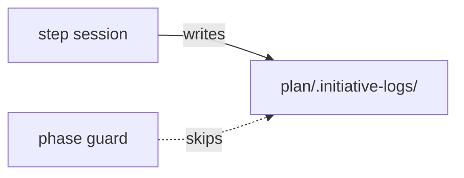

# Execution Plan - step logs stay in place

> Every requirement traces to a user story or acceptance criterion.

**Skill:** [plan](../skills/ravintio-plan/SKILL.md)
**Feature:** 0000314-step-logs-stay-in-place
**Version:** 0.41.1
**Status:** active

## Active Skills

| Skill | Scope | Purpose |
|-------|-------|---------|
| None | plan | No capability skill is active. |

## Functional Requirements Directory

| File | Requirement |
|------|------------|
| [req-001-guard-skips-step-logs.md](requirements/req-001-guard-skips-step-logs.md) | The phase guard skips step logs |
| [req-002-driver-files-stay.md](requirements/req-002-driver-files-stay.md) | Skills and standards name the driver files |
| [req-003-suite-keeps-step-logs.md](requirements/req-003-suite-keeps-step-logs.md) | A suite run keeps every step log |

## Non-Functional Requirements

| ID | Category | Requirement | Target | Measurement |
|----|----------|------------|--------|-------------|
| NFR-001 | Reliability | Both guard suites pass with a populated step log, and a planted stale cite still fails | 100% of the fixture cases | Bash test |
| NFR-002 | Size | The initiative skill stays short | fewer than 120 lines, and all skill text 1720 lines or fewer | Existing tests |

## API Summary

No API.

## Data Model Summary

No data model.

## Component Interactions

## Test impact

| Cause | Test | Unit |
|-------|------|------|
| Skill-text budget: the run edits two `SKILL.md` files | `test-0000031-req-003-five-phases.sh`, `test-0000206-req-002-step-application.sh` (1720 lines) | U2 |
| Skill-text budget: the initiative skill line cap | `test-0000205-req-004-initiative-skill.sh` (fewer than 120 lines, now 111) | U2 |
| Skill count: no skill added | none found | none |
| Size cap: orchestrator edit | none found | U2 |
| Backlog entry ids 0000264 and 0000265 | none found | none |
| Guard exclusion | `test-0000042-req-006`, `test-0000043-req-009` | U1 |

## Concurrency plan

| Unit | Depends on | Writes | Batch | Sequential reason |
|------|-----------|--------|-------|-------------------|
| U1 | none | `ravintio-zero/tests/test-0000042-req-006-phase-guard-and-stale-cites.sh`, (REQ-001 cases live in section (d) of that file) | 1 | none |
| U2 | none | `ravintio-zero/skills/ravintio-orchestrator/SKILL.md`, `ravintio-zero/skills/ravintio-initiative/SKILL.md`, `ravintio-zero/standards/roadmap-standards.md`, `ravintio-zero/tests/test-0000314-req-002-driver-files-stay.sh` | 1 | none |
| U3 | U1 | `ravintio-zero/tests/test-0000314-req-003-suite-keeps-step-logs.sh` | 2 | It runs the guard suite that U1 changes. |

## Assumptions

| ID | Assumption | Impact if Wrong |
|----|-----------|----------------|
| A-001 | Only the phase guard reads step logs as a scan target. | Another suite still fails and U1 widens the fix. |

## Open Questions

None.
