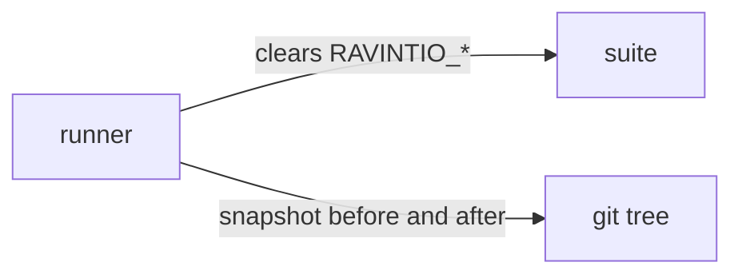

# Execution Plan - isolated test state

> Every requirement traces to a user story or acceptance criterion.

**Skill:** [plan](../skills/ravintio-plan/SKILL.md)
**Feature:** 0000315-isolated-test-state
**Version:** 0.41.2
**Status:** active

## Active Skills

| Skill | Scope | Purpose |
|-------|-------|---------|
| None | plan | No capability skill is active. |

## Functional Requirements Directory

| File | Requirement |
|------|------------|
| [req-001-runners-clear-environment.md](requirements/req-001-runners-clear-environment.md) | Runners clear `RAVINTIO_*` variables for each suite |
| [req-002-suites-leave-repo-state.md](requirements/req-002-suites-leave-repo-state.md) | No suite writes repo state |
| [req-003-final-tree-check.md](requirements/req-003-final-tree-check.md) | The runner fails when the tree changes |
| [req-004-req007-checks-rule-file.md](requirements/req-004-req007-checks-rule-file.md) | `test-0000164-req-007` checks the file that holds the rules |

## Non-Functional Requirements

| ID | Category | Requirement | Target | Measurement |
|----|----------|------------|--------|-------------|
| NFR-001 | Reliability | The suite gives the same result with `RAVINTIO_INITIATIVE_STEP=1` and `RAVINTIO_TEST_QUIET=1` set as without | 0 failures in both | Full run |
| NFR-002 | Cleanliness | Tracked and untracked files match before and after a full run | 0 differing paths | Runner check |

## API Summary

No API.

## Data Model Summary

No data model.

## Component Interactions

## Test impact

| Cause | Test | Unit |
|-------|------|------|
| Skill-text budget: no `SKILL.md` edit | none found | none |
| Skill count: no skill added | none found | none |
| Size cap: no skill edit | none found | none |
| Backlog entry ids 0000309 and 0000267 | none found | none |
| Runner change | `test-0000251-req-001-runners-clear-step-variable.sh`, `test-0000151-req-008-quiet-test-output.sh` | U1 |
| req-007 rewrite | `test-0000164-req-007-gate-write-doc-correction.sh` | U3 |

## Concurrency plan

| Unit | Depends on | Writes | Batch | Sequential reason |
|------|-----------|--------|-------|-------------------|
| U1 | none | `ravintio-zero/tests/run-tests.sh`, `ravintio-zero/tests/run-tests.ps1`, `ravintio-zero/tests/test-0000315-req-001-runners-clear-environment.sh`, `ravintio-zero/tests/README.md` | 1 | none |
| U3 | none | `ravintio-zero/tests/test-0000164-req-007-gate-write-doc-correction.sh` | 1 | none |
| U2 | U1 | `ravintio-zero/tests/test-0000315-req-002-003-final-tree-check.sh` | 2 | The check lives in the runner that U1 changes. |

## Assumptions

| ID | Assumption | Impact if Wrong |
|----|-----------|----------------|
| A-001 | Few suites need a `RAVINTIO_*` variable beyond those they set. | U1 sets the variable in each failing suite. |

## Open Questions

None.
