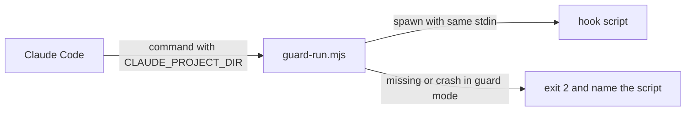

# Execution Plan - hooks fail closed

> Every requirement traces to a user story or acceptance criterion.

**Skill:** [plan](../skills/ravintio-plan/SKILL.md)
**Feature:** 0000316-hooks-fail-closed
**Version:** 0.42.0
**Status:** active

## Active Skills

| Skill | Scope | Purpose |
|-------|-------|---------|
| None | plan | No capability skill is active. |

## Functional Requirements Directory

| File | Requirement |
|------|------------|
| [req-001-bash-stays-in-root.md](requirements/req-001-bash-stays-in-root.md) | Setup writes the Bash working-directory setting |
| [req-002-hooks-use-project-root.md](requirements/req-002-hooks-use-project-root.md) | Hook commands use the project root |
| [req-003-guards-fail-closed.md](requirements/req-003-guards-fail-closed.md) | A guard that cannot run blocks |
| [req-004-advisory-reports-once.md](requirements/req-004-advisory-reports-once.md) | An advisory hook reports a missing script once |

## Non-Functional Requirements

| ID | Category | Requirement | Target | Measurement |
|----|----------|------------|--------|-------------|
| NFR-001 | Security | No case that a guard blocks today becomes allowed | 0 regressions | Existing guard tests pass unchanged |
| NFR-002 | Performance | The launcher adds little time to a guard call | Under 200 ms | Timed test |

## API Summary

No API.

## Data Model Summary

No data model.

## Component Interactions

## Test impact

| Cause | Test | Unit |
|-------|------|------|
| Skill-text budget: no `SKILL.md` edit | none found | none |
| Skill count: no skill added | none found | none |
| Size cap: no skill edit | none found | none |
| Backlog entry ids 0000287 and 0000288 | none found | none |
| Relative hook command strings | `test-0000028-req-002-shared-module-extraction.sh`, `test-0000037-req-007-sh-filter-any-matcher.sh`, `test-0000038-req-001-002-sh-hook-filter.sh`, `test-0000039-req-001-002-sh-setup-hardening.sh`, `test-0000043-req-006-merge-guard-hook.sh`, `test-0000151-req-004-prune-retired-hooks.sh`, `test-0000200-req-004-setup-wires-the-stop-hook.sh`, and the matching `.ps1` suites | U2, U3 |
| Codex command | `test-0000207-req-001-003-codex-setup.sh` and `.ps1` | U2, U3 |
| Hook list and parity | `test-0000035-req-001-hook-parity.sh`, `test-0000171-req-002-install-tree-parity.ps1` | U1, U2 |

## Concurrency plan

| Unit | Depends on | Writes | Batch | Sequential reason |
|------|-----------|--------|-------|-------------------|
| U1 | none | `ravintio-zero/hooks/enforcement/guard-run.mjs`, `ravintio-zero/tests/test-0000316-req-003-004-guard-run.sh` | 1 | U2 and U3 wire the launcher that U1 writes, so U1 goes first. |
| U2 | U1 | `ravintio-zero/setup.sh`, `ravintio-zero/tests/test-0000316-req-001-002-setup-sh.sh`, the `.sh` suites in Test impact | 2 | The commands name the launcher that U1 writes. |
| U3 | U1 | `ravintio-zero/setup.ps1`, `ravintio-zero/tests/test-0000316-req-001-002-setup-ps1.ps1`, the `.ps1` suites in Test impact | 2 | The commands name the launcher that U1 writes. |
| U4 | U2, U3 | docs, `product.yml`, `docs/about.md`, `ravintio-zero/component.yml` | 3 | Docs state what U2 and U3 wrote. |

## Assumptions

| ID | Assumption | Impact if Wrong |
|----|-----------|----------------|
| A-001 | Claude Code substitutes `${CLAUDE_PROJECT_DIR}` in the command string. | The setup rerun check finds a hook that does not run, and the initiative stops. |

## Open Questions

None.
