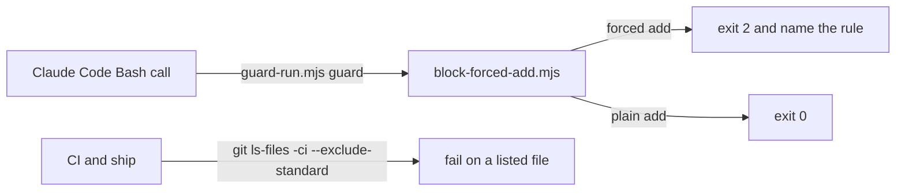

# Execution Plan - block forced adds

> Every requirement traces to a user story or acceptance criterion.

**Skill:** [plan](../skills/ravintio-plan/SKILL.md)
**Feature:** 0000317-block-forced-adds
**Version:** 0.43.0
**Status:** active

## Active Skills

| Skill | Scope | Purpose |
|-------|-------|---------|
| None | plan | No capability skill is active. |

## Functional Requirements Directory

| File | Requirement |
|------|------------|
| [req-001-orchestrator-forbids-forced-adds.md](requirements/req-001-orchestrator-forbids-forced-adds.md) | The orchestrator skill forbids forced adds |
| [req-002-hook-blocks-forced-add.md](requirements/req-002-hook-blocks-forced-add.md) | A hook blocks a forced add |
| [req-003-tracked-driver-ignores.md](requirements/req-003-tracked-driver-ignores.md) | The tracked `.gitignore` lists the driver paths |
| [req-004-fail-on-committed-ignored-file.md](requirements/req-004-fail-on-committed-ignored-file.md) | Ship and CI fail on a committed ignored file |

## Non-Functional Requirements

| ID | Category | Requirement | Target | Measurement |
|----|----------|------------|--------|-------------|
| NFR-001 | Security | No case that a hook blocks today becomes allowed | 0 regressions | Existing guard tests pass unchanged |
| NFR-002 | Performance | The guard adds little time to a Bash call | Under 200 ms | Timed test |

## API Summary

No API.

## Data Model Summary

No data model.

## Component Interactions

## Test impact

| Cause | Test | Unit |
|-------|------|------|
| Skill-text budget: the run edits the orchestrator `SKILL.md` and the ship `SKILL.md` | `test-0000031-req-003-five-phases.sh`, `test-0000206-req-002-step-application.sh`, `test-0000314-req-002-driver-files-stay.sh` (total cap 1720, now 1555) | U1 |
| Skill count: no skill added | none found | none |
| Size cap: orchestrator skill edit | `test-0000151-req-011-orchestrator-references-split.sh` and `.ps1` | U1 |
| Backlog entry id 0000276 | none found | none |
| Hook entry count and list (ten entries now) | `test-0000035-req-001-hook-parity.sh`, `test-0000171-req-002-install-tree-parity.ps1` | U2 |
| Hook wiring and filter patterns | `test-0000037-req-008-non-array-hook-events.sh` and `.ps1`, `test-0000038-req-001-002-sh-hook-filter.sh`, `test-0000039-req-001-002-sh-setup-hardening.sh`, `test-0000039-req-001-003-ps1-setup-hardening.ps1`, `test-0000151-req-003-hook-stderr-reasons.sh` | U2 |

## Concurrency plan

| Unit | Depends on | Writes | Batch | Sequential reason |
|------|-----------|--------|-------|-------------------|
| U1 | none | `ravintio-zero/skills/ravintio-orchestrator/SKILL.md`, `ravintio-zero/skills/ravintio-ship/SKILL.md`, `.gitignore`, `ravintio-zero/hooks/ravintio.yml`, `.github/workflows/ravintio.yml`, `ravintio-zero/tests/test-0000317-req-001-003-004-rules-ignores-checks.sh` | 1 | none |
| U2 | none | `ravintio-zero/hooks/enforcement/block-forced-add.mjs`, `ravintio-zero/setup.sh`, `ravintio-zero/setup.ps1`, `ravintio-zero/tests/test-0000317-req-002-block-forced-add.sh`, the hook-parity suites in Test impact | 1 | none |
| U3 | U1, U2 | `ravintio-zero/standards/hook-enforcement.md`, `ravintio-zero/component.yml`, `product.yml`, `docs/about.md` | 2 | The docs and version record state what U1 and U2 wrote. |

## Assumptions

| ID | Assumption | Impact if Wrong |
|----|-----------|----------------|
| A-001 | No tracked file matches an ignore rule today. | The check fails at once and the step adds a negation rule. |

## Open Questions

None.
