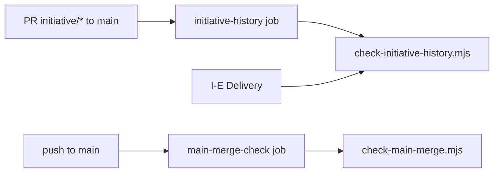

# Execution Plan - initiative history checks

> Every requirement traces to a user story or acceptance criterion.

**Skill:** [plan](../skills/ravintio-plan/SKILL.md)
**Feature:** 0000319-initiative-history-checks
**Version:** 0.45.0
**Status:** active

## Active Skills

| Skill | Scope | Purpose |
|-------|-------|---------|
| None | plan | No capability skill is active. |

## Functional Requirements Directory

| File | Requirement |
|------|------------|
| [req-001-history-script.md](requirements/req-001-history-script.md) | History script |
| [req-002-ci-history-and-push.md](requirements/req-002-ci-history-and-push.md) | CI history job and push trigger |
| [req-003-delivery-check.md](requirements/req-003-delivery-check.md) | Delivery check and PR title |
| [req-004-main-merge-check.md](requirements/req-004-main-merge-check.md) | Main merge check |
| [req-005-ruleset-doc.md](requirements/req-005-ruleset-doc.md) | Ruleset doc |

## Non-Functional Requirements

| ID | Category | Requirement | Target | Measurement |
|----|----------|------------|--------|-------------|
| NFR-001 | Security | CI adds no token scope | 0 new permissions | Test reads workflow `permissions` |
| NFR-002 | Determinism | The scripts keep no state and read git only | Same result for the same history | Suites on fixture repos |
| NFR-003 | Maintainability | The initiative skill stays under its line cap | Under 120 lines | `test-0000314-req-002` |

## API Summary

No API.

## Data Model Summary

No data model.

## Component Interactions

## Test impact

| Cause | Test | Unit |
|-------|------|------|
| Workflow edit: push trigger and `release-tag` guard | `test-0000169-req-006-release-tag-ci-and-ship-flow.sh` pins `push` branches to `main` and `master` and `if` to `github.event_name == 'push'`. U2 updates it. | U2 |
| Workflow edit | `test-0000207-req-004-codex-ci-check.sh`, `test-0000317-req-001-003-004-rules-ignores-checks.sh`, `test-0000036-req-005-windows-ci-job.sh`, `test-0000037-req-006-bash-suites-ci-job.sh`, `test-0000151-req-015-faster-powershell-ci.sh` read the workflow. They run in U2 to confirm they pass. | U2 |
| Skill-text budget: the run edits the initiative `SKILL.md` (total cap 1720, now 1559, initiative skill under 120) | `test-0000031-req-003-five-phases.sh`, `test-0000314-req-002-driver-files-stay.sh` | U3 |
| Standards wording | `test-0000043-req-008-roadmap-delivery.sh`, `test-0000318-req-001-002-coordinator-prs.sh` | U3 |
| Backlog entry ids 0000275, 0000277, 0000278 (entries deleted in P0) | none found | none |
| Skill count: no skill added | none found | none |

## Concurrency plan

| Unit | Depends on | Writes | Batch | Sequential reason |
|------|-----------|--------|-------|-------------------|
| U1 | none | `ravintio-zero/scripts/check-initiative-history.mjs`, `ravintio-zero/tests/test-0000319-req-001-history-script.sh` | 1 | none |
| U2 | none | `ravintio-zero/scripts/check-main-merge.mjs`, `ravintio-zero/tests/test-0000319-req-004-main-merge-check.sh` | 1 | none |
| U3 | none | `ravintio-zero/standards/roadmap-standards.md`, `ravintio-zero/skills/ravintio-initiative/SKILL.md`, `ravintio-zero/tests/test-0000319-req-003-delivery-check.sh`, `ravintio-zero/docs/main-ruleset.md`, `ravintio-zero/tests/test-0000319-req-005-ruleset-doc.sh` | 1 | none |
| U4 | U1, U2 | `.github/workflows/ravintio.yml`, `ravintio-zero/hooks/ravintio.yml`, `ravintio-zero/tests/test-0000169-req-006-release-tag-ci-and-ship-flow.sh`, `ravintio-zero/tests/test-0000319-req-002-ci-jobs.sh` | 2 | The jobs call the two scripts. |
| U5 | U1, U2, U3, U4 | `plan/current-initiative/initiative.md`, `ravintio-zero/component.yml`, `product.yml`, `docs/about.md`, `docs/architecture-overview.md`, `docs/decisions-index.md`, `README.md` if the self-description check needs it | 3 | The docs and the version record state what U1 to U4 wrote. |

## Assumptions

| ID | Assumption | Impact if Wrong |
|----|-----------|----------------|
| A-001 | GitHub writes `Merge pull request #n from owner/initiative/...` for a merge commit and `{title} (#n)` for a squash. | The main check misses a squash. The ruleset remains the defence. |

## Open Questions

None.
