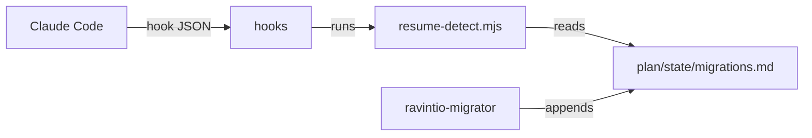

# Execution Plan - Quiet session start

> Every requirement must be traceable to a user story or acceptance criterion.

**Skill:** [plan](../skills/ravintio-plan/SKILL.md)
**Feature:** 0000320-quiet-session-start
**Version:** 0.46.0
**Status:** active

## Active Skills

| Skill | Scope | Purpose |
|-------|-------|---------|
| none | plan | No capability skills are active |

## Functional Requirements Directory

| File | Requirement |
|------|------------|
| [req-001-once-per-session-trigger.md](requirements/req-001-once-per-session-trigger.md) | The load instruction fires once per session |
| [req-002-migration-reporting.md](requirements/req-002-migration-reporting.md) | resume-detect reports a migration only while it needs action |
| [req-003-migration-ledger.md](requirements/req-003-migration-ledger.md) | The migrator records state in a ledger outside the pack |
| [req-004-final-reply-prefix-check.md](requirements/req-004-final-reply-prefix-check.md) | The prefix check reads the final reply |

## Non-Functional Requirements

| ID | Category | Requirement | Target | Measurement |
|----|----------|------------|--------|-------------|
| NFR-001 | Performance | `resume-detect.mjs` finishes inside the hook limit | under 2 seconds with 20 ledger rows | The suite times one run |
| NFR-002 | Security | Hooks and the script print no repo text and never exit 2 | 0 exit-2 results, 0 raw ledger strings in output | The suite checks exit codes and output on a hostile ledger |

## API Summary

None. The feature builds no API.

## Data Model Summary

| Entity | Owner Component | Key Fields | Relationships |
|--------|----------------|------------|--------------|
| Migration ledger row | ravintio-zero | id, result, pack version | One row per migration |
| Loaded-session record | ravintio-zero | session id | One value per working tree |

## Component Interactions

## Test impact

| Cause | Test | Unit |
|-------|------|------|
| Skill-text budget: the run edits the migrator `SKILL.md` | `test-0000005-pack-governance.sh:171` and its `regression/` copy assert the migrator text holds `_done`. `test-0000042-req-008-pack-prose.sh:65` lists the file. | U-003 |
| Skill count | none found | none |
| Size cap | none found | none |
| Backlog entry id: 0000307, 0000282, 0000322 | none found | none |
| Hook behaviour | `test-0000243-req-003-004-hook-injection.sh`, `test-0000205-req-002-ack-and-trigger-hooks.sh`, `test-0000218-req-001-002-skill-owner-banner.sh` | U-001 |
| Stop hook | `test-0000200-req-003-stop-hook-warns-and-logs.sh` | U-004 |
| Resume script | `test-0000243-req-001-002-006-resume-detect.sh` | U-002 |

## Concurrency plan

| Unit | Depends on | Writes | Batch | Sequential reason |
|------|-----------|--------|-------|-------------------|
| U-001 | none | auto-trigger-orchestrator.mjs, check-orchestrator-presence.mjs, .gitignore, test-0000320-req-001 | 1 | none |
| U-002 | none | resume-detect.mjs, migrations 0004 and 0005 Detect lines, test-0000320-req-002 | 1 | none |
| U-003 | none | ravintio-migrator SKILL.md, migration 0006 and helpers, plan/state/migrations.md, governance test edits, test-0000320-req-003 | 1 | none |
| U-004 | none | check-reply-prefix.mjs, test-0000320-req-004 | 1 | none |
| U-005 | U-001, U-002, U-003, U-004 | docs, component.yml, product.yml, changelog | 2 | Shared docs and version files need the code first |

## Assumptions

| ID | Assumption | Impact if Wrong |
|----|-----------|----------------|
| A-001 | The host passes `session_id` and `last_assistant_message` | The hooks fall back to today's behaviour or exit silently |

## Open Questions

None.
