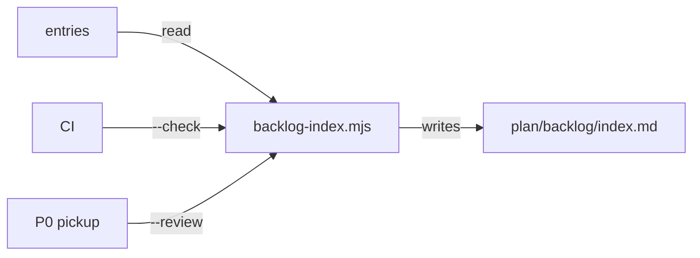

# Execution Plan - Backlog triage

> Every requirement must be traceable to a user story or acceptance criterion.

**Skill:** [plan](../skills/ravintio-plan/SKILL.md)
**Feature:** 0000321-backlog-triage
**Version:** 0.47.0
**Status:** active

## Active Skills

| Skill | Scope | Purpose |
|-------|-------|---------|
| none | plan | No capability skills are active |

## Functional Requirements Directory

| File | Requirement |
|------|------------|
| [req-001-priority-and-theme-fields.md](requirements/req-001-priority-and-theme-fields.md) | Entries carry a priority and a theme |
| [req-002-index-generator.md](requirements/req-002-index-generator.md) | A script writes and checks the backlog index |
| [req-003-ci-index-check.md](requirements/req-003-ci-index-check.md) | CI fails on a stale index |
| [req-004-ordered-pickup-and-review.md](requirements/req-004-ordered-pickup-and-review.md) | Pickup follows the index and a review lists stale entries |
| [req-005-default-migration.md](requirements/req-005-default-migration.md) | Migration 0007 sets defaults on existing entries |

## Non-Functional Requirements

| ID | Category | Requirement | Target | Measurement |
|----|----------|------------|--------|-------------|
| NFR-001 | Determinism | The index is the same for the same entries | 0 differing bytes across 2 runs | The suite runs the script twice and compares |
| NFR-002 | Security | The script prints no entry body text and treats entry text as data | 0 body lines in output | The suite runs it on an entry whose body holds a marker string |

## API Summary

None. The feature builds no API.

## Data Model Summary

| Entity | Owner Component | Key Fields | Relationships |
|--------|----------------|------------|--------------|
| Backlog entry | ravintio-zero | id, slug, priority, theme, status, date filed | One folder each |
| Backlog index | ravintio-zero | one row per entry | Generated from the entries |

## Component Interactions

## Test impact

| Cause | Test | Unit |
|-------|------|------|
| Skill-text budget: the run edits the filing skill `SKILL.md` | `test-0000031-req-003-five-phases.sh:31` and `test-0000206-req-002-step-application.sh:31` cap total skill text at 1720 lines. Now 1566. | U-001 |
| Skill count | none found | none |
| Size cap | `test-0000247-req-001-stage-by-path.sh:35` caps the orchestrator `SKILL.md` at 9000 bytes. The run edits a reference file only. | U-004 |
| Backlog entry id: 0000310 | none found | none |
| Pickup text | `test-0000025-req-005-backlog-unification.sh`, `test-0000039-req-004-release-size.sh`, `test-0000042-req-004-phase-numbers-p0-to-p4.sh`, `test-0000042-req-008-pack-prose.sh` | U-004 |
| Filing skill | `test-0000164-req-005-file-backlog-skill.sh`, `test-0000199-req-001-003-reserve-ids-from-counter.sh` | U-001 |
| Workflow files | `test-0000031-req-002-single-route.sh`, `test-0000036-req-005-windows-ci-job.sh`, `test-0000019-req-002-component-yml-matcher.sh` | U-003 |

## Concurrency plan

| Unit | Depends on | Writes | Batch | Sequential reason |
|------|-----------|--------|-------|-------------------|
| U-001 | none | backlog-entry.template.md, ravintio-file-backlog SKILL.md, test-0000321-req-001 | 1 | none |
| U-002 | none | backlog-index.mjs, test-0000321-req-002 | 1 | none |
| U-005 | none | migration 0007 and helpers, test-0000321-req-005 | 1 | none |
| U-003 | U-002 | .github/workflows/ravintio.yml, ravintio-zero/hooks/ravintio.yml, test-0000321-req-003 | 2 | The step names the script flag from U-002 |
| U-004 | U-002 | orchestrator-p0-start-actions.md, product.template.yml, product.yml, test-0000321-req-004 | 2 | The pickup text names the review mode from U-002 |
| U-006 | U-001, U-002, U-003, U-004, U-005 | test-0000321-req-005-applied (AC-3), plan/backlog entries, plan/backlog/index.md, plan/state/migrations.md, docs, component.yml, product.yml, changelog | 3 | The migration run and shared docs need the code first |

## Assumptions

| ID | Assumption | Impact if Wrong |
|----|-----------|----------------|
| A-001 | Every entry has a `**Date filed:**` line | The entry shows as undated |

## Open Questions

None.
