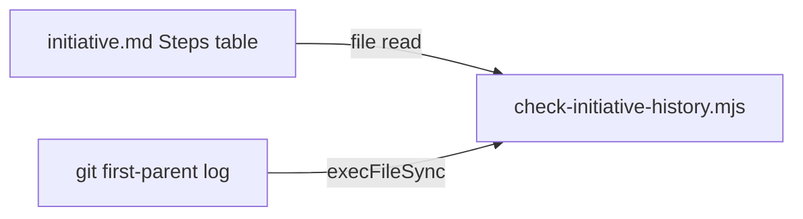

# Execution Plan - Step titles and history shape

> Every requirement is traceable to a user story or acceptance criterion.

**Skill:** [plan](../../ravintio-zero/skills/ravintio-plan/SKILL.md)
**Feature:** 0000351-step-titles-and-history-shape
**Version:** 0.49.0
**Status:** active

## Active Skills

| Skill | Scope | Purpose |
|-------|-------|---------|
| None | plan | No capability skills |

## Functional Requirements Directory

| File | Requirement |
|------|------------|
| [req-001-step-title-form.md](requirements/req-001-step-title-form.md) | Ship titles the step PR with the feature title |
| [req-002-title-column.md](requirements/req-002-title-column.md) | Template charts a Title column |
| [req-003-history-shape-check.md](requirements/req-003-history-shape-check.md) | Check matches titles and the N + 1 shape |
| [req-004-one-commit-pr-subject.md](requirements/req-004-one-commit-pr-subject.md) | One-commit PR subject rule |
| [req-005-chart-format-migration.md](requirements/req-005-chart-format-migration.md) | Chart-format migration rule |

## Non-Functional Requirements

| ID | Category | Requirement | Target | Measurement |
|----|----------|------------|--------|-------------|
| NFR-001 | Determinism | The check gives one result for one history | 100% of fixture runs repeat | Fixture tests |
| NFR-002 | Security | The script runs git through an argument array | 0 shell strings | Code review in P3 |

## API Summary

None. The feature builds no API.

## Data Model Summary

None. The feature owns no data.

## Component Interactions

## Test impact

| Cause | Test | Unit |
|-------|------|------|
| Backlog entry id | none found | U1 |
| Skill-text budget (plan, ship) | `test-0000198-req-001-002-cap-echoed-plan-text.sh`, `test-0000245-req-003-004-repo-skills-and-size-cap.sh` | U1, U3 |
| History script behaviour | `test-0000319-req-001-history-script.sh`, `test-0000319-req-002-ci-jobs.sh`, `test-0000319-req-003-delivery-check.sh` | U2 |
| Ship and roadmap text | `test-0000043-req-008-roadmap-delivery.sh`, `test-0000151-req-002-ship-sentinels-before-pr.sh`, `test-0000327-req-003-ship-skill-rules.sh` | U3 |

## Concurrency plan

| Unit | Depends on | Writes | Batch | Sequential reason |
|------|-----------|--------|-------|-------------------|
| U1 | none | `ravintio-zero/templates/initiative.template.md`, `ravintio-zero/skills/ravintio-plan/SKILL.md`, `ravintio-zero/tests/test-0000351-req-002-005-template-and-plan.sh` | 1 | none |
| U2 | none | `ravintio-zero/scripts/check-initiative-history.mjs`, `ravintio-zero/tests/test-0000319-req-001-history-script.sh`, `ravintio-zero/tests/test-0000351-req-003-shape-check.sh` | 1 | none |
| U3 | U1, U2 | `ravintio-zero/skills/ravintio-ship/SKILL.md`, `ravintio-zero/standards/roadmap-standards.md`, `ravintio-zero/standards/commit-standards.md`, `ravintio-zero/skills/ravintio-orchestrator/references/orchestrator-p0-start-actions.md`, `ravintio-zero/tests/test-0000351-req-001-004-title-rules.sh` | 2 | Shares no file with U1 or U2 but cites the column and the script that they write. |

## Assumptions

| ID | Assumption | Impact if Wrong |
|----|-----------|----------------|
| A-001 | The active chart holds the `Title` column. | The check can't read titles from it. |

## Open Questions

None.
