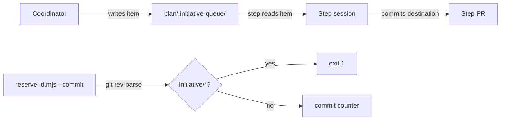

# Execution Plan - Coordinator admin in step PRs

> Every requirement is traceable to a user story or acceptance criterion.

**Skill:** [plan](../../ravintio-zero/skills/ravintio-plan/SKILL.md)
**Feature:** 0000352-coordinator-admin-in-step-prs
**Version:** 0.50.0
**Status:** active

## Active Skills

| Skill | Scope | Purpose |
|-------|-------|---------|
| None | plan | No capability skills |

## Functional Requirements Directory

| File | Requirement |
|------|------------|
| [req-001-reserve-id-refusal.md](requirements/req-001-reserve-id-refusal.md) | `reserve-id.mjs --commit` refuses on `initiative/*` |
| [req-002-queue-rule.md](requirements/req-002-queue-rule.md) | Queue item contract and the routes for aligned and unaligned admin |
| [req-003-step-commits-queue.md](requirements/req-003-step-commits-queue.md) | The step commits the items that name it |
| [req-004-delete-branch.md](requirements/req-004-delete-branch.md) | Every coordinator squash names `--delete-branch` |
| [req-005-callers-name-route.md](requirements/req-005-callers-name-route.md) | Callers of `--commit` name the `feat/` route |

## Non-Functional Requirements

| ID | Category | Requirement | Target | Measurement |
|----|----------|------------|--------|-------------|
| NFR-001 | Determinism | The refusal gives one result for one branch name | 100% of fixture runs repeat | Fixture tests in a scratch repo |
| NFR-002 | Security | The script runs git through an argument array | 0 shell strings | Code review in P3 |

## API Summary

None. The feature builds no API.

## Data Model Summary

None. The feature owns no data.

## Component Interactions

## Test impact

| Cause | Test | Unit |
|-------|------|------|
| Backlog entry id | none found | U2 |
| Skill-text budget (initiative, ship, postmortem, retrospective) | `test-0000031-req-003-five-phases.sh`, `test-0000245-req-003-004-repo-skills-and-size-cap.sh`, `test-0000318-req-001-002-coordinator-prs.sh` (initiative skill under 120 lines) | U3 |
| Size cap (orchestrator reference) | `test-0000151-req-011-orchestrator-references-split.sh` | U3 |
| Reservation script behaviour | `test-0000199-req-001-003-reserve-ids-from-counter.sh`, `test-0000247-req-001-stage-by-path.sh` | U1 |
| Queue and coordinator wording | `test-0000314-req-002-driver-files-stay.sh`, `test-0000250-req-001-routing-and-restart-rules.sh`, `test-0000205-req-004-initiative-skill.sh`, `test-0000318-req-001-002-coordinator-prs.sh` | U2, U3 |

## Concurrency plan

| Unit | Depends on | Writes | Batch | Sequential reason |
|------|-----------|--------|-------|-------------------|
| U1 | none | `ravintio-zero/scripts/reserve-id.mjs`, `ravintio-zero/tests/test-0000352-req-001-reserve-id-refusal.sh` | 1 | none |
| U2 | none | `ravintio-zero/standards/roadmap-standards.md`, `ravintio-zero/tests/test-0000352-req-002-004-standards-rules.sh` | 1 | none |
| U3 | none | `ravintio-zero/skills/ravintio-initiative/SKILL.md`, `ravintio-zero/skills/ravintio-ship/SKILL.md`, `ravintio-zero/skills/ravintio-postmortem/SKILL.md`, `ravintio-zero/skills/ravintio-retrospective/SKILL.md`, `ravintio-zero/skills/ravintio-orchestrator/references/orchestrator-p0-start-actions.md`, `ravintio-zero/tests/test-0000352-req-003-005-skill-rules.sh` | 1 | none |

## Assumptions

| ID | Assumption | Impact if Wrong |
|----|-----------|----------------|
| A-001 | A queue item names its step in `item.md`. | A step skips an item it should commit. |

## Open Questions

None.
