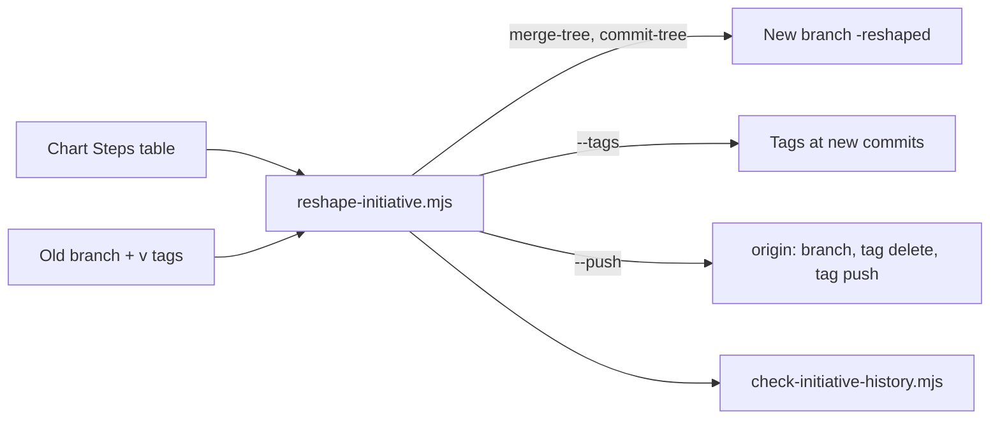

# Execution Plan - Reshape at delivery

> Every requirement is traceable to a user story or acceptance criterion.

**Skill:** [plan](../../ravintio-zero/skills/ravintio-plan/SKILL.md)
**Feature:** 0000353-reshape-at-delivery
**Version:** 0.51.0
**Status:** active

## Active Skills

| Skill | Scope | Purpose |
|-------|-------|---------|
| None | plan | No capability skills |

## Functional Requirements Directory

| File | Requirement |
|------|------------|
| [req-001-reshape-script.md](requirements/req-001-reshape-script.md) | The script writes N + 1 titled commits on a new branch |
| [req-002-tags-without-force.md](requirements/req-002-tags-without-force.md) | Step tags move by delete and recreate, with no force |
| [req-003-stop-on-failure.md](requirements/req-003-stop-on-failure.md) | A conflict, a missing tag, a bad name, or an existing branch exits 1 and writes nothing |
| [req-004-history-check.md](requirements/req-004-history-check.md) | The script runs the history check on the new branch |
| [req-005-delivery-rules.md](requirements/req-005-delivery-rules.md) | I-E Delivery and the initiative skill name the reshape |
| [req-006-ship-no-force-lease.md](requirements/req-006-ship-no-force-lease.md) | Ship drops the `--force-with-lease` allowance |

## Non-Functional Requirements

| ID | Category | Requirement | Target | Measurement |
|----|----------|------------|--------|-------------|
| NFR-001 | Determinism | One fixture gives one tree and one set of subjects | 100% of fixture runs repeat | Fixture tests in a scratch repo |
| NFR-002 | Security | The script runs git through an argument array and checks each name first | 0 shell strings | Code review in P3 |
| NFR-003 | Safety | The script never writes the caller's working tree or index | 0 working tree writes | Fixture test compares `git status` before and after |

## API Summary

None. The feature builds no API.

## Data Model Summary

None. The feature owns no data.

## Component Interactions

## Test impact

| Cause | Test | Unit |
|-------|------|------|
| Ship lease rule removed | `test-0000327-req-003-ship-skill-rules.sh` | U3 |
| Delivery section wording | `test-0000043-req-008-roadmap-delivery.sh`, `test-0000319-req-003-delivery-check.sh` | U2 |
| Initiative skill text and size cap | `test-0000205-req-004-initiative-skill.sh`, `test-0000318-req-001-002-coordinator-prs.sh`, `test-0000245-req-003-004-repo-skills-and-size-cap.sh`, `test-0000031-req-003-five-phases.sh` | U2 |
| Ship skill size cap | `test-0000327-req-003-ship-skill-rules.sh` (AC-3 total size) | U3 |
| New script | none found | U1 |

## Concurrency plan

| Unit | Depends on | Writes | Batch | Sequential reason |
|------|-----------|--------|-------|-------------------|
| U1 | none | `ravintio-zero/scripts/reshape-initiative.mjs`, `ravintio-zero/tests/test-0000353-req-001-004-reshape-script.sh` | 1 | none |
| U2 | none | `ravintio-zero/standards/roadmap-standards.md`, `ravintio-zero/skills/ravintio-initiative/SKILL.md`, `ravintio-zero/tests/test-0000353-req-005-delivery-rules.sh` | 1 | none |
| U3 | none | `ravintio-zero/skills/ravintio-ship/SKILL.md`, `ravintio-zero/tests/test-0000327-req-003-ship-skill-rules.sh`, `ravintio-zero/tests/test-0000353-req-006-ship-no-lease.sh` | 1 | none |

## Assumptions

| ID | Assumption | Impact if Wrong |
|----|-----------|----------------|
| A-001 | Each merged step has a tag `v{Version}` at its squash commit. | The script cannot find the step commit and exits 1. |
| A-002 | An old step subject ends with ` (#{n})`. | The script exits 1 and names the commit. |

## Open Questions

None.
