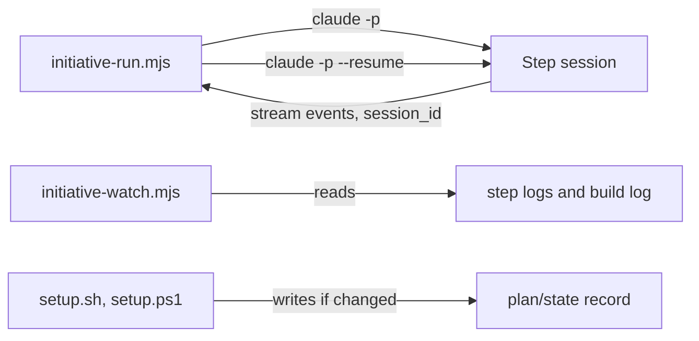

# Execution Plan - Steps run to the end

> Every requirement is traceable to a user story or acceptance criterion.

**Skill:** [plan](../../ravintio-zero/skills/ravintio-plan/SKILL.md)
**Feature:** 0000354-steps-run-to-the-end
**Version:** 0.52.0
**Status:** active

## Active Skills

| Skill | Scope | Purpose |
|-------|-------|---------|
| None | plan | No capability skills |

## Functional Requirements Directory

| File | Requirement |
|------|------------|
| [req-001-driver-resume.md](requirements/req-001-driver-resume.md) | The driver resumes an unmerged step, twice at most |
| [req-002-early-end-rule.md](requirements/req-002-early-end-rule.md) | The orchestrator skill forbids an early end of turn |
| [req-003-setup-record-stable.md](requirements/req-003-setup-record-stable.md) | Setup leaves the record unchanged on a rerun |
| [req-004-driver-args-helper.md](requirements/req-004-driver-args-helper.md) | One helper holds the driver arguments |
| [req-005-watcher-wait.md](requirements/req-005-watcher-wait.md) | The watcher waits and names the running step |
| [req-006-step-ci-fixes.md](requirements/req-006-step-ci-fixes.md) | The chart sets whether a step fixes its CI |

## Non-Functional Requirements

| ID | Category | Requirement | Target | Measurement |
|----|----------|------------|--------|-------------|
| NFR-001 | Determinism | A fake `claude` gives one sequence of lines | 100% of runs repeat | Bash tests with a stub |
| NFR-002 | Security | The driver passes every value to git and `claude` as an array argument | 0 shell strings | Code review in P3 |
| NFR-003 | Size | The orchestrator skill and the skill text total stay within their caps | 0 cap test failures | Existing size tests |

## API Summary

None. The feature builds no API.

## Data Model Summary

None. The feature owns no data.

## Component Interactions

## Test impact

| Cause | Test | Unit |
|-------|------|------|
| Driver arguments move to a helper | `test-0000043-req-007-roadmap-driver.sh`, `test-0000151-req-006-roadmap-step-model-and-turn-cap.sh`, `test-0000189-req-006-old-variable-stop.sh` | U1 |
| Driver loop gains a resume | `test-0000043-req-012-progress-markers-and-resume.sh`, `test-0000151-req-012-roadmap-step-logs.sh`, `test-0000250-req-002-driver-restart-stop.sh`, `test-0000313-req-001-driver-setup-stop.sh`, `test-0000205-req-006-driver-final-report.sh` | U2 |
| Setup record unchanged on rerun | `test-0000032-req-001-bash-write-to-plan-state.sh` (c), `test-0000032-req-002-powershell-write-to-plan-state.sh`, `test-0000037-req-003-setup-record-move.sh` | U3 |
| Watcher output | `test-0000205-req-003-watch-script.sh`, `test-0000241-req-001-watcher-false-events.sh`, `test-0000240-req-002-activity-lines.sh` | U4 |
| Orchestrator skill byte cap and total line cap | `test-0000151-req-011-orchestrator-references-split.sh` (9000 bytes), `test-0000031-req-003-five-phases.sh` (1720 lines) | U5 |
| Chart template and standards text | `test-0000043-req-002-roadmap-chart.sh`, `test-0000189-req-004-initiative-states.sh`, `test-0000151-req-014-chart-clarity-and-dependency-stop.sh` | U5 |
| Backlog entry ids | none found | none |

## Concurrency plan

| Unit | Depends on | Writes | Batch | Sequential reason |
|------|-----------|--------|-------|-------------------|
| U1 | none | `ravintio-zero/tests/helpers/driver-args.sh`, the three driver suites | 1 | none |
| U3 | none | `ravintio-zero/setup.sh`, `ravintio-zero/setup.ps1`, `ravintio-zero/tests/test-0000032-req-001-bash-write-to-plan-state.sh`, `ravintio-zero/tests/test-0000354-req-003-setup-record-stable.sh` | 1 | none |
| U4 | none | `ravintio-zero/scripts/initiative-watch.mjs`, `ravintio-zero/tests/test-0000354-req-005-watcher-wait.sh` | 1 | none |
| U5 | none | `ravintio-zero/skills/ravintio-orchestrator/SKILL.md`, `ravintio-zero/standards/roadmap-standards.md`, `ravintio-zero/templates/initiative.template.md`, `ravintio-zero/tests/test-0000354-req-002-006-text-rules.sh` | 1 | none |
| U2 | U1 | `ravintio-zero/scripts/initiative-run.mjs`, `ravintio-zero/tests/test-0000354-req-001-driver-resume.sh` | 2 | The resume tests use the helper that U1 writes. |

## Assumptions

| ID | Assumption | Impact if Wrong |
|----|-----------|----------------|
| A-001 | Stream events carry `session_id`. | The driver cannot resume. It prints `Blocked:` and exits 1. |
| A-002 | `claude -p --resume {session} "{prompt}"` continues the session. | The resume exits 0 unmerged and the cap ends it with `Blocked:`. |

## Open Questions

None.
