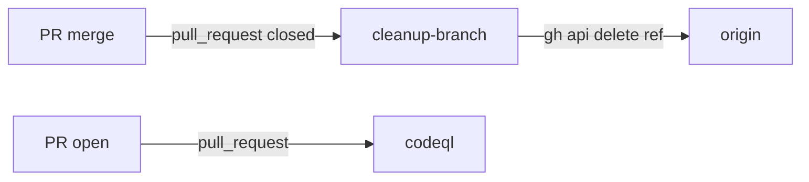

# Execution Plan - CodeQL and branch cleanup in CI

**Skill:** [plan](../skills/ravintio-plan/SKILL.md)
**Feature:** 0000355-codeql-and-branch-cleanup
**Version:** 0.53.0
**Status:** active

## Active Skills

| Skill | Scope | Purpose |
|-------|-------|---------|
| ravintio-implement | plan | Runs the TDD loop for each unit |

## Functional Requirements Directory

| File | Requirement |
|------|------------|
| [req-001-codeql-workflow.md](requirements/req-001-codeql-workflow.md) | CodeQL runs on PRs into `main` and `initiative/**` |
| [req-002-p3-escaping.md](requirements/req-002-p3-escaping.md) | The P3 checklist names incomplete escaping |
| [req-003-workflow-marker.md](requirements/req-003-workflow-marker.md) | A marker comment replaces the job name list, and the plan scan names workflows |
| [req-004-branch-cleanup.md](requirements/req-004-branch-cleanup.md) | CI deletes a merged PR's head branch |
| [req-005-entry-0000323.md](requirements/req-005-entry-0000323.md) | Entry 0000323 matches the repo |

## Non-Functional Requirements

| ID | Category | Requirement | Target | Measurement |
|----|----------|------------|--------|-------------|
| NFR-001 | Security | Write access stays on one new job | `contents: write` appears on `cleanup-branch` and `release-tag` only | Shape test |
| NFR-002 | Security | The cleanup job never deletes a protected branch | 0 deletes of `main` or `master` | Shape test on the job text |
| NFR-003 | Maintainability | A new marked job needs no test edit | 0 test edits | Shape test with a fixture job |

## API Summary

No API changes. The cleanup job calls the GitHub REST endpoint that deletes a git ref, through the `gh` CLI.

## Data Model Summary

No data model changes.

## Component Interactions

## Test impact

| Cause | Test | Unit |
|-------|------|------|
| Workflow job or step edit | `test-0000169-req-006-release-tag-ci-and-ship-flow.sh` | U-003 |
| Workflow job or step edit | `test-0000319-req-002-ci-jobs.sh`, `test-0000327-req-002-ci-job.sh`, `test-0000036-req-005-windows-ci-job.sh`, `test-0000037-req-006-bash-suites-ci-job.sh`, `test-0000151-req-015-faster-powershell-ci.sh` | U-004 |
| Workflow job or step edit | `test-0000037-req-001-drop-telemetry-ci-job.sh`, `test-0000031-req-002-single-route.sh`, `test-0000042-req-008-pack-prose.sh`, `test-0000207-req-004-codex-ci-check.sh`, `test-0000317-req-001-003-004-rules-ignores-checks.sh`, `test-0000321-req-003-ci-index-check.sh` | U-004 |
| Skill-text budget | `test-0000246-req-001-test-impact-scan.sh` (scan stays 15 lines or fewer) | U-003 |
| Skill-text budget | none found for the validate skill line cap | U-002 |
| Backlog entry id | none found for 0000346, 0000338, 0000356, or 0000323 | U-005 |
| Skill count | none found, no skill is added | none |

## Concurrency plan

| Unit | Depends on | Writes | Batch | Sequential reason |
|------|-----------|--------|-------|-------------------|
| U-001 | none | `.github/workflows/codeql.yml`, `ravintio-zero/tests/test-0000355-req-001-codeql-workflow.sh` | 1 | none |
| U-002 | none | `ravintio-zero/skills/ravintio-validate-and-accept/SKILL.md`, `ravintio-zero/tests/test-0000355-req-002-p3-escaping.sh` | 1 | none |
| U-003 | none | `ravintio-zero/tests/test-0000169-req-006-release-tag-ci-and-ship-flow.sh`, `ravintio-zero/skills/ravintio-plan/SKILL.md`, `ravintio-zero/tests/test-0000355-req-003-workflow-marker.sh` | 1 | none |
| U-005 | none | `plan/backlog/0000323-github-free-security-and-repo-settings/entry.md`, `plan/backlog/index.md`, `ravintio-zero/tests/test-0000355-req-005-entry-0000323.sh` | 1 | none |
| U-004 | U-003 | `ravintio-zero/hooks/ravintio.yml`, `.github/workflows/ravintio.yml`, `ravintio-zero/tests/test-0000355-req-004-branch-cleanup.sh` | 2 | Needs the marker rule from U-003, and shares the workflow files |

## Assumptions

| ID | Assumption | Impact if Wrong |
|----|-----------|----------------|
| A-001 | Every pull request job can skip `closed` through its `if` | The cleanup moves to a separate workflow file that setup installs |
| A-002 | The workflow token can delete a head ref | The branches stay |

## Open Questions

None.
