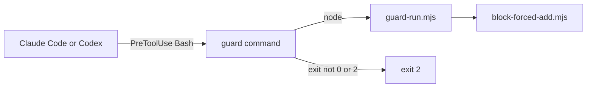

# Execution Plan - Guard gaps closed

**Skill:** [plan](../skills/ravintio-plan/SKILL.md)
**Feature:** 0000357-guard-gaps-closed
**Version:** 0.54.0
**Status:** active

## Active Skills

| Skill | Scope | Purpose |
|-------|-------|---------|
| ravintio-implement | plan | Runs the TDD loop for each unit |

## Functional Requirements Directory

| File | Requirement |
|------|------------|
| [req-001-fail-closed-launcher.md](requirements/req-001-fail-closed-launcher.md) | A guard hook command exits 2 when `guard-run.mjs` is missing |
| [req-002-wider-forced-add-guard.md](requirements/req-002-wider-forced-add-guard.md) | The forced-add guard blocks `git stage`, subshells, and variables |
| [req-003-forced-add-in-codex.md](requirements/req-003-forced-add-in-codex.md) | Setup wires the forced-add guard into Codex |
| [req-004-prefix-misses-ignored.md](requirements/req-004-prefix-misses-ignored.md) | Both ignore files hold the prefix-misses log |

## Non-Functional Requirements

| ID | Category | Requirement | Target | Measurement |
|----|----------|------------|--------|-------------|
| NFR-001 | Security | A guard never passes a call it cannot run or parse | 0 passes with the launcher removed, 0 passes for the five forms | Hook tests |
| NFR-002 | Compatibility | Existing hook filters keep matching the guard commands | 0 failures in the hook filter suites | Suite run |

## API Summary

No API changes.

## Data Model Summary

No data model changes.

## Component Interactions

## Test impact

| Cause | Test | Unit |
|-------|------|------|
| Guard command text | `test-0000028-req-004-install-refresh-registration.sh`, `test-0000035-p5-security-fixes.sh`, `test-0000037-req-007-sh-filter-any-matcher.sh`, `test-0000038-req-001-002-sh-hook-filter.sh`, `test-0000039-req-001-002-sh-setup-hardening.sh`, `test-0000034-req-003-atomic-settings-writes.sh`, `test-0000316-req-001-002-setup-sh.sh` | U-001 |
| Guard command text | `test-0000036-req-004-setup-ps1-install.ps1`, `test-0000039-req-001-003-ps1-setup-hardening.ps1`, `test-0000316-req-001-002-setup-ps1.ps1` | U-001 |
| Guard command text | `regression/test-0000034-req-003-atomic-settings-writes.sh`, `regression/test-0000037-req-007-sh-filter-any-matcher.sh` | U-001 |
| Forced-add guard | `test-0000317-req-002-block-forced-add.sh` | U-002 |
| Codex setup | `test-0000207-req-001-003-codex-setup.sh`, `test-0000207-req-001-003-codex-setup.ps1`, `test-0000316-req-001-002-setup-sh.sh` | U-003 |
| Hook standard | `test-0000245-req-001-hook-enforcement-reference.sh` | U-003 |
| Ignore file | `test-0000317-req-001-003-004-rules-ignores-checks.sh` | U-004 |
| Backlog entry id | none found for 0000340, 0000341, or 0000342 | none |
| Skill count, skill-text budget, size cap | none, no skill changes | none |

## Concurrency plan

| Unit | Depends on | Writes | Batch | Sequential reason |
|------|-----------|--------|-------|-------------------|
| U-001 | none | `ravintio-zero/setup.sh`, `ravintio-zero/setup.ps1`, `ravintio-zero/tests/test-0000357-req-001-fail-closed-launcher.sh`, the guard command tests named under Test impact | 1 | none |
| U-002 | none | `ravintio-zero/hooks/enforcement/block-forced-add.mjs`, `ravintio-zero/tests/test-0000317-req-002-block-forced-add.sh` | 1 | none |
| U-004 | none | `ravintio-zero/.gitignore`, `.gitignore`, `ravintio-zero/tests/test-0000357-req-004-prefix-misses-ignored.sh` | 1 | none |
| U-003 | U-001, U-002 | `ravintio-zero/setup.sh`, `ravintio-zero/setup.ps1`, `ravintio-zero/standards/hook-enforcement.md`, `ravintio-zero/tests/test-0000357-req-003-forced-add-in-codex.sh`, the Codex tests named under Test impact | 2 | Shares both setup scripts with U-001 and documents the guard U-002 widens |

## Assumptions

| ID | Assumption | Impact if Wrong |
|----|-----------|----------------|
| A-001 | Claude Code runs hook commands through a POSIX shell | The guards need a Node wrapper |
| A-002 | The Codex PreToolUse model takes a second Bash group | The step files a backlog entry and carries on |

## Open Questions

None.
