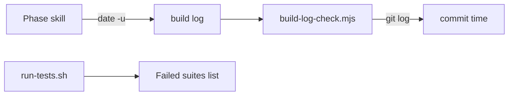

# Execution Plan - Clean step stops and logs

**Skill:** [plan](../skills/ravintio-plan/SKILL.md)
**Feature:** 0000358-clean-step-stops-and-logs
**Version:** 0.55.0
**Status:** active

## Active Skills

| Skill | Scope | Purpose |
|-------|-------|---------|
| ravintio-implement | plan | Runs the TDD loop for each unit |

## Functional Requirements Directory

| File | Requirement |
|------|------------|
| [req-001-question-status.md](requirements/req-001-question-status.md) | The status set names `Question` and `Blocked:` marks exception stops |
| [req-002-clock-times.md](requirements/req-002-clock-times.md) | Phase skills read the clock and the check fails a future time |
| [req-003-closed-phases.md](requirements/req-003-closed-phases.md) | The check fails a closed block with no `Complete:` line |
| [req-004-failed-suite-list.md](requirements/req-004-failed-suite-list.md) | The runners name each failed suite |

## Non-Functional Requirements

| ID | Category | Requirement | Target | Measurement |
|----|----------|------------|--------|-------------|
| NFR-001 | Determinism | Each new check gives the same result on every run | 0 flaky fixtures in 3 runs | Local suite run |
| NFR-002 | Size | Skill edits stay inside the caps | Orchestrator under 9000 bytes, skill text under 1720 lines | Cap tests |

## API Summary

No API changes.

## Data Model Summary

No data model changes.

## Component Interactions

## Units

| Unit | Requirement | Work |
|------|-------------|------|
| U-001 | REQ-001 | Status set in six places, product id line, new test |
| U-002 | REQ-002, REQ-003 | Two `build-log-check.mjs` checks, new tests |
| U-003 | REQ-002, REQ-004 | Clock command in five skills, validate skill pointer, new tests |
| U-004 | REQ-004 | Failed suite list in both runners, new test |

## Test impact

| Cause | Test | Unit |
|-------|------|------|
| Status set text | `test-0000042-req-005-message-prefixes.sh`, `test-0000029-req-001-003-boot-file-regeneration.sh`, `test-0000043-req-009-roadmap-resume-and-prefixes.sh`, `test-0000009-rail-tightening.sh`, `test-0000031-req-003-five-phases.sh`, `test-0000032-req-005-layout-docs-updated.sh`, `test-0000042-req-003-run-mode-resume.sh`, `test-0000042-req-006-phase-guard-and-stale-cites.sh`, `test-0000042-req-008-pack-prose.sh`, `test-0000042-req-009-pack-identifiers.sh`, `test-0000169-req-001-attribution-ban-text.sh` | U-001 |
| Boot file text | `test-0000029-req-001-003-boot-file-regeneration.sh` | U-001 |
| Hook comment | `test-0000200-req-003-stop-hook-warns-and-logs.sh`, `test-0000320-req-004-final-reply-prefix.sh` | U-001 |
| Skill-text budget | `test-0000031-req-003-five-phases.sh` (1720 lines, 1593 now) | U-001, U-003 |
| Size cap | `test-0000151-req-011-orchestrator-references-split.sh` (9000 bytes, 8555 now) | U-001, U-003 |
| Build log check | `test-0000248-req-002-build-log-wall-clock-check.sh` | U-002 |
| Runner output | `test-0000036-req-001-003-runner.sh`, `test-0000151-req-008-quiet-test-output.sh`, `test-0000315-req-002-003-final-tree-check.sh`, `test-0000251-req-001-runners-clear-step-variable.sh` | U-004 |
| Backlog entry id | none found for 0000273, 0000266, 0000335, or 0000269 | none |
| Skill count | none, no skill added | none |
| Workflow job or step edit | none, no workflow change | none |

## Concurrency plan

| Unit | Depends on | Writes | Batch | Sequential reason |
|------|-----------|--------|-------|-------------------|
| U-001 | none | `ravintio-zero/skills/ravintio-orchestrator/SKILL.md`, `ravintio-zero/skills/ravintio-orchestrator/references/orchestrator-p0-start-actions.md`, `ravintio-zero/pipeline-reference.md`, `ravintio-zero/templates/standard-boot.md`, `ravintio-zero/templates/codex-boot.md`, `CLAUDE.md`, `ravintio-zero/hooks/enforcement/check-reply-prefix.mjs`, `ravintio-zero/tests/test-0000358-req-001-question-status.sh`, the status tests named under Test impact | 1 | none |
| U-002 | none | `ravintio-zero/scripts/build-log-check.mjs`, `ravintio-zero/tests/test-0000358-req-002-003-build-log-checks.sh`, `ravintio-zero/tests/test-0000248-req-002-build-log-wall-clock-check.sh` | 1 | none |
| U-004 | none | `ravintio-zero/tests/run-tests.sh`, `ravintio-zero/tests/run-tests.ps1`, `ravintio-zero/tests/test-0000358-req-004-failed-suite-list.sh` | 1 | none |
| U-003 | U-001, U-002, U-004 | `ravintio-zero/skills/ravintio-orchestrator/SKILL.md`, `ravintio-zero/skills/ravintio-plan/SKILL.md`, `ravintio-zero/skills/ravintio-implement/SKILL.md`, `ravintio-zero/skills/ravintio-validate-and-accept/SKILL.md`, `ravintio-zero/skills/ravintio-ship/SKILL.md`, `ravintio-zero/tests/test-0000358-req-002-clock-in-skills.sh` | 2 | Shares the orchestrator skill with U-001 and points at the list U-004 builds |

## Assumptions

| ID | Assumption | Impact if Wrong |
|----|-----------|----------------|
| A-001 | Git reports the commit that adds a log line | The time check compares with the clock |

## Open Questions

None.
