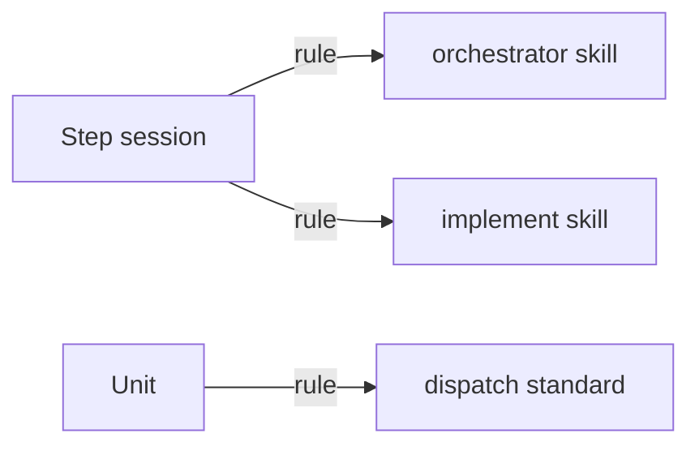

# Execution Plan - Safe parallel commits

**Skill:** [plan](../skills/ravintio-plan/SKILL.md)
**Feature:** 0000359-safe-parallel-commits
**Version:** 0.56.0
**Status:** active

## Active Skills

| Skill | Scope | Purpose |
|-------|-------|---------|
| ravintio-implement | plan | Runs the TDD loop for each unit |

## Functional Requirements Directory

| File | Requirement |
|------|------------|
| [req-001-no-tree-git-under-subagents.md](requirements/req-001-no-tree-git-under-subagents.md) | Skills ban tree-wide git under subagents and name the scratch clone |
| [req-002-own-path-commits.md](requirements/req-002-own-path-commits.md) | The standard names the path-limited commit and bans amend |

## Non-Functional Requirements

| ID | Category | Requirement | Target | Measurement |
|----|----------|------------|--------|-------------|
| NFR-001 | Size | Skill edits stay inside the caps | Orchestrator at most 9000 bytes, skill text at most 1720 lines | Cap tests |

## API Summary

No API changes.

## Data Model Summary

No data model changes.

## Component Interactions

## Units

| Unit | Requirement | Work |
|------|-------------|------|
| U-001 | REQ-001 | Rule in the orchestrator and implement skills, new test |
| U-002 | REQ-002 | Two bullets in the dispatch standard, new test |

## Test impact

| Cause | Test | Unit |
|-------|------|------|
| Skill-text budget | `test-0000031-req-003-five-phases.sh` (1720 lines, 1604 now) | U-001 |
| Size cap | `test-0000151-req-011-orchestrator-references-split.sh`, `test-0000247-req-001-stage-by-path.sh` (9000 bytes, 8779 now) | U-001 |
| Dispatch standard text | `test-0000247-req-003-no-stash-in-batch.sh`, `test-0000172-req-002-fast-batches.sh` | U-002 |
| Backlog entry id | none found for 0000331 or 0000336 | none |
| Skill count | none, no skill added | none |
| Workflow job or step edit | none, no workflow change | none |

## Concurrency plan

| Unit | Depends on | Writes | Batch | Sequential reason |
|------|-----------|--------|-------|-------------------|
| U-001 | none | `ravintio-zero/skills/ravintio-orchestrator/SKILL.md`, `ravintio-zero/skills/ravintio-implement/SKILL.md`, `ravintio-zero/tests/test-0000359-req-001-no-tree-git-under-subagents.sh` | 1 | none |
| U-002 | none | `ravintio-zero/standards/agent-dispatch-standards.md`, `ravintio-zero/tests/test-0000359-req-002-own-path-commits.sh` | 1 | none |

## Assumptions

| ID | Assumption | Impact if Wrong |
|----|-----------|----------------|
| A-001 | A text rule meets entries 0000331 and 0000336 | A later step adds a hook |

## Open Questions

None.
