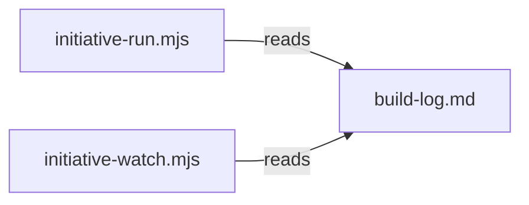

# Execution Plan - Driver stops and headroom

> Every requirement traces to a user story.

**Skill:** [plan](../skills/ravintio-plan/SKILL.md)
**Feature:** 0000377-driver-stops-and-headroom
**Version:** 0.57.0
**Status:** active

## Active Skills

| Skill | Scope | Purpose |
|-------|-------|---------|
| ravintio-implement | plan | TDD loop for each requirement |

## Functional Requirements Directory

| File | Requirement |
|------|------------|
| [req-001-context-hygiene-reference.md](requirements/req-001-context-hygiene-reference.md) | Move Context Hygiene to a reference file |
| [req-002-question-stop.md](requirements/req-002-question-stop.md) | Driver and watcher stop on an open Question line |
| [req-003-setup-check-after-last-step.md](requirements/req-003-setup-check-after-last-step.md) | Setup check after the last step |

## Non-Functional Requirements

| ID | Category | Requirement | Target | Measurement |
|----|----------|------------|--------|-------------|
| NFR-001 | Size | Orchestrator `SKILL.md` size | 8700 bytes or fewer | `wc -c` in the cap tests |
| NFR-002 | Security | Driver prints repo text cut to a fixed length | 500 characters or fewer per line | Existing `MAX_LINE` limit |

## API Summary

No API. The full contract is not applicable.

## Data Model Summary

No data store.

## Component Interactions

## Test impact

| Cause | Test | Unit |
|-------|------|------|
| Skill-text budget, size cap | `test-0000247-req-001-stage-by-path.sh` | U-001 |
| Skill-text budget, size cap | `test-0000151-req-011-orchestrator-references-split.sh` and `.ps1` | U-001 |
| Skill-text budget, size cap | `test-0000359-req-001-no-tree-git-under-subagents.sh` | U-001 |
| Moved text | `tests/fixtures/0000151-orchestrator-skill-base.md` (read through the reference glob) | U-001 |
| Moved text | `test-0000245-req-003-004-repo-skills-and-size-cap.sh` | U-001 |
| Backlog entry id | none found | U-001 |
| Continue prompt text | `test-0000354-req-001-driver-resume.sh` | U-002 |
| Pending line | `test-0000043-req-005-roadmap-advance.sh`, `test-0000205-req-006-driver-final-report.sh` | U-003 |

## Concurrency plan

| Unit | Depends on | Writes | Batch | Sequential reason |
|------|-----------|--------|-------|-------------------|
| U-001 | none | `ravintio-zero/skills/ravintio-orchestrator/SKILL.md`, `references/orchestrator-context-hygiene.md`, cap tests | 1 | Chart orders the skill move before the Question edit |
| U-002 | U-001 | `initiative-run.mjs`, `initiative-watch.mjs`, driver tests, `roadmap-standards.md` | 2 | Both units edit the driver and `roadmap-standards.md` |
| U-003 | U-002 | `initiative-run.mjs`, driver tests, `roadmap-standards.md` | 3 | Shares `initiative-run.mjs` with U-002 |

## Assumptions

| ID | Assumption | Impact if Wrong |
|----|-----------|----------------|
| A-001 | A `Question:` line in the build log is the stop signal | The driver misses a question |

## Open Questions

None.
