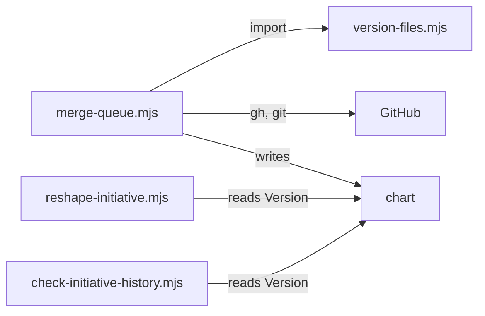

# Execution Plan - Merge-time versioning

> Every requirement traces to a user story or acceptance criterion.

**Skill:** [plan](../skills/ravintio-plan/SKILL.md)
**Feature:** 0000378-merge-time-versioning
**Version:** 0.58.0
**Status:** active

## Active Skills

| Skill | Scope | Purpose |
|-------|-------|---------|
| None | plan | none |

## Functional Requirements Directory

Functional requirements are split into individual files, one user story per file, at `plan/current/requirements/`.
Each file follows the naming convention `req-{NNN}-{kebab-slug}.md` and the [Requirement Template](../templates/requirement.template.md).

| File | Requirement |
|------|------------|
| [req-001-version-file-list.md](requirements/req-001-version-file-list.md) | Version file list and check |
| [req-002-step-pr-title-check.md](requirements/req-002-step-pr-title-check.md) | Step PR title check |
| [req-003-merge-queue.md](requirements/req-003-merge-queue.md) | Merge queue |
| [req-004-merge-order-history.md](requirements/req-004-merge-order-history.md) | Merge-order history |
| [req-005-reshape-folds.md](requirements/req-005-reshape-folds.md) | Reshape folds admin commits |

## Non-Functional Requirements

| ID | Category | Requirement | Target | Measurement |
|----|----------|------------|--------|-------------|
| NFR-001 | Dependencies | No new packages | 0 added | `git diff` shows no `package.json` change |
| NFR-002 | Performance | Each new suite finishes quickly | under 60 s | suite wall clock |
| NFR-003 | Security | No force-push, no shell string from input | 0 cases | tests and review |

## API Summary

No API. The scripts expose command lines.

| Method | Path | Description | Feature |
|--------|------|-------------|---------|
| CLI | `version-files.mjs check\|set` | Check or set every version file | REQ-001 |
| CLI | `merge-queue.mjs title\|versions\|run` | Title check, version check, one queue run | REQ-002, REQ-003 |

## Data Model Summary

| Entity | Owner Component | Key Fields | Relationships |
|--------|----------------|------------|--------------|
| `version-files.txt` | ravintio-zero | one path per line | read by `version-files.mjs` |
| Chart `## Merges` table | ravintio-zero | step, PR, merge commit, version, time | written by the queue |

## Component Interactions

## Test impact

| Cause | Test | Unit |
|-------|------|------|
| Backlog entry ids 0000374, 0000376, 0000372, 0000368 | none found | U5 |
| Skill-text budget: edits `ravintio-ship` and `ravintio-initiative` | `test-0000042-req-008-pack-prose.sh`, `test-0000205-req-004-initiative-skill.sh`, `test-0000151-req-002-ship-sentinels-before-pr.sh`, `test-0000043-req-005-roadmap-advance.sh`, `test-0000043-req-008-roadmap-delivery.sh` | U5 |
| Skill count | none found (no skill added) | U5 |
| Size cap | none found (orchestrator not edited) | U5 |
| Workflow job or step edit | none found (no workflow edit) | U5 |

## Concurrency plan

| Unit | Depends on | Writes | Batch | Sequential reason |
|------|-----------|--------|-------|-------------------|
| U1 | none | `ravintio-zero/version-files.txt`, `ravintio-zero/scripts/version-files.mjs`, `ravintio-zero/tests/test-0000378-req-001-version-files.sh` | 1 | none |
| U3 | none | `ravintio-zero/scripts/reshape-initiative.mjs`, `ravintio-zero/scripts/check-initiative-history.mjs`, `ravintio-zero/tests/test-0000378-req-004-merge-order.sh` | 1 | none |
| U2 | U1 | `ravintio-zero/scripts/merge-queue.mjs`, `ravintio-zero/tests/test-0000378-req-002-003-merge-queue.sh` | 2 | none |
| U4 | U3 | `ravintio-zero/scripts/reshape-initiative.mjs`, `ravintio-zero/tests/test-0000378-req-005-reshape-folds.sh` | 2 | none |
| U5 | U2, U4 | roadmap standards, ship skill, initiative skill, `component.yml`, living docs | 3 | Reads the final behaviour of U2 and U4 |

## Assumptions

| ID | Assumption | Impact if Wrong |
|----|-----------|----------------|
| A-001 | Merged steps carry tags `v{Version}` | The reshape cannot find a step commit |
| A-002 | `merge-guard` allows the queue's squash merge into `initiative/*` | The merge step is blocked |

## Open Questions

| ID | Question | Blocking |
|----|----------|----------|
| none | none | none |
