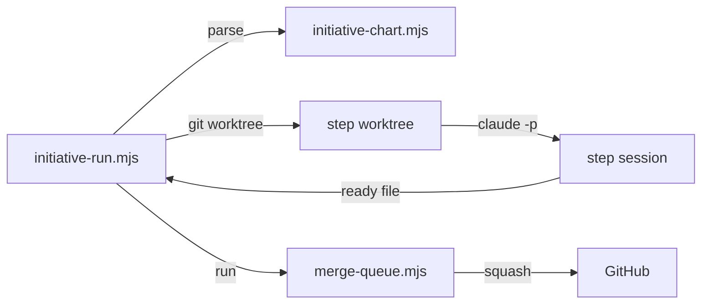

# Execution Plan - Parallel steps on worktrees

> Every requirement traces to a user story or acceptance criterion.

**Skill:** [plan](../skills/ravintio-plan/SKILL.md)
**Feature:** 0000379-parallel-steps-on-worktrees
**Version:** 0.59.0
**Status:** active

## Active Skills

| Skill | Scope | Purpose |
|-------|-------|---------|
| None | plan | none |

## Functional Requirements Directory

Functional requirements are split into individual files, one user story per file, at `plan/current/requirements/`.
Each file follows the naming convention `req-{NNN}-{kebab-slug}.md` and the [Requirement Template](../templates/requirement.template.md).

| File | Requirement |
|------|------------|
| [req-001-chart-columns-and-fields.md](requirements/req-001-chart-columns-and-fields.md) | Chart columns and fields |
| [req-002-scheduler.md](requirements/req-002-scheduler.md) | Scheduler |
| [req-003-worktrees-logs-and-control.md](requirements/req-003-worktrees-logs-and-control.md) | Worktrees, logs, and control areas |
| [req-004-queue-handoff.md](requirements/req-004-queue-handoff.md) | Queue hand-off |
| [req-005-stops-and-state-report.md](requirements/req-005-stops-and-state-report.md) | Stops and state report |
| [req-006-watcher-and-reports.md](requirements/req-006-watcher-and-reports.md) | Watcher and skill reports |
| [req-007-worktree-rule-scope.md](requirements/req-007-worktree-rule-scope.md) | Worktree rule scope |

## Non-Functional Requirements

| ID | Category | Requirement | Target | Measurement |
|----|----------|------------|--------|-------------|
| NFR-001 | Dependencies | No new packages | 0 added | `git diff` shows no `package.json` change |
| NFR-002 | Performance | Each new suite finishes quickly | under 60 s | suite wall clock |
| NFR-003 | Security | No force-push, no shell string from input, no path outside `plan/.initiative-worktrees/` | 0 cases | tests and review |
| NFR-004 | Compatibility | A chart without `**Concurrency:**` runs as before | 0 existing driver suites changed | the existing suites pass |

## API Summary

No API. The driver and queue expose command lines and environment variables.

| Method | Path | Description | Feature |
|--------|------|-------------|---------|
| CLI | `initiative-run.mjs` | Scheduler, worktrees, queue hand-off | REQ-002 to REQ-005 |
| CLI | `initiative-chart.mjs` | Parse the chart steps | REQ-001 |

## Data Model Summary

| Entity | Owner Component | Key Fields | Relationships |
|--------|----------------|------------|--------------|
| Chart `## Steps` | ravintio-zero | step, lane, after, status | read by the driver and the queue |
| Control folder | ravintio-zero | `ready` | written by a step, read by the driver |

## Component Interactions

## Test impact

| Cause | Test | Unit |
|-------|------|------|
| Backlog entry id 0000375 | none found | U6 |
| Skill-text budget: edits `ravintio-ship` and `ravintio-initiative` | `test-0000042-req-008-pack-prose.sh`, `test-0000205-req-004-initiative-skill.sh`, `test-0000151-req-002-ship-sentinels-before-pr.sh`, `test-0000043-req-005-roadmap-advance.sh`, `test-0000043-req-008-roadmap-delivery.sh` | U6 |
| Boot template edit | `test-0000029-req-001-003-boot-file-regeneration.sh`, `test-0000207-req-001-003-codex-setup.sh` | U2 |
| Template edit | `test-0000043-req-002-roadmap-chart.sh`, `test-0000043-req-001-roadmap-drafts.sh`, `test-0000189-req-004-initiative-states.sh` | U1 |
| Driver edit | the 25 driver suites that name `initiative-run.mjs` | U4 |
| Skill count | none found (no skill added) | U6 |
| Size cap | none found (orchestrator not edited) | U6 |
| Workflow job or step edit | none found (no workflow edit) | U6 |

## Concurrency plan

| Unit | Depends on | Writes | Batch | Sequential reason |
|------|-----------|--------|-------|-------------------|
| U1 | none | `ravintio-zero/scripts/initiative-chart.mjs`, `ravintio-zero/templates/initiative.template.md`, `ravintio-zero/tests/test-0000379-req-001-chart-columns.sh` | 1 | none |
| U2 | none | `ravintio-zero/templates/standard-boot.md`, `ravintio-zero/templates/codex-boot.md`, `ravintio-overrides/instructions/custom-001-local-git-only.md`, `ravintio-zero/tests/test-0000379-req-007-worktree-rule.sh` | 1 | none |
| U3 | none | `ravintio-zero/scripts/merge-queue.mjs`, `ravintio-zero/tests/test-0000379-req-004-position.sh` | 1 | none |
| U4 | U1, U3 | `ravintio-zero/scripts/initiative-run.mjs`, `ravintio-zero/tests/test-0000379-req-002-003-005-scheduler.sh`, `ravintio-zero/tests/test-0000379-req-004-queue-handoff.sh` | 2 | Both tests exercise one driver file |
| U5 | U4 | `ravintio-zero/scripts/initiative-watch.mjs`, `ravintio-zero/tests/test-0000379-req-006-watcher.sh` | 3 | Reads the log and control layout U4 settles |
| U6 | U4 | `ravintio-zero/standards/roadmap-standards.md`, `ravintio-zero/skills/ravintio-ship/SKILL.md`, `ravintio-zero/skills/ravintio-initiative/SKILL.md`, `ravintio-zero/component.yml`, `plan/current-initiative/initiative.md`, living docs | 3 | Documents the final behaviour of U4 |

## Assumptions

| ID | Assumption | Impact if Wrong |
|----|-----------|----------------|
| A-001 | `git worktree` works in the host repo | The driver stops with a named error |
| A-002 | Setup output is git-ignored and copyable | A step starts without hooks |

## Open Questions

| ID | Question | Blocking |
|----|----------|----------|
| none | none | none |
