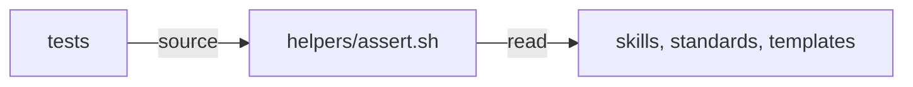

# Execution Plan - Test helpers and rule anchors

**Skill:** [plan](../../ravintio-zero/skills/ravintio-plan/SKILL.md)
**Feature:** 0000380-test-helpers-and-rule-anchors
**Version:** 0.60.0
**Status:** active

## Active Skills

| Skill | Scope | Purpose |
|-------|-------|---------|
| none | plan | No capability skills are active |

## Functional Requirements Directory

| File | Requirement |
|------|------------|
| [req-001-section-helper.md](requirements/req-001-section-helper.md) | A helper returns a named section from `SKILL.md` and every reference file |
| [req-002-rule-anchors.md](requirements/req-002-rule-anchors.md) | Rules carry anchors and a helper reads a rule by anchor |
| [req-003-timeout-helper.md](requirements/req-003-timeout-helper.md) | A helper caps a command with a time limit on every runner |

## Non-Functional Requirements

| ID | Category | Requirement | Target | Measurement |
|----|----------|------------|--------|-------------|
| NFR-001 | Performance | The helpers add little to the suite run | Under 1 second added to the full Bash run | Runner total before and after |
| NFR-002 | Portability | The helpers run on macOS Bash 3.2, Linux, and Git Bash | 0 uses of `timeout`, associative arrays, or GNU-only flags | Grep of the helper files |

## API Summary

No API.

## Data Model Summary

No data model.

## Component Interactions

## Test impact

| Cause | Test | Unit |
|-------|------|------|
| Skill count | none found | none |
| Skill-text budget | `test-0000151-req-011-orchestrator-references-split.sh` caps `SKILL.md`. The run leaves `SKILL.md` unchanged. | U3 |
| Size cap | none found. No cap test measures the edited references. | U3 |
| Backlog entry id 0000261, 0000308, 0000337 | none found | none |
| Workflow job or step edit | none found | none |
| Known test files in `run-tests.sh` | `run-tests.sh` lists `helpers/*.sh` files in `KNOWN_NON_SUITES` | U1 |

## Concurrency plan

| Unit | Depends on | Writes | Batch | Sequential reason |
|------|-----------|--------|-------|-------------------|
| U1 | none | `tests/helpers/timeout.sh`, `tests/run-tests.sh`, `tests/test-0000380-req-003-timeout-helper.sh`, `tests/test-0000321-req-005-default-migration.sh` | 1 | none |
| U2 | none | `tests/helpers/assert.sh`, `tests/test-0000380-req-001-section-helper.sh` | 1 | none |
| U3 | U2 | `tests/helpers/assert.sh`, orchestrator references, `standards/roadmap-standards.md`, `tests/test-0000380-req-002-rule-anchors.sh` | 2 | U3 edits `assert.sh`, which U2 also edits |
| U4 | U2, U3 | `tests/test-*.sh` that extract orchestrator sections | 3 | none |
| U5 | U1, U2, U3 | `standards/testing-standards.md`, `tests/README.md`, `component.yml`, `docs/` | 3 | none |

## Assumptions

| ID | Assumption | Impact if Wrong |
|----|-----------|----------------|
| A-001 | `perl` exists on macOS and Linux | The helper takes its Bash watchdog path |
| A-002 | An anchored rule is the paragraph or item after the anchor | A rule split by a blank line loses its tail |

## Open Questions

None.
