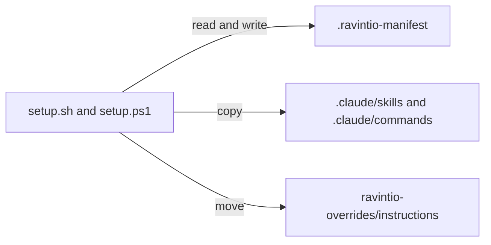

# Execution Plan - Setup safety

**Skill:** [plan](../../ravintio-zero/skills/ravintio-plan/SKILL.md)
**Feature:** 0000381-setup-safety
**Version:** 0.60.0
**Status:** active

## Active Skills

| Skill | Scope | Purpose |
|-------|-------|---------|
| none | plan | No capability skills are active |

## Functional Requirements Directory

| File | Requirement |
|------|------------|
| [req-001-manifest-confinement.md](requirements/req-001-manifest-confinement.md) | Setup removes only folders inside its skills directory |
| [req-002-capability-skill-folders.md](requirements/req-002-capability-skill-folders.md) | Setup copies every file of a capability skill folder |
| [req-003-claude-md-preserved.md](requirements/req-003-claude-md-preserved.md) | A first install keeps a developer `CLAUDE.md` content |
| [req-004-retired-commands.md](requirements/req-004-retired-commands.md) | Setup prunes retired commands and keeps developer commands |

## Non-Functional Requirements

| ID | Category | Requirement | Target | Measurement |
|----|----------|------------|--------|-------------|
| NFR-001 | Security | Setup removes nothing outside the skills directory | 0 removals outside in the absolute, `..`, and symlink cases | Paired tests |
| NFR-002 | Parity | `setup.sh` and `setup.ps1` install the same files | 0 differing files | Paired tests |

## API Summary

No API.

## Data Model Summary

Two manifest files. `.claude/skills/.ravintio-manifest` holds repo-relative paths. `.claude/commands/.ravintio-manifest` holds command file names.

## Component Interactions

## Test impact

| Cause | Test | Unit |
|-------|------|------|
| Skill count | none found | none |
| Skill-text budget | none found. The run edits no `SKILL.md`. | none |
| Size cap | none found | none |
| Backlog entry id 0000262, 0000289, 0000290, 0000293 | none found | none |
| Workflow job or step edit | none found | none |
| Manifest format | `test-0000007-agent-optimisation.sh`, `test-0000160-req-002-runtime-names.sh`, `test-0000171-req-004-no-skill-bundling.sh`, `test-0000207-req-001-003-codex-setup.sh`, `test-0000239-req-002-stale-install-skip.sh`, and the `.ps1` twins | U1 |
| Boot file regeneration | `test-0000029-req-001-003-boot-file-regeneration.sh` | U3 |

## Concurrency plan

| Unit | Depends on | Writes | Batch | Sequential reason |
|------|-----------|--------|-------|-------------------|
| U1 | none | `setup.sh`, `setup.ps1`, `tests/run-tests.sh`, `tests/run-tests.ps1`, `tests/test-0000381-req-001-*.sh` | 1 | U1 to U4 edit `setup.sh` and `setup.ps1`, so they cannot run together |
| U2 | U1 | `setup.sh`, `setup.ps1`, `tests/test-0000381-req-002-*.sh` | 2 | Shared write target |
| U3 | U2 | `setup.sh`, `setup.ps1`, `tests/test-0000381-req-003-*.sh` | 3 | Shared write target |
| U4 | U3 | `setup.sh`, `setup.ps1`, `migrations/0008-*`, `tests/test-0000381-req-004-*.sh` | 4 | Shared write target |
| U5 | U1, U2, U3, U4 | `project-operations.md`, `tests/README.md`, `component.yml`, `docs/` | 5 | Documents the finished behaviour |

## Assumptions

| ID | Assumption | Impact if Wrong |
|----|-----------|----------------|
| A-001 | A legacy manifest holds absolute paths | A legacy line is skipped with a warning |
| A-002 | `pwsh` is missing locally | PowerShell suites run first in CI |

## Open Questions

None.
