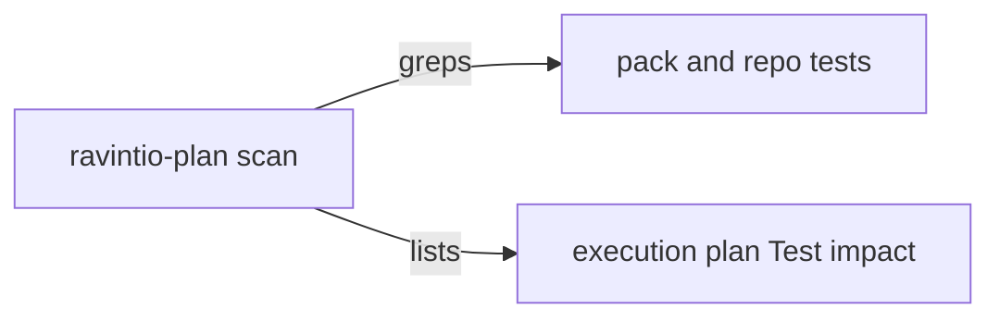

# Execution Plan - Test impact scan

**Skill:** [plan](../../ravintio-zero/skills/ravintio-plan/SKILL.md)
**Feature:** 0000383-test-impact-scan
**Version:** 0.61.0
**Status:** active

## Active Skills

| Skill | Scope | Purpose |
|-------|-------|---------|
| none | plan | No capability skills are active |

## Functional Requirements Directory

| File | Requirement |
|------|------------|
| [req-001-reference-files.md](requirements/req-001-reference-files.md) | Scan covers `references/` edits |
| [req-002-test-style-rules.md](requirements/req-002-test-style-rules.md) | Scan lists style tests for a new test file |
| [req-003-runner-allowlist.md](requirements/req-003-runner-allowlist.md) | Scan lists the runner allowlist |
| [req-004-fixture-pins.md](requirements/req-004-fixture-pins.md) | Scan covers fixture pins and P2 runs them first |
| [req-005-repo-tests.md](requirements/req-005-repo-tests.md) | Scan covers the repo's own tests |

## Non-Functional Requirements

| ID | Category | Requirement | Target | Measurement |
|----|----------|------------|--------|-------------|
| NFR-001 | Size | The scan stays small | 15 non-blank lines or fewer | `test-0000246-req-001-test-impact-scan.sh` |
| NFR-002 | Size | Skill text stays under its cap | 1720 lines or fewer | `test-0000031-req-003-five-phases.sh` |

## API Summary

No API.

## Data Model Summary

No data model.

## Component Interactions

## Test impact

| Cause | Test | Unit |
|-------|------|------|
| Skill count | none found | none |
| Skill-text budget | `test-0000031-req-003-five-phases.sh`, `test-0000206-req-002-step-application.sh`, `test-0000314-req-002-driver-files-stay.sh`, `test-0000359-req-001-no-tree-git-under-subagents.sh`, `test-0000327-req-003-ship-skill-rules.sh` cap skill text at 1720 lines | U1 |
| Size cap | none found. No cap test measures the plan skill in bytes. | none |
| Backlog entry id | none found | none |
| Workflow job or step edit | none found | none |
| Scan size | `test-0000246-req-001-test-impact-scan.sh` caps the scan at 15 lines | U1 |
| New test file | `test-0000164-req-008-no-process-substitution-loops.sh` applies to the new suite | U2 |
| Non-suite file | none. The run adds only `test-*.sh` suites. | none |
| Fixture-pinned line | none found. The edits add lines and change none that a fixture holds. | none |

## Concurrency plan

| Unit | Depends on | Writes | Batch | Sequential reason |
|------|-----------|--------|-------|-------------------|
| U1 | none | `skills/ravintio-plan/SKILL.md`, `skills/ravintio-implement/SKILL.md`, `tests/test-0000246-req-001-test-impact-scan.sh` | 1 | none |
| U2 | none | `tests/test-0000383-req-001-005-test-impact-causes.sh` | 1 | none |
| U3 | none | `skills/ravintio-test-writer/SKILL.md`, `skills/ravintio-refactor/SKILL.md`, `skills/ravintio-validate-and-accept/SKILL.md` | 1 | none |
| U4 | U1, U3 | `component.yml`, `docs/` | 2 | U4 documents the edits of U1 and U3 |

## Assumptions

| ID | Assumption | Impact if Wrong |
|----|-----------|----------------|
| A-001 | A developer repo names test folders in the stack or uses a common name | The scan says `none found` |

## Open Questions

None.
