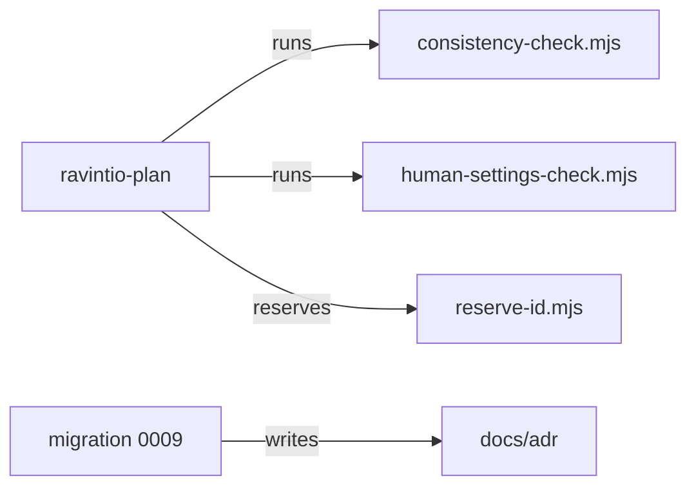

# Execution Plan - Plan checks

> Every requirement must be traceable to a user story or acceptance criterion.

**Skill:** [plan](../skills/ravintio-plan/SKILL.md)
**Feature:** 0000384-plan-checks
**Version:** 0.63.0
**Status:** active

## Active Skills

| Skill | Scope | Purpose |
|-------|-------|---------|
| ravintio-plan | plan | Plan and the skill under edit |

## Functional Requirements Directory

| File | Requirement |
|------|------------|
| [req-001-shell-version-check.md](requirements/req-001-shell-version-check.md) | Check 9: Bash 4 feature needs an oldest-shell line |
| [req-002-component-paths-template.md](requirements/req-002-component-paths-template.md) | Design template holds Component Paths |
| [req-003-commit-limit-and-living-docs.md](requirements/req-003-commit-limit-and-living-docs.md) | Commit subject limit and check 10 |
| [req-004-shared-resources.md](requirements/req-004-shared-resources.md) | Shared resources column in check 8 |
| [req-005-adrs-in-docs-adr.md](requirements/req-005-adrs-in-docs-adr.md) | ADRs in docs/adr, counter, migration 0009 |
| [req-006-human-settings-check.md](requirements/req-006-human-settings-check.md) | Human-only settings check |

## Non-Functional Requirements

| ID | Category | Requirement | Target | Measurement |
|----|----------|------------|--------|-------------|
| NFR-001 | Reliability | Migration 0009 is idempotent | A second run changes 0 files | Suite diffs the tree |
| NFR-002 | Performance | `consistency-check.mjs` run time | Under 2 s on a 50-file plan | Suite timing |

## API Summary

None. The feature adds no endpoint.

## Data Model Summary

| Entity | Owner Component | Key Fields | Relationships |
|--------|----------------|------------|--------------|
| ADR file | ravintio-zero | number, slug, component, status | Supersedes another ADR by number |
| ADR counter | ravintio-zero | `docs/adr/.next-id` | none |

## Component Interactions

## Test impact

| Cause | Test | Unit |
|-------|------|------|
| Skill-text budget: the run edits `ravintio-plan` and `ravintio-ship` `SKILL.md` | test-0000031-req-003-five-phases.sh (1720 line total, 1614 now) | U6 |
| Size cap: plan and ship skills | test-0000171-req-004-no-skill-bundling.sh | U6 |
| Backlog entry id: 0000255, 0000263, 0000333, 0000347, 0000280, 0000364 | none found | U6 |
| Workflow job or step edit | none found | U6 |
| Reference file edit | none found | U6 |
| New test file | test-0000164-req-008 style tests, `test-0000384-*` | U1 |
| Non-suite file | `run-tests.sh`, `run-tests.ps1` | U4 |
| Fixture-pinned line: design template | test-0000009-rail-tightening.sh, test-0000007-agent-optimisation.sh, test-0000017-req-006-structured-discovery-pass.sh, test-0000151-req-014-chart-clarity-and-dependency-stop.sh | U2 |
| Fixture-pinned line: execution plan template | test-0000005-pack-governance.sh, test-0000201-req-001-concurrency-section.sh, test-0000246-req-001-test-impact-scan.sh | U1 |
| Fixture-pinned line: consistency check | test-0000016-pipeline-governance.sh, test-0000170-req-003, test-0000170-req-004, test-0000198-req-001-002, test-0000201-req-003 | U1 |
| Fixture-pinned line: dispatch standard | test-0000151-req-007-dispatch-model-tiers.sh, test-0000201-req-002-concurrent-by-default.sh, test-0000359-req-002-own-path-commits.sh | U2 |
| Fixture-pinned line: ADR template and archive paths | test-0000031-req-001-rename.sh, test-0000031-req-006-present-docs.sh, test-0000042-req-008-pack-prose.sh | U5 |
| Migration count | test-0000243-req-001-002-006-resume-detect.sh, test-0000320-req-003-migration-ledger.sh | U4 |

## Concurrency plan

Units in one batch run at the same time. A unit alone in its batch gives its reason. See the [guide](execution-plan-guide.md).

| Unit | Depends on | Writes | Batch | Sequential reason | Shared resources |
|------|-----------|--------|-------|-------------------|------------------|
| U1 | none | ravintio-zero/scripts/consistency-check.mjs, ravintio-zero/templates/execution-plan.template.md, ravintio-zero/tests/test-0000384-req-001-004-plan-checks.sh | 1 | none | none |
| U2 | none | ravintio-zero/templates/design.template.md, ravintio-zero/templates/adr.template.md, ravintio-zero/standards/agent-dispatch-standards.md, ravintio-zero/tests/test-0000384-req-002-003-templates.sh | 1 | none | none |
| U3 | none | ravintio-zero/scripts/human-settings-check.mjs, ravintio-zero/tests/test-0000384-req-006-human-settings.sh | 1 | none | none |
| U4 | none | ravintio-zero/migrations/0009-adrs-in-docs-adr.md, ravintio-zero/migrations/migrate-adr-home.mjs, ravintio-zero/migrations/migrate-adr-home.sh, ravintio-zero/migrations/migrate-adr-home.ps1, ravintio-zero/tests/test-0000384-req-005-adr-migration.sh | 1 | none | none |
| U5 | U4 | docs/adr, plan/_archive, plan/current/adr | 2 | none | none |
| U6 | U1, U3 | ravintio-zero/skills/ravintio-plan/SKILL.md, ravintio-zero/skills/ravintio-ship/SKILL.md, ravintio-zero/tests/test-0000384-skill-text.sh | 2 | none | none |
| U7 | U5, U6 | docs/decisions-index.md, docs/architecture-overview.md, docs/about.md | 3 | It indexes the ADRs that U5 moved and the skills that U6 edited | none |

## Assumptions

| ID | Assumption | Impact if Wrong |
|----|-----------|----------------|
| A-001 | Git history holds the ADRs of features 0000001 to 0000029 | The migration lists each missing feature and skips it |
| A-002 | Four digits is wide enough | File names stop sorting past 9999 ADRs |

## Open Questions

None.
