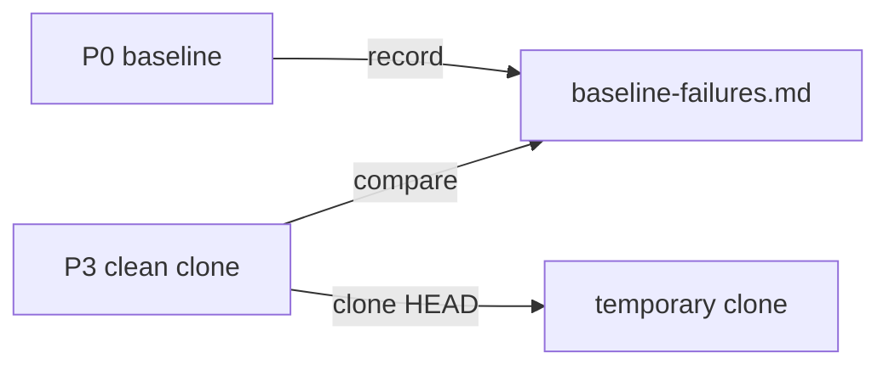

# Execution Plan - Faster test runs

**Skill:** [plan](../../ravintio-zero/skills/ravintio-plan/SKILL.md)
**Feature:** 0000385-faster-test-runs
**Version:** 0.61.0
**Status:** active

## Active Skills

| Skill | Scope | Purpose |
|-------|-------|---------|
| none | plan | No capability skills are active |

## Functional Requirements Directory

| File | Requirement |
|------|------------|
| [req-001-affected-tests-per-cycle.md](requirements/req-001-affected-tests-per-cycle.md) | Each cycle runs the affected tests, P2 runs the full suite once, and the build log records each cycle's tests |
| [req-002-baseline-failures.md](requirements/req-002-baseline-failures.md) | P0 records base-commit failures and P3 stops only on new ones |
| [req-003-clean-clone-suite.md](requirements/req-003-clean-clone-suite.md) | P3 runs the suite in a clean clone of `HEAD` |

## Non-Functional Requirements

| ID | Category | Requirement | Target | Measurement |
|----|----------|------------|--------|-------------|
| NFR-001 | Performance | The clean clone adds little to P3 | Under 30 seconds on this repo, excluding the suite | Time the clone and removal |
| NFR-002 | Portability | The scripts run on macOS, Linux, and Git Bash | 0 uses of `timeout` or GNU-only flags | Grep of the script files |

## API Summary

No API.

## Data Model Summary

No data model. `plan/current/baseline-failures.md` lists one suite name per line.

## Component Interactions

## Test impact

| Cause | Test | Unit |
|-------|------|------|
| Skill count | none found | none |
| Skill-text budget | `test-0000031-req-003-five-phases.sh` caps the skill text at 1720 lines. The edits add under 40 lines. | U1, U2, U3 |
| Size cap | none found. The run leaves the orchestrator `SKILL.md` unchanged. | none |
| Backlog entry id 0000294, 0000295, 0000296 | none found | none |
| Workflow job or step edit | none found | none |
| Known test files in `run-tests.sh` | none. New suites match `test-*.sh`. | none |
| Refactor skill wording | grep for `Run the full suite` in `ravintio-refactor` before the edit | U1 |

## Concurrency plan

| Unit | Depends on | Writes | Batch | Sequential reason |
|------|-----------|--------|-------|-------------------|
| U1 | none | `skills/ravintio-implement/SKILL.md`, `skills/ravintio-refactor/SKILL.md`, `templates/build-log.template.md`, `tests/test-0000385-req-001-affected-tests.sh` | 1 | none |
| U2 | none | `scripts/baseline-failures.mjs`, `skills/ravintio-orchestrator/references/orchestrator-p0-start-actions.md`, `tests/test-0000385-req-002-baseline-failures.sh` | 1 | none |
| U3 | none | `scripts/clean-clone-test.mjs`, `tests/test-0000385-req-003-clean-clone.sh` | 1 | none |
| U4 | U1, U2, U3 | `skills/ravintio-validate-and-accept/SKILL.md`, `skills/ravintio-ship/SKILL.md`, `standards/testing-standards.md`, `tests/README.md`, `component.yml` | 2 | U4 names the scripts and rules that U1 to U3 write |

## Assumptions

| ID | Assumption | Impact if Wrong |
|----|-----------|----------------|
| A-001 | `git clone` of a local path works on every runner | The script exits non-zero with the git error |
| A-002 | The runner prints each failed suite on its own line under `Failed suites:` | The baseline records nothing |

## Open Questions

None.
