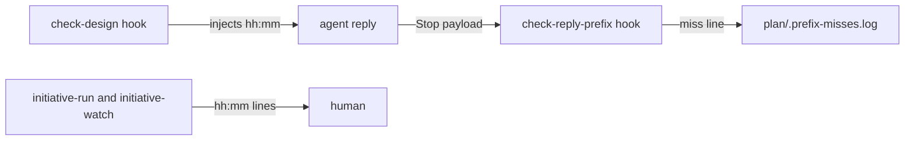

# Execution Plan - Replies and questions

> Every requirement must be traceable to a user story or acceptance criterion.

**Skill:** [plan](../../ravintio-zero/skills/ravintio-plan/SKILL.md)
**Feature:** 0000388-replies-and-questions
**Version:** 0.1.0
**Status:** draft

## Active Skills

None.

## Functional Requirements Directory

Functional requirements are split into individual files, one user story per file, at `plan/current/requirements/`.

Each file follows the [Requirement Template](../../ravintio-zero/templates/requirement.template.md).

| File | Requirement |
|------|------------|
| [req-001-time-before-prefix.md](requirements/req-001-time-before-prefix.md) | The hooks inject and accept a leading `hh:mm` (US-001, 0000257) |
| [req-002-clear-prefix-warning.md](requirements/req-002-clear-prefix-warning.md) | The prefix warning names the check, reply, and session, and skips the coordinator (US-002, 0000258) |
| [req-003-explicit-agreement.md](requirements/req-003-explicit-agreement.md) | The agreement rule asks for "Yes, I agree" and one permission per question (US-003, 0000259) |
| [req-004-question-form.md](requirements/req-004-question-form.md) | The question rule sets closed, open, and list-approval forms (US-004, 0000306) |
| [req-005-driver-and-watcher-time.md](requirements/req-005-driver-and-watcher-time.md) | Driver and watcher lines start with `hh:mm`, and the docs name it (US-001, 0000257) |

## Non-Functional Requirements

| ID | Category | Requirement | Target | Measurement |
|----|----------|------------|--------|-------------|
| NFR-001 | Size | Orchestrator skill size | 9000 bytes or fewer | Existing cap tests |
| NFR-002 | Reliability | Hook exit code | 0 on every input | Existing hook tests |
| NFR-003 | Size | Boot template size | 3600 bytes or fewer | `test-0000151-req-011-orchestrator-references-split.sh` |
| NFR-004 | Size | Initiative skill length | Fewer than 120 lines | `test-0000314-req-002-driver-files-stay.sh` |

## API Summary

None. The pack has no API and no OpenAPI specification.

## Data Model Summary

None. The pack has no data model and no data contract.

## Component Interactions

## Test impact

Scanned with grep over `ravintio-zero/tests/`. Backlog ids 0000257, 0000258, 0000259, and 0000306 match no test. The run adds no skill and no workflow edit, so those rows read none found.

| Cause | Test | Unit |
|-------|------|------|
| Backlog entry ids 0000257, 0000258, 0000259, 0000306 | none found | none |
| Skill count | none found (no skill added or removed) | none |
| Workflow job or step edit | none found (no workflow edit) | none |
| Prefix hook text and handling | `test-0000200-req-003-stop-hook-warns-and-logs.sh` | U1 |
| Prefix hook text and handling | `test-0000320-req-004-final-reply-prefix.sh` | U1 |
| Prefix hook text and handling | `test-0000357-req-004-prefix-misses-ignored.sh` | U1 |
| Prefix hook text and handling | `test-0000358-req-001-question-status.sh` | U1 |
| Hook description | `test-0000245-req-001-hook-enforcement-reference.sh` | U1 |
| Driver and watcher output pins (30 files match `initiative-run.mjs` or `initiative-watch.mjs`, among them `test-0000189-req-003-initiative-prefixes.sh`, `test-0000205-req-006-driver-final-report.sh`, `test-0000377-req-002-question-stop.sh`, `test-0000205-req-003-watch-script.sh`, `test-0000240-req-002-activity-lines.sh`, `test-0000379-req-006-watcher.sh`, and `test-0000241-req-001-watcher-false-events.sh`) | `^I-E Delivery:` greps in `test-0000205-req-006-driver-final-report.sh` match from line start and need the time | U2 |
| Driver and watcher output pins | the remaining files from `grep -rln "initiative-run.mjs\|initiative-watch.mjs" ravintio-zero/tests`, checked one by one when U2 runs | U2 |
| Reply Conventions boot text | `test-0000200-req-001-002-reply-conventions.sh` | U2 |
| Reply Conventions boot text | `test-0000379-req-007-worktree-rule.sh` | U2 |
| Reply Conventions boot text | `test-0000009-rail-tightening.sh` | U2 |
| Reply Conventions boot text | `test-0000029-req-001-003-boot-file-regeneration.sh` | U2 |
| Size cap, orchestrator `SKILL.md` 9000 bytes | `test-0000151-req-011-orchestrator-references-split.sh` (also caps the boot template at 3600) | U2 |
| Size cap, orchestrator `SKILL.md` 9000 bytes | `test-0000247-req-001-stage-by-path.sh` | U2 |
| Size cap, orchestrator `SKILL.md` 9000 bytes | `test-0000359-req-001-no-tree-git-under-subagents.sh` | U2 |
| Skill-text budget, initiative skill under 120 lines | `test-0000314-req-002-driver-files-stay.sh`, `test-0000352-req-003-005-skill-rules.sh` | U2, U3 |
| Skill-text budget, total under 1720 lines (now 1608) | `test-0000206-req-002-step-application.sh`, `test-0000327-req-003-ship-skill-rules.sh`, `test-0000359-req-001-no-tree-git-under-subagents.sh` | U3 |

## Concurrency plan

Units in one batch run at the same time. A unit alone in its batch gives its reason. See the [guide](../../ravintio-zero/templates/execution-plan-guide.md).

| Unit | Depends on | Writes | Batch | Sequential reason |
|------|-----------|--------|-------|-------------------|
| U1 | none | `ravintio-zero/hooks/enforcement/check-design.mjs`, `ravintio-zero/hooks/enforcement/check-reply-prefix.mjs`, `ravintio-zero/standards/hook-enforcement.md`, prefix hook tests (REQ-001, REQ-002) | 1 | none |
| U2 | none | `ravintio-zero/scripts/initiative-run.mjs`, `ravintio-zero/scripts/initiative-watch.mjs`, `ravintio-zero/templates/standard-boot.md`, `ravintio-zero/templates/codex-boot.md`, `ravintio-zero/skills/ravintio-orchestrator/SKILL.md`, `ravintio-zero/skills/ravintio-initiative/SKILL.md`, `ravintio-zero/standards/roadmap-standards.md`, driver, watcher, and boot tests (REQ-005) | 1 | none |
| U4 | none | `ravintio-zero/skills/ravintio-orchestrator/references/orchestrator-discovery-coaching.md`, question rule test (REQ-004) | 1 | none |
| U3 | U2 | `ravintio-zero/skills/ravintio-orchestrator/references/orchestrator-p0-coaching.md`, `ravintio-zero/skills/ravintio-initiative/SKILL.md`, phase skills that ask for approval, agreement rule test (REQ-003) | 2 | Shares `ravintio-initiative/SKILL.md` with U2, which also holds the line cap. |

## Assumptions

Each is a risk item with likelihood: medium.

| ID | Assumption | Impact if Wrong |
|----|-----------|----------------|
| A-001 | A step session sets `RAVINTIO_INITIATIVE_STEP=1` and the coordinator does not. | The coordinator warning stays on. |
| A-002 | `plan/.initiative-runner.lock` marks that a step runs. | The skip misfires. |

## Open Questions

None.
