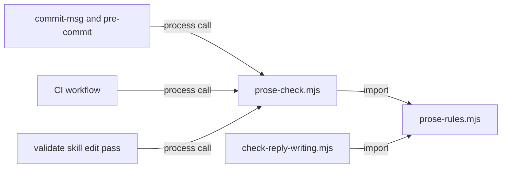

# Execution Plan - Prose checks

> Every requirement must be traceable to a user story or acceptance criterion.

**Skill:** [plan](../skills/ravintio-plan/SKILL.md)
**Feature:** 0000390-prose-checks
**Version:** 0.71.0
**Status:** active

## Active Skills

| Skill | Scope | Purpose |
|-------|-------|---------|
| ravintio-implement | plan | Builds each requirement through the TDD loop |

## Functional Requirements Directory

Functional requirements are split into individual files, one user story per file, at `plan/current/requirements/`.

Each file follows the naming convention `req-{NNN}-{kebab-slug}.md` and the [Requirement Template](../templates/requirement.template.md).

| File | Requirement |
|------|------------|
| [req-001-prose-rules.md](requirements/req-001-prose-rules.md) | The rules module and the `check` command |
| [req-002-baseline-ratchet.md](requirements/req-002-baseline-ratchet.md) | The baseline file, `update`, and `diff` |
| [req-003-enforcement-points.md](requirements/req-003-enforcement-points.md) | `commit-msg`, pre-commit, and CI |
| [req-004-docs-edit-pass.md](requirements/req-004-docs-edit-pass.md) | The P3 docs edit pass |
| [req-005-advisory-reply-check.md](requirements/req-005-advisory-reply-check.md) | The advisory Stop hook |

## Non-Functional Requirements

| ID | Category | Requirement | Target | Measurement |
|----|----------|------------|--------|-------------|
| NFR-001 | Reliability | The Stop hook never blocks | Exit code 0 for every input | A test feeds bad JSON, an empty payload, and a clean reply |
| NFR-002 | Performance | Pre-commit checks staged files only | One staged file reads one file | A test counts the files the script reads |
| NFR-003 | Security | The script writes only the baseline file | No other write | A test lists changed files after each command |

## API Summary

None. The feature adds no HTTP API.

## Data Model Summary

| Entity | Owner Component | Key Fields | Relationships |
|--------|----------------|------------|--------------|
| Prose baseline | ravintio-zero | `version`, `files.{path}.{rule-id}` | Read by `check`, `update`, and `diff` |

## Component Interactions

## Test impact

| Cause | Test | Unit |
|-------|------|------|
| Skill-text budget and size cap: edits `ravintio-validate-and-accept/SKILL.md` | `test-0000010-pack-quality-improvements.sh`, `test-0000031-req-003-five-phases.sh`, `test-0000042-req-008-pack-prose.sh`, `test-0000043-req-012-progress-markers-and-resume.sh`, `test-0000383-req-001-005-test-impact-causes.sh` | U4 |
| Workflow job or step edit: edits `ravintio.yml` and `.github/workflows/ravintio.yml` | `test-0000037-req-006-bash-suites-ci-job.sh`, `test-0000151-req-015-faster-powershell-ci.sh`, `test-0000409-req-002-workflow-shards.sh`, `test-0000394-req-002-pinned-actions.sh`, `test-0000319-req-002-ci-jobs.sh` | U3 |
| Hook list: adds a hook beside `check-reply-prefix` | `test-0000028-req-002-shared-module-extraction.sh`, `test-0000200-req-004-setup-wires-the-stop-hook.sh`, `test-0000245-req-001-hook-enforcement-reference.sh`, `test-0000207-req-001-003-codex-setup.sh`, `fixtures/0000038-hook-filter/expected-after.txt` | U5 |
| Commit hook edit: edits `commit-msg` and `pre-commit` | `test-commit-msg-hook.sh`, `test-0000405-req-001-short-base-merge-subject.sh`, `test-0000169-req-002-attribution-check-script.sh` | U3 |
| Pack facts: adds a script and a hook | `test-0000382-req-006-pack-facts-file.sh` | U5 |
| New test file: adds suites | `test-0000164-req-008-no-process-substitution-loops.sh`, `test-0000042-req-008-pack-prose.sh` | U1 |
| Backlog entry id: pulls in 0000301, 0000303, and 0000304 | none found | U1 |
| Reference file edit: edits no `references/` file | none found | none |
| Fixture-pinned line: edits the hook install lists | `fixtures/0000038-hook-filter/expected-after.txt` | U5 |

## Concurrency plan

Units in one batch run at the same time. A unit alone in its batch gives its reason.

| Unit | Depends on | Writes | Batch | Sequential reason | Shared resources |
|------|-----------|--------|-------|-------------------|------------------|
| U1 | none | `ravintio-zero/hooks/enforcement/prose-rules.mjs`, `ravintio-zero/scripts/prose-check.mjs`, tests for REQ-001 and REQ-002 | 1 | Every later unit imports the module | none |
| U2 | U1 | `plan/state/prose-baseline.json` | 2 | Later units edit prose and need the baseline | none |
| U3 | U2 | `ravintio-zero/hooks/commit-msg`, `ravintio-zero/hooks/pre-commit`, `ravintio-zero/hooks/ravintio.yml`, `.github/workflows/ravintio.yml`, REQ-003 tests | 3 | none | none |
| U4 | U2 | `ravintio-zero/skills/ravintio-validate-and-accept/SKILL.md`, REQ-004 tests | 3 | none | none |
| U5 | U2 | `ravintio-zero/hooks/enforcement/check-reply-writing.mjs`, `ravintio-zero/setup.sh`, `ravintio-zero/setup.ps1`, `ravintio-zero/scripts/install-lifecycle.mjs`, `ravintio-zero/scripts/pack-facts.mjs`, `ravintio-zero/pack-facts.json`, REQ-005 tests | 3 | none | none |
| U6 | U3, U4, U5 | `docs/architecture-overview.md`, `docs/component-registry.md`, `ravintio-zero/standards/hook-enforcement.md`, `ravintio-zero/project-operations.md`, `ravintio-zero/pipeline-reference.md`, `ravintio-zero/component.yml` | 4 | Describes the output of batch 3 | none |

## Assumptions

| ID | Assumption | Impact if Wrong |
|----|-----------|----------------|
| A-001 | The Stop payload carries `last_assistant_message` | The advisory hook stays silent |
| A-002 | `commit-msg` can run `node` | The prose check skips with a note |

## Open Questions

None.
