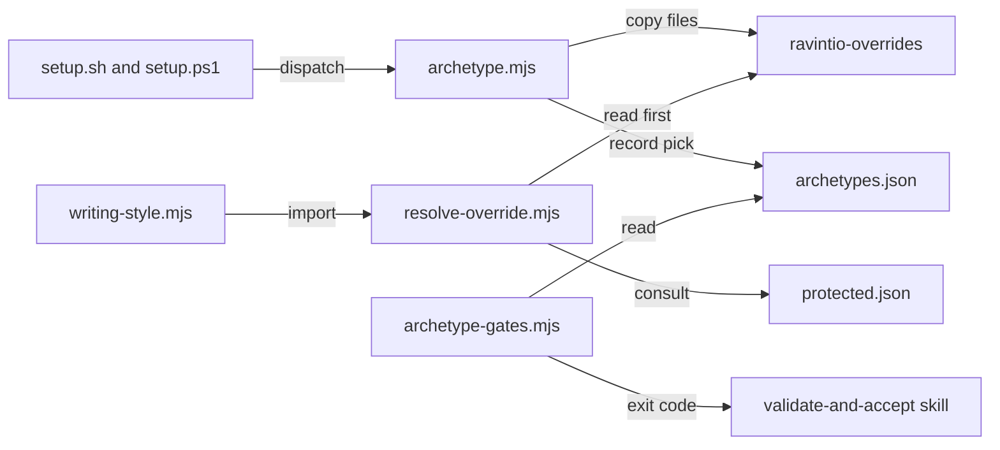

# Execution Plan - Standards archetypes

> Every requirement traces to a user story or acceptance criterion.

**Skill:** [plan](../../ravintio-zero/skills/ravintio-plan/SKILL.md)
**Feature:** 0000391-standards-archetypes
**Wave:** 1
**Version:** 0.74.0
**Status:** draft

## Active Skills

None

## Functional Requirements Directory

Functional requirements sit in individual files, one user story per file, at `plan/current/requirements/`.

| File | Requirement |
|------|------------|
| [req-001-override-resolver.md](requirements/req-001-override-resolver.md) | The resolver returns an override before the pack copy. |
| [req-002-protected-rules.md](requirements/req-002-protected-rules.md) | A protected-rule list stops an override from relaxing a hook-enforced rule. |
| [req-003-archetype-command.md](requirements/req-003-archetype-command.md) | `archetype list` and `archetype use` install and report. |
| [req-004-clash-and-threshold.md](requirements/req-004-clash-and-threshold.md) | Slot, file, and threshold checks run before any write. |
| [req-005-four-archetypes.md](requirements/req-005-four-archetypes.md) | The catalogue holds four starter archetypes. |
| [req-006-gate-check.md](requirements/req-006-gate-check.md) | P3 fails when an installed archetype gate breaks. |
| [req-007-writing-outputs.md](requirements/req-007-writing-outputs.md) | The output style and `AGENTS.md` section follow the writing pick. |

## Non-Functional Requirements

| ID | Category | Requirement | Target | Measurement |
|----|----------|------------|--------|-------------|
| NFR-001 | Safety | No archetype or override relaxes a hook-enforced rule. | 0 relaxing overrides take effect | A test plants a relaxing override for each protected entry and expects the pack copy |
| NFR-002 | Determinism | The resolver and the use command give the same result on every run. | 2 runs give byte-identical output and files | A test runs each twice and compares |
| NFR-003 | Atomicity | A failed check writes no file. | 0 files change after exit 1 | A test hashes `ravintio-overrides/` before and after a clash |
| NFR-004 | Parity | `setup.sh` and `setup.ps1` print the same `archetype list` output. | 0 differing lines | A parity test compares both outputs |
| NFR-005 | Size | The skill text stays under its caps. | Total skill text at most 1720 lines, validate-and-accept at most 200 lines, orchestrator at most 9000 bytes | Existing cap tests |

## API Summary

The feature builds no HTTP API. The command line surface is:

| Method | Path | Description | Feature |
|--------|------|-------------|---------|
| CLI | `setup.sh archetype list` | Prints each archetype with kind and summary. | Standards archetypes |
| CLI | `setup.sh archetype use {kind}/{name}` | Checks, copies, prints replaced files, records the pick. | Standards archetypes |
| CLI | `node ravintio-zero/scripts/archetype-gates.mjs` | Runs installed gates and exits 1 on a failure. | Standards archetypes |
| Module | `resolve-override.mjs` | Returns the path to read for a standard or template. | Standards archetypes |

## Data Model Summary

| Entity | Owner Component | Key Fields | Relationships |
|--------|----------------|------------|--------------|
| Archetype manifest (`archetype.json`) | ravintio-zero | `name`, `kind`, `summary`, `slots[]`, `thresholds{}`, `gates[]` | Has a `files/` folder that mirrors `ravintio-overrides/` |
| Protected rule (`protected.json`) | ravintio-zero | path, `mode` (`ignore` or `require`), pinned lines | Read by the resolver |
| Pick record (`ravintio-overrides/archetypes.json`) | the consumer repo | installed `{kind}/{name}` list | Read by the gate check and the clash checks |

## Component Interactions

## Test impact

The scan ran from `ravintio-zero/tests/`. Skill text totals 1666 lines against a cap of 1720, so 54 lines of headroom remain. The validate-and-accept skill has 160 lines against a cap of 200, so 40 lines remain. No byte cap measures it or the implement skill. The orchestrator `SKILL.md` has 8923 of 9000 bytes and U7 does not edit it.

| Cause | Test | Unit |
|-------|------|------|
| New test file | Repo-wide style tests such as `test-0000164-req-008-no-process-substitution-loops.sh` and `test-0000042-req-008-pack-prose.sh` scan the new `test-0000391-*.sh` files | U8 |
| Non-suite file | none found, because the run adds only `test-*.sh` suites and no `run-tests.sh` or `run-tests.ps1` edit | U8 |
| Skill-text budget | `test-0000384-skill-text.sh` and `test-0000359-req-001-no-tree-git-under-subagents.sh` cap total skill text at 1720 lines | U7 |
| Size cap | `test-0000390-req-004-docs-edit-pass.sh` caps validate-and-accept at 200 lines. `test-0000151-req-011-orchestrator-references-split.sh` and `test-0000359-req-001-no-tree-git-under-subagents.sh` cap the orchestrator at 9000 bytes. No test caps `ravintio-implement/SKILL.md` | U7 |
| Skill count | `test-0000160-req-001-pack-identifiers.sh`, `test-0000204-req-003-living-docs.sh`, `test-0000205-req-005-living-docs-and-counts.sh`, and `test-0000382-req-005-clear-first-run.sh` pin 16 skills. The run adds no skill folder | U7 |
| Fixture-pinned line | `ravintio-zero/tests/fixtures/0000151-orchestrator-skill-base.md` and `0000243-resume-detection-base.md` pin orchestrator and resume text. The run edits neither source | U7 |
| Fixture-pinned line | `test-0000389-req-003-generator.sh`, `test-0000389-req-003-005-setup-sh.sh`, and `test-0000389-req-003-005-setup-ps1.ps1` run `writing-style.mjs` and the setup scripts. They pin output text and the `--no-writing-style` flag line | U6, U3 |
| Fixture-pinned line | `test-0000382-req-006-pack-facts-file.sh` compares every flag in `setup.sh` and `setup.ps1` with `pack-facts.json`. The dispatch adds a verb and no flag, so `pack-facts.json` stays as is | U3 |
| Fixture-pinned line | `test-0000019-req-002-component-yml-matcher.sh` and `test-0000016-pipeline-governance.sh` read `component.yml` | U9 |
| Standards or templates count | none found. Only `test-0000042-req-008-pack-prose.sh` counts files, and it counts 21 test-tool library standards | U7 |
| Backlog entry id | none found for 0000305 in `ravintio-zero/tests/` | U8 |

## Concurrency plan

Units in one batch run at the same time. A unit alone in its batch gives its reason. See the [guide](../../ravintio-zero/templates/execution-plan-guide.md). The optional Shared resources column lists build output, ports, and lock files. Two units in one batch must not name the same resource.

| Unit | Depends on | Writes | Batch | Sequential reason | Shared resources |
|------|-----------|--------|-------|-------------------|------------------|
| U1 | none | `ravintio-zero/scripts/resolve-override.mjs`, `ravintio-zero/archetypes/protected.json` | 1 | none | none |
| U4 | none | `ravintio-zero/scripts/archetype-gates.mjs` | 1 | none | none |
| U5 | none | `ravintio-zero/archetypes/README.md`, `ravintio-zero/archetypes/alternative/us-writing/archetype.json`, `ravintio-zero/archetypes/alternative/us-writing/files/standards/language-quirks-en-gb.md`, `ravintio-zero/archetypes/alternative/language-standards/archetype.json`, `ravintio-zero/archetypes/alternative/language-standards/files/standards/language-quirks-en-gb.md`, `ravintio-zero/archetypes/constraint/restricted-stack/archetype.json`, `ravintio-zero/archetypes/constraint/strict-testing/archetype.json` | 1 | none | none |
| U2 | U1 | `ravintio-zero/scripts/archetype.mjs` | 2 | none | none |
| U6 | U1 | `ravintio-zero/scripts/writing-style.mjs` | 2 | none | none |
| U7 | U4 | `ravintio-zero/standards/archetype-standards.md`, `ravintio-zero/skills/ravintio-validate-and-accept/SKILL.md` | 2 | none | none |
| U3 | U2 | `ravintio-zero/setup.sh`, `ravintio-zero/setup.ps1` | 3 | Dispatches to `archetype.mjs`, and no other unit remains that touches the setup scripts | none |
| U8 | U1, U2, U3, U4, U5, U6, U7 | `ravintio-zero/tests/test-0000391-req-001-002-resolver.sh`, `ravintio-zero/tests/test-0000391-req-003-004-command.sh`, `ravintio-zero/tests/test-0000391-req-005-archetypes.sh`, `ravintio-zero/tests/test-0000391-req-006-gates.sh`, `ravintio-zero/tests/test-0000391-req-007-writing-outputs.sh` | 4 | none | none |
| U9 | U1, U2, U3, U4, U5, U6, U7 | `docs/about.md`, `docs/architecture-overview.md`, `docs/component-registry.md`, `ravintio-zero/component.yml` | 4 | none | none |

U5 may add files under `files/` beyond the list above once it sees the standard text it must carry. It then adds the paths to this table.

## Assumptions

Each is a risk item with likelihood: medium.

| ID | Assumption | Impact if Wrong |
|----|-----------|----------------|
| A-001 | The prose check tests no spelling. | The US archetype fails its own check. |
| A-002 | Overrides sit in `ravintio-overrides/standards/` and `ravintio-overrides/templates/`. | The resolver reads the wrong folder. |

## Open Questions

None.
