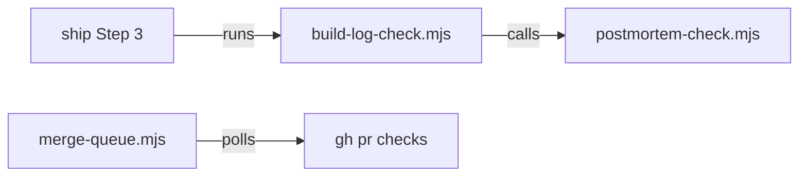

# Execution Plan - Ship postmortems

**Skill:** [plan](../../ravintio-zero/skills/ravintio-plan/SKILL.md)
**Feature:** 0000392-ship-postmortems
**Version:** 0.60.0
**Status:** active

## Active Skills

| Skill | Scope | Purpose |
|-------|-------|---------|
| none | plan | No capability skills are active |

## Functional Requirements Directory

| File | Requirement |
|------|------------|
| [req-001-ship-postmortem-check.md](requirements/req-001-ship-postmortem-check.md) | Ship fails when a stop or rework has no postmortem |
| [req-002-capa-record-check.md](requirements/req-002-capa-record-check.md) | A postmortem holds one row of each CAPA type |
| [req-003-queue-waits-for-ci.md](requirements/req-003-queue-waits-for-ci.md) | The merge queue waits for CI after its version push |
| [req-004-pr-title-form.md](requirements/req-004-pr-title-form.md) | P4 writes a PR title that the queue accepts |

## Non-Functional Requirements

| ID | Category | Requirement | Target | Measurement |
|----|----------|------------|--------|-------------|
| NFR-001 | Performance | The queue polls CI at a fixed interval and stops at a limit | 10 second poll, 30 minute limit | A stub `gh` test with `MQ_POLL_MS` and `MQ_TIMEOUT_MS` |
| NFR-002 | Portability | The scripts run on macOS Bash 3.2, Linux, and Git Bash | 0 uses of GNU-only flags | Grep of the new test files |

## API Summary

No API.

## Data Model Summary

No data model.

## Component Interactions

## Test impact

| Cause | Test | Unit |
|-------|------|------|
| Skill count | none found | none |
| Skill-text budget | `test-0000327-req-003-ship-skill-rules.sh` and `test-0000352-req-003-005-skill-rules.sh` pin ship text. `test-0000245-req-003-004-repo-skills-and-size-cap.sh` pins the ship override. | U4 |
| Size cap | none found. No cap test measures the ship or postmortem skills. | none |
| Backlog entry id 0000285, 0000403 | none found | none |
| Workflow job or step edit | none found | none |
| Postmortem template | `test-0000203-req-001-postmortem-skill.sh` pins `## Actions` and the skill steps | U2 |
| Build-log check | `test-0000248-req-002-build-log-wall-clock-check.sh` and `test-0000358-req-002-003-build-log-checks.sh` run `build-log-check.mjs` on fixtures with no `Resolved:` line | U1 |
| Merge queue | `test-0000378-req-002-003-merge-queue.sh` and `test-0000379-req-004-queue-handoff.sh` use a stub `gh` with no `--json` checks mode | U3 |

## Concurrency plan

| Unit | Depends on | Writes | Batch | Sequential reason |
|------|-----------|--------|-------|-------------------|
| U1 | none | `ravintio-zero/scripts/postmortem-check.mjs`, `ravintio-zero/templates/postmortem.template.md`, `ravintio-zero/tests/test-0000392-req-002-capa-record-check.sh` | 1 | none |
| U2 | none | `ravintio-zero/scripts/merge-queue.mjs`, `ravintio-zero/tests/test-0000378-req-002-003-merge-queue.sh`, `ravintio-zero/tests/test-0000392-req-003-queue-waits-for-ci.sh` | 1 | none |
| U3 | U1 | `ravintio-zero/scripts/build-log-check.mjs`, `ravintio-zero/tests/test-0000392-req-001-ship-postmortem-check.sh` | 2 | U3 calls the check that U1 writes |
| U4 | U1, U3 | `ravintio-zero/skills/`, `ravintio-zero/tests/test-0000392-req-004-pr-title-form.sh`, `ravintio-zero/tests/test-0000203-req-001-postmortem-skill.sh` | 3 | The skill text names the scripts from U1 and U3 |
| U5 | U1, U2, U3, U4 | `ravintio-zero/component.yml`, `docs/` | 4 | Docs describe the finished behaviour |

## Assumptions

| ID | Assumption | Impact if Wrong |
|----|-----------|----------------|
| A-001 | `gh pr checks --json name,bucket` exists in the installed `gh` | The queue stops with the `gh` error |
| A-002 | A postmortem line names a rework requirement by its `REQ-nnn` id | The check reports an uncovered requirement |

## Open Questions

None.
