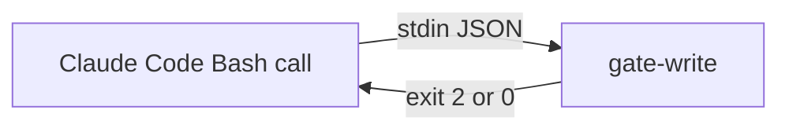

# Execution Plan - Session integrity and guards

**Skill:** [plan](../../ravintio-zero/skills/ravintio-plan/SKILL.md)
**Feature:** 0000393-session-integrity-and-guards
**Version:** 0.65.0
**Status:** active

## Active Skills

| Skill | Scope | Purpose |
|-------|-------|---------|
| None | plan | none |

## Functional Requirements Directory

| File | Requirement |
|------|------------|
| [req-001-gate-write-shell-writes.md](requirements/req-001-gate-write-shell-writes.md) | gate-write checks shell writes |
| [req-002-forced-add-option-values-and-braces.md](requirements/req-002-forced-add-option-values-and-braces.md) | Forced-add guard reads option values and brace groups |
| [req-003-pack-version-record.md](requirements/req-003-pack-version-record.md) | Pack version has its own record |
| [req-004-filing-wording-check.md](requirements/req-004-filing-wording-check.md) | Filing skill runs the wording check |

## Non-Functional Requirements

| ID | Category | Requirement | Target | Measurement |
|----|----------|------------|--------|-------------|
| NFR-001 | Security | No guard passes a form it blocks today | 0 forms | Existing guard tests stay green |
| NFR-002 | Performance | The Bash gate check adds latency | under 100 ms | A timed fixture run |

## API Summary

None. No endpoints.

## Data Model Summary

| Entity | Owner Component | Key Fields | Relationships |
|--------|----------------|------------|--------------|
| Pack version record | ravintio-zero | `packVersion`, `confirmedAt` | none |

## Component Interactions

## Test impact

| Cause | Test | Unit |
|-------|------|------|
| Backlog entry id 0000271, 0000367, 0000272, 0000260 | none found | n/a |
| Hook wiring edit in both setup scripts | test-0000035-req-001-hook-parity.sh, test-0000316, test-0000357-req-001, test-0000382-req-003-uninstall.sh | U1 |
| Reference file edit | test-0000243-req-001-002-006-resume-detect.sh | U3 |
| Reference file edit: resume detection finding line | fixtures/0000243-resume-detection-base.md | U3 |
| New test file: repo-wide style tests | test-0000164-req-008 | U1 to U4 |
| New script under scripts/ | run-tests.sh, run-tests.ps1 | U4 |
| Skill edit | test-0000164-req-005-file-backlog-skill.sh | U4 |

## Concurrency plan

| Unit | Depends on | Writes | Batch | Sequential reason |
|------|-----------|--------|-------|-------------------|
| U1 | none | hooks/enforcement/gate-write.mjs, setup.sh, setup.ps1, tests/test-0000393-req-001-gate-write-shell.sh | 1 | none |
| U2 | none | hooks/enforcement/block-forced-add.mjs, tests/test-0000393-req-002-forced-add-options.sh | 1 | none |
| U3 | none | scripts/resume-detect.mjs, pack-update-policy.md, about.template.md, skills/ravintio-orchestrator/references/orchestrator-resume-detection.md, tests/test-0000393-req-003-pack-version-record.sh | 1 | none |
| U4 | none | scripts/check-entry-wording.mjs, skills/ravintio-file-backlog/SKILL.md, tests/test-0000393-req-004-filing-wording.sh | 1 | none |
| U5 | U1, U2, U3, U4 | component.yml responsibilities, hook-enforcement.md | 2 | Shared docs after the code units land |

## Assumptions

| ID | Assumption | Impact if Wrong |
|----|-----------|----------------|
| A-001 | Claude Code sends `tool_input.command` for Bash | The shell check never runs |

## Open Questions

None.
