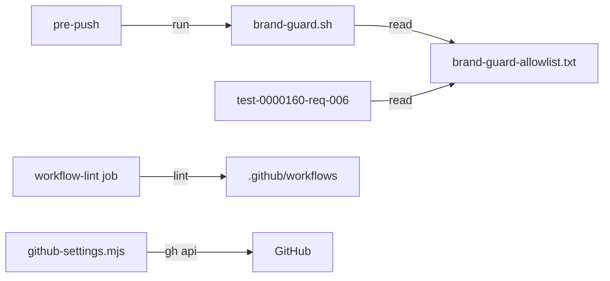

# Execution Plan - GitHub security and CI lint

**Skill:** [plan](../../ravintio-zero/skills/ravintio-plan/SKILL.md)
**Feature:** 0000394-github-security-and-ci-lint
**Version:** 0.61.0
**Status:** active

## Active Skills

| Skill | Scope | Purpose |
|-------|-------|---------|
| none | plan | No capability skills are active |

## Functional Requirements Directory

| File | Requirement |
|------|------------|
| [req-001-community-and-security-files.md](requirements/req-001-community-and-security-files.md) | The repo holds the security and community files |
| [req-002-pinned-actions-and-supply-chain.md](requirements/req-002-pinned-actions-and-supply-chain.md) | Every action is pinned by SHA, with dependency review and Scorecard workflows |
| [req-003-workflow-lint-job.md](requirements/req-003-workflow-lint-job.md) | CI lints the workflows with `actionlint` and `zizmor` |
| [req-004-brand-guard-before-push.md](requirements/req-004-brand-guard-before-push.md) | `pre-push` runs the brand guard with the shared allowlist |
| [req-005-settings-checklist.md](requirements/req-005-settings-checklist.md) | A script lists and checks the admin-only settings |

## Non-Functional Requirements

| ID | Category | Requirement | Target | Measurement |
|----|----------|------------|--------|-------------|
| NFR-001 | Performance | The brand guard checks a push quickly | Under 5 seconds for a push of under 100 files | Timed in the req-004 suite |
| NFR-002 | Security | No workflow uses a floating action tag | 0 third-party `uses:` lines without a 40-character SHA | Grep in the req-002 suite |

## API Summary

No API.

## Data Model Summary

No data model.

## Component Interactions

## Test impact

| Cause | Test | Unit |
|-------|------|------|
| Skill count | none found | none |
| Skill-text budget | none found. The run edits no `SKILL.md`. | none |
| Size cap | none found | none |
| Backlog entry id 0000323, 0000324, 0000325 | `test-0000355-req-005-entry-0000323.sh` reads the pulled-in entry 0000323. The run removes the test. | U5 |
| Workflow job or step edit | `test-0000355-req-003`, `test-0000355-req-004`, `test-0000169-req-006`, `test-0000037-req-006`, `test-0000036-req-005`, `test-0000151-req-015`, `test-0000319-req-002`, `test-0000327-req-002`, `test-0000321-req-003`, `test-0000317-req-001-003-004` read `ravintio.yml` | U1 |
| Brand guard and pre-push | `test-0000160-req-006-brand-guard.sh`, `test-0000019-req-002-component-yml-matcher.sh` (and its regression copy) | U3 |

## Concurrency plan

| Unit | Depends on | Writes | Batch | Sequential reason |
|------|-----------|--------|-------|-------------------|
| U1 | none | `.github/workflows/*.yml`, `ravintio-zero/hooks/ravintio.yml`, `ravintio-zero/tests/test-0000394-req-002-*.sh`, `ravintio-zero/tests/test-0000394-req-003-*.sh` | 1 | none |
| U2 | none | `SECURITY.md`, `CONTRIBUTING.md`, `CODE_OF_CONDUCT.md`, `.github/dependabot.yml`, `.github/ISSUE_TEMPLATE/*`, `.github/PULL_REQUEST_TEMPLATE.md`, `.github/CODEOWNERS`, `.github/release.yml`, `ravintio-zero/tests/test-0000394-req-001-*.sh` | 1 | none |
| U3 | none | `ravintio-zero/hooks/pre-push`, `ravintio-zero/scripts/brand-guard.sh`, `ravintio-zero/tests/brand-guard-allowlist.txt`, `ravintio-zero/tests/test-0000160-req-006-brand-guard.sh`, `ravintio-zero/tests/test-0000394-req-004-*.sh` | 1 | none |
| U4 | none | `ravintio-zero/scripts/github-settings.mjs`, `ravintio-zero/docs/github-settings.md`, `ravintio-zero/tests/test-0000394-req-005-*.sh` | 1 | none |
| U5 | U1, U2, U3, U4 | `ravintio-zero/tests/test-0000355-req-005-entry-0000323.sh`, `ravintio-zero/component.yml`, `ravintio-zero/tests/README.md`, `README.md`, `docs/` | 2 | U5 edits shared manifests and docs that name the files from U1 to U4 |

## Assumptions

| ID | Assumption | Impact if Wrong |
|----|-----------|----------------|
| A-001 | Action SHAs resolve through `gh api` | The step stops with the failing action named |
| A-002 | `product.yml` id is `ravintio-zero` only in the pack source | The guard runs in a consumer repo |

## Open Questions

None.
