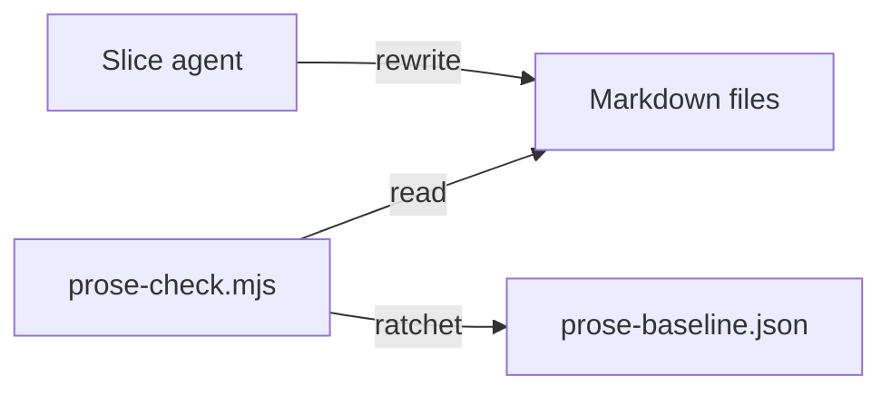

# Execution Plan - Pack prose to the standard

> Every requirement traces to a user story or acceptance criterion.

**Skill:** [plan](../../ravintio-zero/skills/ravintio-plan/SKILL.md)
**Feature:** 0000395-pack-prose-to-the-standard
**Wave:** 1
**Version:** 0.75.0
**Status:** draft

## Active Skills

None

## Functional Requirements Directory

Functional requirements sit in individual files, one user story per file, at `plan/current/requirements/`.

| File | Requirement |
|------|------------|
| [req-001-rewrite-pack-prose.md](requirements/req-001-rewrite-pack-prose.md) | Every file in scope passes the prose linter. |
| [req-002-empty-the-baseline.md](requirements/req-002-empty-the-baseline.md) | The baseline holds no entry for the pack, and the suite passes. |

## Non-Functional Requirements

| ID | Category | Requirement | Target | Measurement |
|----|----------|------------|--------|-------------|
| NFR-001 | Meaning | A rewrite keeps the rule that the text states. | 0 changed rules in the reviewed diff | A reviewer reads the diff of each slice against the original |
| NFR-002 | Structure | Rule anchors and headings survive. | 0 lost anchors | A script compares the anchor ids and headings before and after |
| NFR-003 | Regression | The suite fails no new suite. | 0 new failing suites | `baseline-failures.mjs check` |

## API Summary

The feature builds no API.

| Method | Path | Description | Feature |
|--------|------|-------------|---------|
| none | none | none | Pack prose to the standard |

## Data Model Summary

| Entity | Owner Component | Key Fields | Relationships |
|--------|----------------|------------|--------------|
| Prose baseline | ravintio-zero | file path, rule id, count | Read by `prose-check.mjs` |

## Component Interactions

## Test impact

The scan ran against `ravintio-zero/tests/`. The run adds no skill, no workflow job, and no test file.

| Cause | Test | Unit |
|-------|------|------|
| Reference file edit | Frozen-line tests such as `test-0000151-req-011-orchestrator-references-split.sh` read the orchestrator references | U11 |
| Fixture-pinned line | `ravintio-zero/tests/fixtures/0000151-orchestrator-skill-base.md` and `0000243-resume-detection-base.md` pin orchestrator and resume text | U11, U15 |
| Skill-text budget | `test-0000384-skill-text.sh` caps total skill text at 1720 lines. A rewrite must not add lines | U11 |
| Size cap | The orchestrator `SKILL.md` has a byte cap of 9000. A rewrite must not grow it | U11 |
| Backlog entry id | `test-0000247-req-002-commit-id-reservations.sh` names 0000302 | U15 |
| Standards or templates count | none found. A rewrite adds no file | U9, U10, U12 |
| Workflow job or step edit | none found | none |
| New test file | none found | none |
| Non-suite file | none found | none |
| Wording pins | Tests that grep a rewritten sentence fail until U15 updates them. The suite run lists each | U15 |

## Concurrency plan

Units in one batch run at the same time. A unit alone in its batch gives its reason. See the [guide](../../ravintio-zero/templates/execution-plan-guide.md). The optional Shared resources column lists build output, ports, and lock files. Two units in one batch must not name the same resource.

| Unit | Depends on | Writes | Batch | Sequential reason | Shared resources |
|------|-----------|--------|-------|-------------------|------------------|
| U1 | none | docs/adr slice U1 (files in `plan/current/slices/U1.txt`) | 1 | none | none |
| U2 | none | docs/adr slice U2 (files in `plan/current/slices/U2.txt`) | 1 | none | none |
| U3 | none | docs/adr slice U3 (files in `plan/current/slices/U3.txt`) | 1 | none | none |
| U4 | none | docs/adr slice U4 (files in `plan/current/slices/U4.txt`) | 1 | none | none |
| U5 | none | docs/adr slice U5 (files in `plan/current/slices/U5.txt`) | 1 | none | none |
| U6 | none | docs/adr slice U6 (files in `plan/current/slices/U6.txt`) | 1 | none | none |
| U7 | none | docs/adr slice U7 (files in `plan/current/slices/U7.txt`) | 1 | none | none |
| U8 | none | docs/adr slice U8 (files in `plan/current/slices/U8.txt`) | 2 | none | none |
| U9 | none | ravintio-zero/standards slice U9 (files in `plan/current/slices/U9.txt`) | 2 | none | none |
| U10 | none | ravintio-zero/standards slice U10 (files in `plan/current/slices/U10.txt`) | 2 | none | none |
| U11 | none | ravintio-zero/skills slice U11 (files in `plan/current/slices/U11.txt`) | 2 | none | none |
| U12 | none | ravintio-zero/templates slice U12 (files in `plan/current/slices/U12.txt`) | 2 | none | none |
| U13 | none | docs/ top files and ravintio-zero/migrations slice U13 (files in `plan/current/slices/U13.txt`) | 2 | none | none |
| U14 | none | root, ravintio-overrides, and remaining ravintio-zero files, slice U14 (files in `plan/current/slices/U14.txt`) | 2 | none | none |
| U15 | U1, U2, U3, U4, U5, U6, U7, U8, U9, U10, U11, U12, U13, U14 | `plan/state/prose-baseline.json`, pinned lines in `ravintio-zero/tests/`, `docs/about.md` | 3 | Runs the baseline update and the suite after every slice lands | none |

Each unit is class `content`, scored 2, so the tier table gives the primary tier at high effort.

## Assumptions

Each is a risk item with likelihood: medium.

| ID | Assumption | Impact if Wrong |
|----|-----------|----------------|
| A-001 | Every breach in scope sits outside code font, tables, and comments. | A breach cannot be fixed by a prose edit. |

## Open Questions

None.
