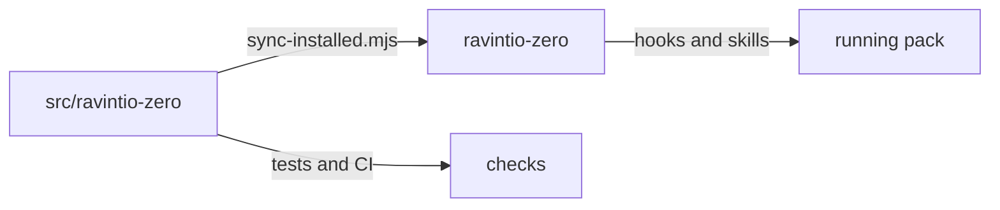

# Execution Plan - Pack source in src

> Every requirement traces to a user story or acceptance criterion.

**Skill:** [plan](../../ravintio-zero/skills/ravintio-plan/SKILL.md)
**Feature:** 0000397-pack-source-in-src
**Version:** 0.76.0
**Status:** active

## Active Skills

| Skill | Scope | Purpose |
|-------|-------|---------|
| ravintio-implement | plan | Drives the TDD loop for each requirement |

## Functional Requirements Directory

Functional requirements sit in individual files at `plan/current/requirements/`.

| File | Requirement |
|------|------------|
| [req-001-move-with-history.md](requirements/req-001-move-with-history.md) | Pure move commit with history |
| [req-002-installed-copy.md](requirements/req-002-installed-copy.md) | Installed copy and parity check |
| [req-003-retarget-tooling.md](requirements/req-003-retarget-tooling.md) | Tests and CI run against the source |
| [req-004-refresh-route-and-docs.md](requirements/req-004-refresh-route-and-docs.md) | Refresh route and docs |
| [req-005-guards-cover-both.md](requirements/req-005-guards-cover-both.md) | Guards cover both paths |

## Non-Functional Requirements

| ID | Category | Requirement | Target | Measurement |
|----|----------|------------|--------|-------------|
| NFR-001 | History | Renames keep history | `git log --follow` reaches pre-move commits | Local command |
| NFR-002 | Parity | The folders match | 0 differing files at the end | `sync-installed.mjs --check` |
| NFR-003 | Security | No guard gains an allowed form | 0 new allowlist forms | Guard tests |

## API Summary

No API changes.

## Data Model Summary

No data model changes.

## Component Interactions

## Test impact

| Cause | Test | Unit |
|-------|------|------|
| Workflow job or step edit | `test-0000037-req-006-bash-suites-ci-job.sh`, `test-0000036-req-005-windows-ci-job.sh`, `test-0000327-req-002-ci-job.sh`, `test-0000321-req-003-ci-index-check.sh`, `test-0000207-req-004-codex-ci-check.sh`, `test-0000169-req-006-release-tag-ci-and-ship-flow.sh`, `test-0000151-req-015-faster-powershell-ci.sh` | U5 |
| Fixture-pinned line | tests that name `ravintio-zero/` in 148 files under `ravintio-zero/tests/` | U3 |
| Backlog entry id | none found for 0000396 outside the entry | U1 |
| New test file | repo-wide style tests such as `test-0000164-req-008` | U3 |
| Non-suite file | `run-tests.sh` and `run-tests.ps1` | U3 |
| Skill-text budget | none found, no `SKILL.md` edit | none |

## Concurrency plan

| Unit | Depends on | Writes | Batch | Sequential reason | Shared resources |
|------|-----------|--------|-------|-------------------|------------------|
| U1 | none | `src/ravintio-zero/`, `ravintio-zero/` | 1 | A pure rename must stand alone in its commit | none |
| U2 | U1 | `ravintio-zero/` | 2 | The copy needs the move first | none |
| U3 | U2 | `src/ravintio-zero/tests/` | 3 | none | none |
| U4 | U2 | `src/ravintio-zero/hooks/`, `src/ravintio-zero/scripts/brand-guard.sh` | 3 | none | none |
| U5 | U2 | `.github/workflows/`, `src/ravintio-zero/scripts/sync-installed.mjs` | 3 | none | none |
| U6 | U2 | `docs/`, `src/ravintio-zero/docs/`, `README.md`, `CONTRIBUTING.md`, `SECURITY.md`, `plan/feature-structure.md` | 3 | none | none |
| U7 | U3, U4, U5, U6 | `ravintio-zero/`, `.claude/` | 4 | The copy needs every source edit | none |

## Assumptions

| ID | Assumption | Impact if Wrong |
|----|-----------|----------------|
| A-001 | One test file passes from either folder. | The suite needs two variants and parity breaks. |
| A-002 | Setup copies the pack from the installed folder. | Consumer paths change. |

## Open Questions

None.
