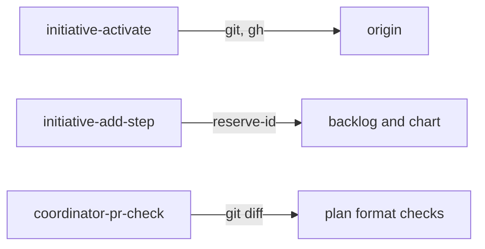

# Execution Plan - Smoother activation

> Every requirement traces to a user story in the design.

**Skill:** [plan](../skills/ravintio-plan/SKILL.md)
**Feature:** 0000399-smoother-activation
**Version:** 0.1.0
**Status:** draft

## Active Skills

None.

## Functional Requirements Directory

Functional requirements sit in individual files at `plan/current/requirements/`.

| File | Requirement |
|------|------------|
| [req-001-activate-command.md](requirements/req-001-activate-command.md) | One script runs I-B Activate in order |
| [req-002-add-step-helper.md](requirements/req-002-add-step-helper.md) | One command adds a step to every chart table |
| [req-003-question-restate-default.md](requirements/req-003-question-restate-default.md) | Restate the request as one plan with a default |
| [req-004-one-question-per-reply.md](requirements/req-004-one-question-per-reply.md) | At most one question per reply |
| [req-005-plan-only-pr-check.md](requirements/req-005-plan-only-pr-check.md) | Skip the full suite for a plan-only PR |
| [req-006-applicable-migrations-only.md](requirements/req-006-applicable-migrations-only.md) | Print pending only for an applicable migration |
| [req-007-coordinator-startup.md](requirements/req-007-coordinator-startup.md) | Hooks name the initiative skill for a coordinator |

## Non-Functional Requirements

| ID | Category | Requirement | Target | Measurement |
|----|----------|------------|--------|-------------|
| NFR-001 | Usability | Human confirmations to activate | 1 | The activate test counts prompts |
| NFR-002 | Security | New allowed guard forms | 0 | The guard tests pass with no change to a guard |
| NFR-003 | Maintainability | Initiative skill length | Under 120 lines | `test-0000205-req-004-initiative-skill.sh` |

The design defers latency, availability, and scalability. Scope records this and sets no target.

## API Summary

No API. The feature adds command-line scripts only.

| Command | Description | Feature |
|---------|-------------|---------|
| `initiative-activate.mjs` | Runs I-B Activate | 0000399-smoother-activation |
| `initiative-add-step.mjs` | Adds a step to the chart | 0000399-smoother-activation |
| `coordinator-pr-check.mjs` | Decides plan-only or full-suite | 0000399-smoother-activation |

## Data Model Summary

| Entity | Owner Component | Key Fields | Relationships |
|--------|----------------|------------|--------------|
| Initiative chart (`initiative.md`) | ravintio-zero | status, seven chart tables | Written by activate and add-step |

## Component Interactions

## Test impact

| Cause | Test | Unit |
|-------|------|------|
| Skill-text budget and size cap on the initiative skill | `test-0000205-req-004-initiative-skill.sh` (fewer than 120 lines), `test-0000205-req-007-stage-ownership.sh`, `test-0000252-req-002-step-confirmation-rule.sh`, `test-0000318-req-001-002-coordinator-prs.sh`, `test-0000352-req-003-005-skill-rules.sh` | U-001, U-002, U-003, U-005 |
| Backlog entry id 0000398 | none found | U-003 |
| Workflow job or step edit (`ravintio.yml`) | none found. The feature edits no workflow. The matches `test-0000019-req-002`, `test-0000036-req-005`, and `test-0000037-req-001` read the file only | none |
| Reference file edit (`roadmap-standards.md`) | `test-0000043-req-002`, `-003`, `-004`, `-009`, and `-010` read the standard | U-003 |
| `resume-detect` edit | `test-0000243-req-001-002-006-resume-detect.sh`, `test-0000320-req-002-migration-reporting.sh`, `test-0000320-req-003-migration-ledger.sh`, `test-0000358-req-001-question-status.sh`, `test-0000243-req-003-004-hook-injection.sh` | U-006 |
| Hook edit | `test-0000205-req-002-ack-and-trigger-hooks.sh`, `test-0000243-req-003-004-hook-injection.sh` | U-007 |
| New test files | `test-0000164-req-008-no-process-substitution-loops.sh` | U-001 to U-007 |
| Non-suite file | none found. The feature adds only `test-*.sh` suites | none |

## Concurrency plan

| Unit | Depends on | Writes | Batch | Sequential reason | Shared resources |
|------|-----------|--------|-------|-------------------|------------------|
| U-001 | none | `src/ravintio-zero/scripts/initiative-activate.mjs`, `src/ravintio-zero/tests/test-0000399-req-001-activate.sh` | 1 | none | none |
| U-002 | none | `src/ravintio-zero/scripts/initiative-add-step.mjs`, `src/ravintio-zero/tests/test-0000399-req-002-add-step.sh` | 1 | none | none |
| U-005 | none | `src/ravintio-zero/scripts/coordinator-pr-check.mjs`, `src/ravintio-zero/tests/test-0000399-req-005-plan-only-check.sh` | 1 | none | none |
| U-006 | none | `src/ravintio-zero/scripts/resume-detect.mjs`, `src/ravintio-zero/tests/test-0000399-req-006-detect-applies.sh` | 1 | none | none |
| U-007 | none | `src/ravintio-zero/hooks/auto-trigger-orchestrator.mjs`, `src/ravintio-zero/hooks/check-orchestrator-presence.mjs`, `src/ravintio-zero/tests/test-0000399-req-007-coordinator-hooks.sh` | 1 | none | none |
| U-003 | U-001, U-002, U-005 | `src/ravintio-zero/skills/ravintio-initiative/SKILL.md`, `src/ravintio-zero/standards/roadmap-standards.md`, `src/ravintio-zero/tests/test-0000399-req-003-004-question-rule.sh` | 2 | U-001, U-002, and U-005 add text to the same skill | none |
| U-008 | U-003 | `docs/component-registry.md` (only if it changes) | 3 | Living docs unit runs last | none |
| U-009 | U-008 | `ravintio-zero/` (installed copy) | 4 | `sync-installed.mjs` copies every source change | none |

## Assumptions

| ID | Assumption | Impact if Wrong |
|----|-----------|----------------|
| A-001 | The initiative skill starts the driver and watcher as host background tasks. | The script would have to detach them itself. |
| A-002 | A `charted` draft in `plan/roadmap/` marks the coordinator session. | A feature session on that branch loads the initiative skill. |

## Open Questions

None.
