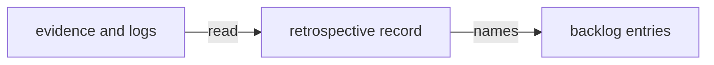

# Execution Plan - Initiative retrospective

> Every requirement traces to a user story.

**Skill:** [plan](../../ravintio-zero/skills/ravintio-plan/SKILL.md)
**Feature:** 0000421-initiative-retrospective
**Version:** 0.77.1
**Status:** active

## Active Skills

| Skill | Scope | Purpose |
|-------|-------|---------|
| ravintio-retrospective | plan | Writes the blameless record. |

## Functional Requirements Directory

| File | Requirement |
|------|------------|
| [req-001-retrospective-record.md](requirements/req-001-retrospective-record.md) | One record of every stop and mistake. |
| [req-002-backlog-entries.md](requirements/req-002-backlog-entries.md) | One backlog entry per unaddressed finding. |

## Non-Functional Requirements

| ID | Category | Requirement | Target | Measurement |
|----|----------|------------|--------|-------------|
| NFR-001 | Security | The record holds no credential and quotes no log text. | 0 matches | Credential scan before commit. |
| NFR-002 | Quality | Each row of the evidence file appears in the record. | 27 of 27 | A script that greps for each row number. |

## API Summary

No API changes.

## Data Model Summary

No data model changes.

## Component Interactions

## Test impact

| Cause | Test | Unit |
|-------|------|------|
| Backlog entry id 0000422 | none found | U5-file-entries |
| Reference file edit | none found | U4-write-record |
| New test file | none found | U4-write-record |

## Concurrency plan

| Unit | Depends on | Writes | Batch | Sequential reason | Shared resources |
|------|-----------|--------|-------|-------------------|------------------|
| U1-research-postmortems | none | plan/current/findings-postmortems.md | 1 | none | none |
| U2-research-logs | none | plan/current/findings-logs.md | 1 | none | none |
| U3-research-buildlogs | none | plan/current/findings-buildlogs.md | 1 | none | none |
| U4-write-record | U1-research-postmortems, U2-research-logs, U3-research-buildlogs | plan/retrospectives/0000360-backlog-sweep-retrospective.md | 2 | The record joins all findings. | none |
| U5-file-entries | U4-write-record | plan/backlog/index.md | 3 | Entry ids come from the record. | file:plan/backlog/.next-id |
| U6-living-docs | U5-file-entries | docs/about.md | 4 | Needs the final entry list. | none |

## Assumptions

| ID | Assumption | Impact if Wrong |
|----|-----------|----------------|
| A-001 | The step logs in the main root stay readable. | A row gets the verdict "unaddressed, evidence unreadable". |

## Open Questions

None.
