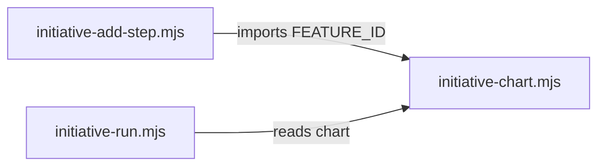

# Execution Plan - Add-step writes the full feature id

> Every requirement traces to a user story or acceptance criterion.

**Skill:** [plan](../skills/ravintio-plan/SKILL.md)
**Feature:** 0000438-add-step-writes-full-feature-id
**Version:** 0.77.2
**Status:** active

## Active Skills

| Skill | Scope | Purpose |
|-------|-------|---------|
| none | plan | No capability skills apply |

## Functional Requirements Directory

| File | Requirement |
|------|------------|
| [req-001-full-feature-id.md](requirements/req-001-full-feature-id.md) | The helper writes the full feature id and the driver pattern stays in step |

## Non-Functional Requirements

| ID | Category | Requirement | Target | Measurement |
|----|----------|------------|--------|-------------|
| NFR-001 | Correctness | A chart the helper writes passes the driver feature id check | 0 rejected rows | AC-2 test |

## API Summary

None. The change adds no endpoint.

## Data Model Summary

| Entity | Owner Component | Key Fields | Relationships |
|--------|----------------|------------|--------------|
| Steps row | ravintio-zero | Feature id | The driver reads it |

## Component Interactions

## Test impact

| Cause | Test | Unit |
|-------|------|------|
| Backlog entry id 0000423 | none found | U-1 |
| New test file | test-0000164-req-008-no-process-substitution-loops.sh | U-1 |
| Reference file edit | none found | U-1 |
| Skill count, skill-text budget, size cap | none found | U-1 |
| Workflow job or step edit | none found | U-1 |
| Non-suite file | none found | U-1 |
| Fixture-pinned line | none found | U-1 |

## Concurrency plan

| Unit | Depends on | Writes | Batch | Sequential reason | Shared resources |
|------|-----------|--------|-------|-------------------|------------------|
| U-1 | none | src/ravintio-zero/tests/test-0000438-req-001-full-feature-id.sh, src/ravintio-zero/scripts/initiative-add-step.mjs, src/ravintio-zero/scripts/initiative-chart.mjs | 1 | One test drives one script change | none |
| U-2 | U-1 | docs/architecture-overview.md, ravintio-zero/ | 2 | The docs describe the finished change and the sync copies the finished source | none |

## Assumptions

| ID | Assumption | Impact if Wrong |
|----|-----------|----------------|
| A-001 | The helper slug is a valid feature slug | The helper exits 1 before it writes |

## Open Questions

None.
