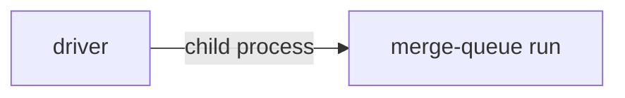

# Execution Plan - Merge ready PRs after a stop

> Every requirement traces to a user story or acceptance criterion.

**Skill:** [plan](../../ravintio-zero/skills/ravintio-plan/SKILL.md)
**Feature:** 0000446-drain-ready-prs-after-a-stop
**Version:** 0.91.0
**Status:** active

## Active Skills

| Skill | Scope | Purpose |
|-------|-------|---------|
| ravintio-implement | plan | Runs the TDD loop for each requirement |

## Functional Requirements Directory

| File | Requirement |
|------|------------|
| [req-001-drain-after-queue-failure.md](requirements/req-001-drain-after-queue-failure.md) | The driver keeps queueing ready PRs after one queue failure |
| [req-002-document-the-drain.md](requirements/req-002-document-the-drain.md) | The roadmap standards state the drain rule |

## Non-Functional Requirements

| ID | Category | Requirement | Target | Measurement |
|----|----------|------------|--------|-------------|
| NFR-001 | Safety | Each ready PR gets one queue attempt per driver run | At most 1 queue call per step | The test counts the lines in the stub `queue.log` |

## API Summary

None. The feature builds no API.

## Data Model Summary

None. The feature adds no data and changes no schema.

## Component Interactions

## Test impact

| Cause | Test | Unit |
|-------|------|------|
| Backlog entry id 0000426 | none found | U-005 |
| Roadmap standards edit | `test-0000379-req-004-queue-handoff.sh`, `test-0000452-req-002-ready-needs-green.sh`, `test-0000250-req-001-routing-and-restart-rules.sh`, `test-0000151-req-012-roadmap-step-logs.sh` | U-004 |
| New test file | `test-0000164-req-008` style tests | U-001, U-002 |
| Fixture-pinned line | none found | U-003 |
| Non-suite file | none, both new files are `test-*.sh` suites | U-001 |

## Branch-point reads

| File | Commit read | Unit |
|------|-------------|------|
| `src/ravintio-zero/scripts/initiative-run.mjs` | 5dd28ede | U-003 |
| `src/ravintio-zero/standards/roadmap-standards.md` | 5dd28ede | U-004 |
| `src/ravintio-zero/tests/test-0000446-req-001-drain-after-queue-failure.sh` | new | U-001 |
| `src/ravintio-zero/tests/test-0000446-req-002-drain-rule-in-standards.sh` | new | U-002 |
| `docs/decisions-index.md` | read at U-005 | U-005 |

## Concurrency plan

| Unit | Depends on | Writes | Batch | Sequential reason | Shared resources |
|------|-----------|--------|-------|-------------------|------------------|
| U-001 | none | `src/ravintio-zero/tests/test-0000446-req-001-drain-after-queue-failure.sh` | 1 | none | none |
| U-002 | none | `src/ravintio-zero/tests/test-0000446-req-002-drain-rule-in-standards.sh` | 1 | none | none |
| U-003 | U-001 | `src/ravintio-zero/scripts/initiative-run.mjs` | 2 | none | none |
| U-004 | U-002 | `src/ravintio-zero/standards/roadmap-standards.md` | 2 | none | none |
| U-005 | U-003, U-004 | `docs/decisions-index.md`, `plan/changelog/0000446-drain-ready-prs-after-a-stop-2026-11-10.md`, `ravintio-zero/` | 3 | The docs and the sync need the final code and text | none |

## Assumptions

| ID | Assumption | Impact if Wrong |
|----|-----------|----------------|
| A-001 | A ready step never shares a lane with a failed step and never lists it in `After`. | A drained PR could depend on an unmerged step. |

## Open Questions

None.
