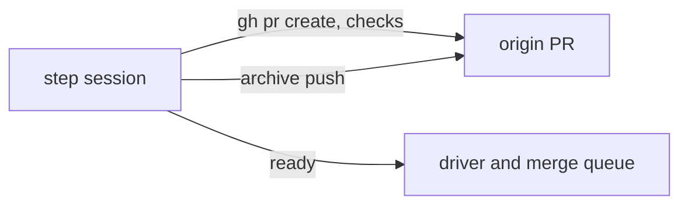

# Execution Plan - Ship waits for CI before it archives

> Every requirement traces to a user story in the design.

**Skill:** [plan](../skills/ravintio-plan/SKILL.md)
**Feature:** 0000452-ci-wait-before-archive
**Version:** 0.1.0
**Status:** draft

## Active Skills

None.

## Functional Requirements Directory

Functional requirements sit in individual files at `plan/current/requirements/`.

| File | Requirement |
|------|------------|
| [req-001-archive-after-green-ci.md](requirements/req-001-archive-after-green-ci.md) | Archive after green CI |
| [req-002-ready-needs-green-checks.md](requirements/req-002-ready-needs-green-checks.md) | Ready needs green checks |

## Non-Functional Requirements

| ID | Category | Requirement | Target | Measurement |
|----|----------|------------|--------|-------------|
| NFR-001 | Security | New allowed guard forms | 0 | `git diff` shows no change to `gate-write` or `merge-guard` |
| NFR-002 | Maintainability | Ship skill length | At or under its current cap | `test-0000245-req-003-004-repo-skills-and-size-cap.sh` |

The design defers latency, availability, and scalability. Scope records this and sets no target.

## API Summary

No API. The feature edits skill and standards text.

| Command | Description | Feature |
|---------|-------------|---------|
| none | none | 0000452-ci-wait-before-archive |

## Data Model Summary

| Entity | Owner Component | Key Fields | Relationships |
|--------|----------------|------------|--------------|
| Ship sequence text | ravintio-zero | Steps 1 to 10, I-D Advance | Read by tests and by step sessions |

## Component Interactions

## Test impact

| Cause | Test | Unit |
|-------|------|------|
| Skill-text budget and size cap on the ship skill | `test-0000245-req-003-004-repo-skills-and-size-cap.sh`, `test-0000352-req-003-005-skill-rules.sh`, `test-0000384-skill-text.sh` | U-001 |
| Backlog entry id 0000412 | none found | U-001 |
| Workflow job or step edit | none found. The feature edits no workflow | none |
| Reference file edit (`roadmap-standards.md`) | `test-0000043-req-005-roadmap-advance.sh`, `test-0000151-req-002-ship-sentinels-before-pr.sh`, `test-0000318-req-003-pr-number-before-squash.sh`, `test-0000247-req-001-stage-by-path.sh`, `test-0000248-req-001-plain-merge-command.sh`, `test-0000353-req-005-006-delivery-and-ship.sh`, `test-0000327-req-003-ship-skill-rules.sh`, `test-0000379-req-004-queue-handoff.sh`, `test-0000352-req-002-004-standards-rules.sh`, `test-0000354-req-002-006-text-rules.sh` | U-001, U-002 |
| Ship skill edit | `test-0000173-req-004-ship-governance-report.sh`, `test-0000169-req-003-attribution-check-in-ship-and-ci.sh`, `test-0000169-req-006-release-tag-ci-and-ship-flow.sh`, `test-0000172-req-001-run-speed.sh`, `test-0000203-req-002-trigger-and-report.sh` | U-001 |
| New test files | `test-0000164-req-008-no-process-substitution-loops.sh` | U-001, U-002 |
| Non-suite file | none found. The feature adds only `test-*.sh` suites | none |
| Fixture-pinned line | none found in `src/ravintio-zero/tests/fixtures/` for the ship text | none |

The impact scan lists suspects. U-003 runs the full suite and fixes each test that the new order breaks.

## Concurrency plan

| Unit | Depends on | Writes | Batch | Sequential reason | Shared resources |
|------|-----------|--------|-------|-------------------|------------------|
| U-001 | none | `src/ravintio-zero/skills/ravintio-ship/SKILL.md`, `src/ravintio-zero/standards/roadmap-standards.md`, `src/ravintio-zero/tests/test-0000452-req-001-archive-after-ci.sh` | 1 | The two text files describe one order, so one unit edits both | none |
| U-002 | U-001 | `src/ravintio-zero/tests/test-0000452-req-002-ready-needs-green.sh` | 2 | REQ-002 asserts the text that U-001 writes | none |
| U-003 | U-002 | the existing tests that pin the old order, under `src/ravintio-zero/tests/` | 3 | Needs the final text | none |
| U-004 | U-003 | `docs/decisions-index.md`, `docs/component-registry.md` (only if it changes) | 4 | Living docs unit runs last | none |
| U-005 | U-004 | `ravintio-zero/` (installed copy) | 5 | `sync-installed.mjs` copies every source change | none |

## Assumptions

| ID | Assumption | Impact if Wrong |
|----|-----------|----------------|
| A-001 | The squash carries the net branch diff. | Sentinels committed early reach the initiative branch. |
| A-002 | A plan-only archive push needs no code edit. | A failing check on the archive head stops the step. |

## Open Questions

None.
