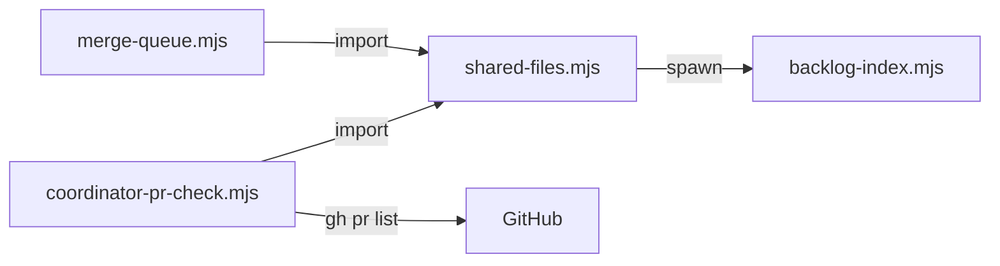

# Execution Plan - Regenerate shared files at merge

> Every requirement traces to a user story and its acceptance criteria.

**Skill:** [plan](../skills/ravintio-plan/SKILL.md)
**Feature:** 0000456-regenerate-shared-files-at-merge
**Version:** 0.81.0
**Status:** active

## Active Skills

None.

## Functional Requirements Directory

| File | Requirement |
|------|------------|
| [req-001-shared-file-resolver.md](requirements/req-001-shared-file-resolver.md) | The queue resolves conflicts on shared files |
| [req-002-overlap-check.md](requirements/req-002-overlap-check.md) | The coordinator check names overlapping step PRs |

## Non-Functional Requirements

| ID | Category | Requirement | Target | Measurement |
|----|----------|------------|--------|-------------|
| NFR-001 | Safety | A conflict outside the allowlist stops the queue | 0 files resolved outside the allowlist | Test with a conflict in another file |
| NFR-002 | Security | Git and gh calls take argument arrays | 0 shell strings | Code review in P3 |

## API Summary

None. The feature adds no endpoint.

## Data Model Summary

None. The feature adds no stored data.

## Component Interactions

## Edits

All source edits land under `src/ravintio-zero/`. The last unit syncs them to `ravintio-zero/`.

- New: `src/ravintio-zero/scripts/shared-files.mjs`. It exports `ALLOWLIST`, `isShared(path)`, and `resolveSharedConflicts({ root })`.
- Edit: `src/ravintio-zero/scripts/merge-queue.mjs`. On a failed base merge it calls the resolver, commits the merge, and prints a `resolved:` line per file. If the resolver throws, the queue aborts the merge and stops.
- Edit: `src/ravintio-zero/scripts/coordinator-pr-check.mjs`. It adds `--base` and the overlap check.
- New: `src/ravintio-zero/tests/test-0000456-req-001-shared-files.sh` for the resolver.
- New: `src/ravintio-zero/tests/test-0000456-req-001-queue-resolves.sh` for the queue call.
- New: `src/ravintio-zero/tests/test-0000456-req-002-overlap-check.sh`.
- Edit docs: `docs/architecture-overview.md`, `docs/decisions-index.md`, and the Merge queue and Coordinator PRs sections of `src/ravintio-zero/standards/roadmap-standards.md`.

## Test impact

| Cause | Test | Unit |
|-------|------|------|
| Backlog entry id 0000430 | none found | U1 |
| Edit to merge-queue.mjs | test-0000378-req-002-003-merge-queue.sh, test-0000392-req-003-queue-waits-for-ci.sh, test-0000405-req-001-short-base-merge-subject.sh, test-0000411-req-001-queue-waits.sh, test-0000420-req-001-optional-version-files.sh, test-0000454-req-001-queue-failure-recovery.sh | U2 |
| Edit to coordinator-pr-check.mjs | test-0000399-req-003-004-question-rule.sh, test-0000399-req-005-plan-only-check.sh | U3 |
| New test file | test-0000164-req-008-no-process-substitution-loops.sh | U1, U2, U3 |
| Edit to a pack line | test-0000151 fixture `0000151-orchestrator-skill-base.md` names merge-queue, no line changes | U4 |
| Non-suite file | none found | none |
| Skill count, skill-text budget, size cap, workflow edit, reference file edit | none found | none |

## Concurrency plan

| Unit | Depends on | Writes | Batch | Sequential reason | Shared resources |
|------|-----------|--------|-------|-------------------|------------------|
| U1 | none | src/ravintio-zero/scripts/shared-files.mjs, src/ravintio-zero/tests/test-0000456-req-001-shared-files.sh | 1 | U2 and U3 import its exports | none |
| U2 | U1 | src/ravintio-zero/scripts/merge-queue.mjs, src/ravintio-zero/tests/test-0000456-req-001-queue-resolves.sh | 2 | none | none |
| U3 | U1 | src/ravintio-zero/scripts/coordinator-pr-check.mjs, src/ravintio-zero/tests/test-0000456-req-002-overlap-check.sh | 2 | none | none |
| U4 | U1 | docs/architecture-overview.md, docs/decisions-index.md, src/ravintio-zero/standards/roadmap-standards.md | 2 | none | none |
| U5 | U2, U3, U4 | ravintio-zero/ | 3 | The copy needs every source edit first | none |

## Assumptions

| ID | Assumption | Impact if Wrong |
|----|-----------|----------------|
| A-001 | Conflicts on the listed files are mechanical | The resolver aborts on hunks it cannot read |

## Open Questions

None.

## Units

- U1: the resolver module and its test.
- U2: the queue hook-in and its test.
- U3: the overlap check and its test.
- U4: the living docs.
- U5: the sync to `ravintio-zero/`.
