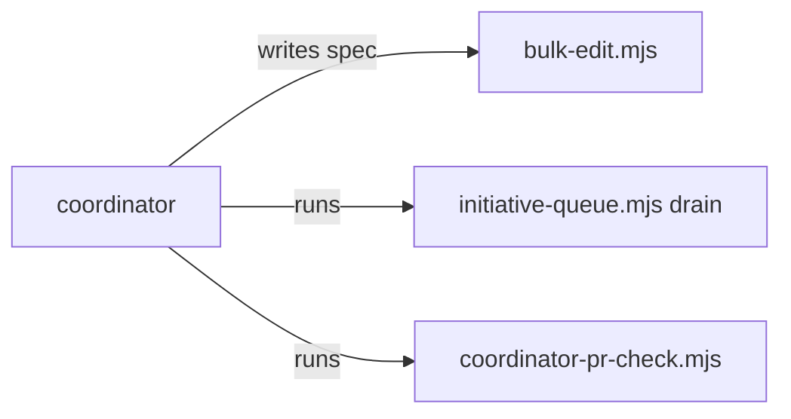

# Execution Plan - Coordinator shell guidance

> Every requirement traces to a user story or acceptance criterion.

**Skill:** [plan](../../ravintio-zero/skills/ravintio-plan/SKILL.md)
**Feature:** 0000474-coordinator-shell-guidance
**Version:** 0.98.0
**Status:** active

## Active Skills

| Skill | Scope | Purpose |
|-------|-------|---------|
| ravintio-implement | plan | TDD loop for REQ-001 to REQ-004 |

## Functional Requirements Directory

| File | Requirement |
|------|------------|
| [req-001-shell-section.md](requirements/req-001-shell-section.md) | The roadmap standards hold a shell section and the skill points to it |
| [req-002-queue-drain.md](requirements/req-002-queue-drain.md) | A drain subcommand removes the items of a merged step |
| [req-003-bulk-edit.md](requirements/req-003-bulk-edit.md) | A script applies literal edits from a JSON spec file |
| [req-004-guards-unchanged.md](requirements/req-004-guards-unchanged.md) | A test pins the guards as they are |

## Non-Functional Requirements

| ID | Category | Requirement | Target | Measurement |
|----|----------|------------|--------|-------------|
| NFR-001 | Security | The scripts take argument arrays and treat file and spec text as data | 0 shell-interpolated calls | Code review at P3 |
| NFR-002 | Maintainability | Total skill text stays within its cap | 1720 lines or fewer | `test-0000031-req-003-five-phases.sh` |

## API Summary

None. The feature has no API.

## Data Model Summary

None. The feature changes no stored data.

## Component Interactions

## Test impact

| Cause | Test | Unit |
|-------|------|------|
| Backlog entry id 0000437 | none found | U-3 |
| New test file | repo-wide style tests such as `test-0000164-req-008` | U-1, U-2, U-3 |
| Edit to `SKILL.md` (skill-text budget) | `test-0000031-req-003-five-phases.sh` (1720 lines) | U-3 |
| Edit to `roadmap-standards.md` | `test-0000352-req-002-004-standards-rules.sh` (rule anchors) | U-3 |
| Edit to `initiative-queue.mjs` | `test-0000444-req-001-003-queue-items.sh` | U-1 |

## Branch-point reads

| File | Commit read | Unit |
|------|-------------|------|
| src/ravintio-zero/scripts/initiative-queue.mjs | 5dd28ede | U-1 |
| src/ravintio-zero/scripts/bulk-edit.mjs | new | U-2 |
| src/ravintio-zero/standards/roadmap-standards.md | 75939335 | U-3 |
| src/ravintio-zero/skills/ravintio-initiative/SKILL.md | 86bed28b | U-3 |
| src/ravintio-zero/component.yml | 75939335 | U-4 |
| docs/decisions-index.md | 75939335 | U-4 |

## Concurrency plan

| Unit | Depends on | Writes | Batch | Sequential reason | Shared resources |
|------|-----------|--------|-------|-------------------|------------------|
| U-1 | none | src/ravintio-zero/scripts/initiative-queue.mjs, src/ravintio-zero/tests/test-0000474-req-002-queue-drain.sh | 1 | Too small to split. One subcommand with its test. | none |
| U-2 | none | src/ravintio-zero/scripts/bulk-edit.mjs, src/ravintio-zero/tests/test-0000474-req-003-bulk-edit.sh | 1 | none | none |
| U-3 | none | src/ravintio-zero/standards/roadmap-standards.md, src/ravintio-zero/skills/ravintio-initiative/SKILL.md, src/ravintio-zero/tests/test-0000474-req-001-004-shell-section-and-guards.sh | 1 | none | none |
| U-4 | none | docs/architecture-overview.md, docs/decisions-index.md, src/ravintio-zero/component.yml | 1 | none | none |
| U-5 | U-1, U-2, U-3, U-4 | ravintio-zero/, .claude/skills/ (sync-installed refresh) | 2 | Copies the source to the installed copies after all units | none |

## Assumptions

| ID | Assumption | Impact if Wrong |
|----|-----------|----------------|
| A-001 | `coordinator-pr-check.mjs` covers the overlap check | The change adds a new script |

## Open Questions

None.
