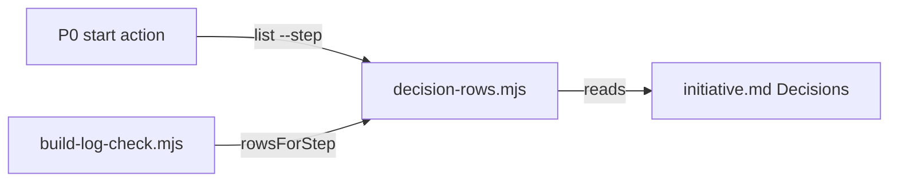

# Execution Plan - Steps apply the chart's Decisions rows

> Every requirement traces to a user story.

**Skill:** [plan](../skills/ravintio-plan/SKILL.md)
**Feature:** 0000487-steps-apply-decision-rows
**Version:** 0.95.0
**Status:** active

## Active Skills

None.

## Functional Requirements Directory

| File | Requirement |
|------|------------|
| [req-001-list-decision-rows-for-a-step.md](requirements/req-001-list-decision-rows-for-a-step.md) | List the Decisions rows for a step |
| [req-002-build-log-check-fails-a-missed-row.md](requirements/req-002-build-log-check-fails-a-missed-row.md) | The build log check fails a missed row |
| [req-003-p0-applies-and-logs-the-rows.md](requirements/req-003-p0-applies-and-logs-the-rows.md) | P0 applies and logs the rows |

## Non-Functional Requirements

| ID | Category | Requirement | Target | Measurement |
|----|----------|------------|--------|-------------|
| NFR-001 | Safety | A run outside an initiative gains no finding | 0 new findings | the check test |
| NFR-002 | Security | The module treats chart text as data | 0 shell strings, 0 paths built from chart text | code review |

## API Summary

No API.

## Data Model Summary

No data store.

## Component Interactions

## Test impact

| Cause | Test | Unit |
|-------|------|------|
| Backlog entry id 0000488 | none found | U-1 |
| New test file | repo-wide style tests, such as `test-0000164-req-008` | U-1 |
| Reference file edit | `test-0000151-req-011-orchestrator-references-split.sh`, `test-0000321-req-004-pickup-text.sh`, `test-0000351-req-001-004-title-rules.sh`, `test-0000444-req-001-003-queue-items.sh` read `orchestrator-p0-start-actions.md` | U-3 |
| Fixture-pinned line | `test-0000206-req-002-step-application.sh` pins the `Decision applied` line in `roadmap-standards.md` | U-3 |
| Non-suite file | none, the change adds only `test-*.sh` suites | U-1 |

## Branch-point reads

| File | Commit read | Unit |
|------|-------------|------|
| src/ravintio-zero/scripts/decision-rows.mjs | new | U-1 |
| src/ravintio-zero/scripts/build-log-check.mjs | c952df2c local | U-2 |
| src/ravintio-zero/skills/ravintio-orchestrator/references/orchestrator-p0-start-actions.md | 5dd28ede local | U-3 |
| src/ravintio-zero/standards/roadmap-standards.md | 4b19f29a local | U-3 |
| docs/decisions-index.md | 4b19f29a local | U-4 |
| docs/adr/0316-check-decision-rows-in-the-build-log.md | new | U-4 |

## Concurrency plan

U-1 is the module and its suite. U-2 is check 9 and its suite. U-3 is the P0 text, the standards text, and their suite. U-4 is the living docs.

| Unit | Depends on | Writes | Batch | Sequential reason | Shared resources |
|------|-----------|--------|-------|-------------------|------------------|
| U-1 | none | src/ravintio-zero/scripts/decision-rows.mjs, src/ravintio-zero/tests/test-0000487-req-001-decision-rows.sh | 1 | the check imports the module | none |
| U-2 | U-1 | src/ravintio-zero/scripts/build-log-check.mjs, src/ravintio-zero/tests/test-0000487-req-002-check-decisions.sh | 2 | depends on U-1 | none |
| U-3 | U-1 | src/ravintio-zero/skills/ravintio-orchestrator/references/orchestrator-p0-start-actions.md, src/ravintio-zero/standards/roadmap-standards.md, src/ravintio-zero/tests/test-0000487-req-003-p0-text.sh | 2 | none | none |
| U-4 | U-2, U-3 | docs/, plan/changelog/ | 3 | depends on the final behaviour | none |

## Assumptions

| ID | Assumption | Impact if Wrong |
|----|-----------|----------------|
| A-001 | The build log Feature ID equals the chart Feature id column. | The check skips. |
| A-002 | A Fork text is unique within its step. | One log line covers two rows. |

## Open Questions

None.
