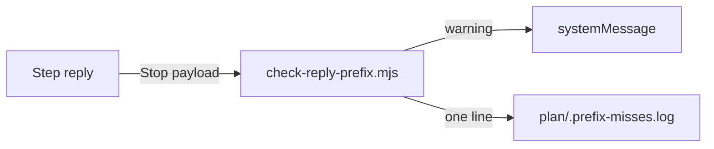

# Execution Plan - Steps use Question only for real questions

> Every requirement traces to a user story.

**Skill:** [plan](../skills/ravintio-plan/SKILL.md)
**Feature:** 0000489-question-only-for-questions
**Version:** 0.99.0
**Status:** active

## Active Skills

None.

## Functional Requirements Directory

| File | Requirement |
|------|------------|
| [req-001-question-wording.md](requirements/req-001-question-wording.md) | Question asks the human something |
| [req-002-question-check.md](requirements/req-002-question-check.md) | Warn on a Question line with no question mark |

## Non-Functional Requirements

| ID | Category | Requirement | Target | Measurement |
|----|----------|------------|--------|-------------|
| NFR-001 | Safety | The hook exits 0 and blocks no turn | exit code 0 in 100% of test cases | the hook suite |
| NFR-002 | Size | The orchestrator `SKILL.md` stays under its cap | 9,000 bytes or fewer | `test-0000391-req-008-standard-text.sh` |

## API Summary

No API.

## Data Model Summary

No data store. The hook appends one line to `plan/.prefix-misses.log`.

## Component Interactions

## Test impact

| Cause | Test | Unit |
|-------|------|------|
| Skill-text budget | `test-0000206-req-002-step-application.sh`, `test-0000383-req-001-005-test-impact-causes.sh`, `test-0000391-req-008-standard-text.sh` cap all skills at 1,720 lines. Now 1,683 | U-1 |
| Size cap | `test-0000391-req-008-standard-text.sh` caps the orchestrator at 9,000 bytes. Now 8,952 | U-1 |
| Reference file edit | none, the change edits no `references/` file | U-1 |
| Frozen-line tests | `test-0000354-req-002-006-text-rules.sh` pins "never end your turn before". `test-0000358-req-001-question-status.sh` pins `exception stop` on the Question line | U-1 |
| Backlog entry id 0000490 | none found | U-1 |
| New test file | repo-wide style tests, such as `test-0000164-req-008` | U-1, U-2 |
| Hook comment | `test-0000358-req-001-question-status.sh` reads the first 40 lines of `check-reply-prefix.mjs` for `Question` | U-2 |
| Non-suite file | none, the change adds only `test-*.sh` suites | U-2 |

## Branch-point reads

| File | Commit read | Unit |
|------|-------------|------|
| src/ravintio-zero/skills/ravintio-orchestrator/SKILL.md | 83ffac21 local | U-1 |
| src/ravintio-zero/pipeline-reference.md | 83ffac21 local | U-1 |
| src/ravintio-zero/standards/roadmap-standards.md | 83ffac21 local | U-1 |
| src/ravintio-zero/hooks/enforcement/check-reply-prefix.mjs | 83ffac21 local | U-2 |
| docs/architecture-overview.md | 83ffac21 local | U-3 |
| docs/decisions-index.md | 83ffac21 local | U-3 |
| docs/adr/0318-question-asks-the-human.md | new | U-3 |

## Concurrency plan

U-1 is the text edits and their pin suite. U-2 is the hook check and its suite. U-3 is the living docs.

| Unit | Depends on | Writes | Batch | Sequential reason | Shared resources |
|------|-----------|--------|-------|-------------------|------------------|
| U-1 | none | src/ravintio-zero/skills/ravintio-orchestrator/SKILL.md, src/ravintio-zero/pipeline-reference.md, src/ravintio-zero/standards/roadmap-standards.md, src/ravintio-zero/tests/test-0000489-req-001-question-wording.sh | 1 | none | none |
| U-2 | none | src/ravintio-zero/hooks/enforcement/check-reply-prefix.mjs, src/ravintio-zero/tests/test-0000489-req-002-question-check.sh | 1 | none | none |
| U-3 | U-1, U-2 | docs/, plan/changelog/ | 2 | depends on the final behaviour | none |

## Assumptions

| ID | Assumption | Impact if Wrong |
|----|-----------|----------------|
| A-001 | The status line is the first non-empty line of the reply. | The check misses a `Question:` line deeper in the reply. |

## Open Questions

None.
