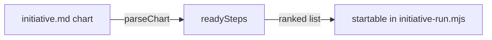

# Execution Plan - Driver favours the critical path

> Every requirement traces to a user story.

**Skill:** [plan](../skills/ravintio-plan/SKILL.md)
**Feature:** 0000491-driver-favours-critical-path
**Version:** 0.101.0
**Status:** active

## Active Skills

None.

## Functional Requirements Directory

| File | Requirement |
|------|------------|
| [req-001-chain-ranking.md](requirements/req-001-chain-ranking.md) | Start the longest chain first |
| [req-002-roadmap-standards-text.md](requirements/req-002-roadmap-standards-text.md) | The standards state the start order |

## Non-Functional Requirements

| ID | Category | Requirement | Target | Measurement |
|----|----------|------------|--------|-------------|
| NFR-001 | Performance | The ranking is fast on a large chart | under 100 ms for 60 steps | the suite times `readySteps` on a generated chart |

## API Summary

No API.

## Data Model Summary

No data store. The function reads the parsed chart and writes nothing.

## Component Interactions

## Test impact

| Cause | Test | Unit |
|-------|------|------|
| Backlog entry id 0000492 | none found | U-1 |
| Frozen-line tests | `test-0000379-req-001-chart-columns.sh` calls `readySteps` and pins chart order for equal chains | U-1 |
| Reference file edit | none, the change edits no `references/` file | U-1 |
| New test file | repo-wide style tests, such as `test-0000164-req-008` | U-1 |
| Non-suite file | none, the change adds only a `test-*.sh` suite | U-1 |
| Fixture-pinned line | none found for item 2 of `## Concurrent steps` | U-1 |

## Branch-point reads

| File | Commit read | Unit |
|------|-------------|------|
| src/ravintio-zero/scripts/initiative-chart.mjs | 91adb1d1 | U-1 |
| src/ravintio-zero/standards/roadmap-standards.md | 140887d0 | U-1 |
| src/ravintio-zero/tests/test-0000491-req-001-chain-ranking.sh | new | U-1 |
| docs/architecture-overview.md | 140887d0 | U-2 |
| docs/decisions-index.md | 140887d0 | U-2 |
| docs/adr/0321-driver-ranks-startable-steps-by-chain.md | new | U-2 |

## Concurrency plan

U-1 is the ranking, the standards text, and the suite. U-2 is the living docs.

| Unit | Depends on | Writes | Batch | Sequential reason | Shared resources |
|------|-----------|--------|-------|-------------------|------------------|
| U-1 | none | src/ravintio-zero/scripts/initiative-chart.mjs, src/ravintio-zero/standards/roadmap-standards.md, src/ravintio-zero/tests/test-0000491-req-001-chain-ranking.sh | 1 | the only code unit, and its suite shares one function | none |
| U-2 | U-1 | docs/, plan/changelog/ | 2 | depends on the final behaviour | none |

## Assumptions

| ID | Assumption | Impact if Wrong |
|----|-----------|----------------|
| A-001 | Every step takes about the same time. | A long step in a short chain can still run late. |

## Open Questions

None.
