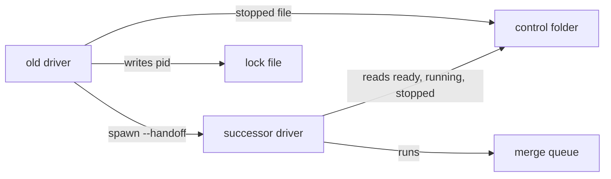

# Execution Plan - Driver keeps starting steps after a Restart

> Every requirement traces to a user story.

**Skill:** [plan](../skills/ravintio-plan/SKILL.md)
**Feature:** 0000493-driver-starts-after-restart
**Version:** 0.105.0
**Status:** active

## Active Skills

None.

## Functional Requirements Directory

| File | Requirement |
|------|------------|
| [req-001-driver-handoff.md](requirements/req-001-driver-handoff.md) | A Restart-only hit starts a successor driver |
| [req-002-adopt-running-steps.md](requirements/req-002-adopt-running-steps.md) | The successor adopts running steps and queues ready ones once |
| [req-003-stop-relay.md](requirements/req-003-stop-relay.md) | A block in a handed-over step stops the successor |
| [req-004-docs-and-skill-text.md](requirements/req-004-docs-and-skill-text.md) | The standards, header, and skill describe the handoff |

## Non-Functional Requirements

| ID | Category | Requirement | Target | Measurement |
|----|----------|------------|--------|-------------|
| NFR-001 | Performance | The successor starts a ready step soon after the merge. | within 10 seconds of the merge | The scheduler test times the gap between the merge and the next step start. |
| NFR-002 | Safety | No step runs in two sessions and no PR goes through the queue twice. | 1 start per step and 1 queue run per PR | The scheduler test counts both. |
| NFR-003 | Security | The driver passes the successor a fixed argument list and reads the `stopped` file as data. | no shell, 500 characters at most | A test reads the spawn call and feeds a long file. |

## API Summary

No API.

## Data Model Summary

No data store. The control folder gains one optional file.

| Entity | Owner Component | Key Fields | Relationships |
|--------|----------------|------------|--------------|
| `stopped` file | ravintio-zero | one stop line, 500 characters at most | one per step control folder |
| Lock file | ravintio-zero | pid of the lock holder | one per initiative |

## Component Interactions

## Test impact

| Cause | Test | Unit |
|-------|------|------|
| Frozen-line tests that read the Restart line or text | `test-0000250-req-001-routing-and-restart-rules.sh`, `test-0000250-req-002-driver-restart-stop.sh`, `test-0000313-req-001-driver-setup-stop.sh`, `test-0000313-req-002-initiative-skill-setup-stop.sh`, `test-0000313-req-003-standards-setup-stop.sh`, `test-0000379-req-002-003-005-scheduler.sh`, `test-0000448-req-002-driver-runs-setup-command.sh` | U-1, U-2 |
| Skill-text budget | `test-0000205-req-004-initiative-skill.sh` caps the skill at fewer than 120 lines, and it holds 116 | U-2 |
| Backlog entry id 0000494 | none found | U-1 |
| New test file | repo-wide style tests, such as `test-0000164-req-008` | U-1, U-2 |
| Non-suite file | none, the change adds only `test-*.sh` suites | U-1, U-2 |
| Fixture-pinned line | none found in `tests/fixtures/` | U-1 |

## Branch-point reads

| File | Commit read | Unit |
|------|-------------|------|
| src/ravintio-zero/scripts/initiative-run.mjs | 86bed28b | U-1 |
| src/ravintio-zero/standards/roadmap-standards.md | fbec5db9 | U-2 |
| src/ravintio-zero/skills/ravintio-initiative/SKILL.md | fded1b2e | U-2 |
| src/ravintio-zero/tests/test-0000493-req-001-003-handoff.sh | new | U-1 |
| src/ravintio-zero/tests/test-0000493-req-004-handoff-text.sh | new | U-2 |
| ravintio-zero/ (mirror of each file above) | 86bed28b | U-3 |
| docs/architecture-overview.md | fbec5db9 | U-4 |
| docs/decisions-index.md | fbec5db9 | U-4 |
| docs/adr/0323-driver-hands-over-new-starts-after-restart.md | new | U-4 |

## Concurrency plan

U-1 is the handoff, the successor, the stop relay, the header comment, and their suite. U-2 is the text and its suite. U-3 mirrors both into the `ravintio-zero/` tree. U-4 is the living docs.

| Unit | Depends on | Writes | Batch | Sequential reason | Shared resources |
|------|-----------|--------|-------|-------------------|------------------|
| U-1 | none | src/ravintio-zero/scripts/initiative-run.mjs, src/ravintio-zero/tests/test-0000493-req-001-003-handoff.sh | 1 | one script holds all three requirements, so they run in one TDD loop | none |
| U-2 | none | src/ravintio-zero/standards/roadmap-standards.md, src/ravintio-zero/skills/ravintio-initiative/SKILL.md, src/ravintio-zero/tests/test-0000493-req-004-handoff-text.sh | 1 | none | none |
| U-3 | U-1, U-2 | ravintio-zero/ | 2 | copies the final files of batch 1 | none |
| U-4 | U-1, U-2 | docs/, src/ravintio-zero/docs/, src/ravintio-zero/component.yml, plan/changelog/ | 2 | depends on the final behaviour | none |

## Assumptions

| ID | Assumption | Impact if Wrong |
|----|-----------|----------------|
| A-001 | The main root sits on the initiative branch. | The fast-forward fails and the driver keeps the existing stop. |
| A-002 | The `running` file holds the pid of the supervising driver. | The successor starts a duplicate session. |
| A-003 | Inherited output handles stay valid after the old driver exits. | The successor loses its output. |

## Open Questions

None.
