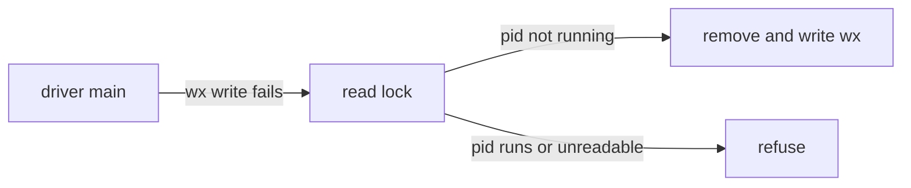

# Execution Plan - Driver clears a dead lock

> Every requirement must be traceable to a user story or acceptance criterion.

**Skill:** [plan](../../ravintio-zero/skills/ravintio-plan/SKILL.md)
**Feature:** 0000495-driver-clears-dead-lock
**Version:** 0.106.0
**Status:** active

## Active Skills

| Skill | Scope | Purpose |
|-------|-------|---------|
| none | plan | No capability skill applies |

## Functional Requirements Directory

Functional requirements are split into individual files, one user story per file, at `plan/current/requirements/`.

| File | Requirement |
|------|------------|
| [req-001-take-dead-lock.md](requirements/req-001-take-dead-lock.md) | The driver takes a lock whose process no longer runs |
| [req-002-refuse-live-lock.md](requirements/req-002-refuse-live-lock.md) | The driver refuses a live, unreadable, or symlinked lock |
| [req-003-document-dead-lock.md](requirements/req-003-document-dead-lock.md) | The driver header and the roadmap standards state the rule |

## Non-Functional Requirements

| ID | Category | Requirement | Target | Measurement |
|----|----------|------------|--------|-------------|
| NFR-001 | Safety | The driver never takes a lock it cannot prove dead | 0 takeovers of a live pid, a non-numeric lock, or a symlink in the tests | The new test file |

## API Summary

No API changes.

## Data Model Summary

| Entity | Owner Component | Key Fields | Relationships |
|--------|----------------|------------|--------------|
| `plan/.initiative-runner.lock` | ravintio-zero | one decimal pid and a newline | Read by the watcher and the status script |

## Component Interactions

## Test impact

| Cause | Test | Unit |
|-------|------|------|
| Backlog entry id 0000496 | none found | U3 |
| New test file | `test-0000164-req-008-no-process-substitution-loops.sh` | U1 |
| Reference file edit | none found | U3 |
| Existing lock refusal | `test-0000043-req-007-roadmap-driver.sh` (writes `other-driver` into the lock) | U2 |
| Fixture-pinned line | none found | U2 |

## Branch-point reads

| File | Commit read | Unit |
|------|-------------|------|
| `src/ravintio-zero/scripts/initiative-run.mjs` | 3814e3ed | U2 |
| `src/ravintio-zero/standards/roadmap-standards.md` | 3814e3ed | U3 |
| `docs/decisions-index.md` | 3814e3ed | U3 |
| `docs/adr/0324-driver-takes-a-dead-lock.md` | new | U3 |
| `src/ravintio-zero/tests/test-0000495-req-001-002-dead-lock.sh` | new | U1 |

## Concurrency plan

| Unit | Depends on | Writes | Batch | Sequential reason | Shared resources |
|------|-----------|--------|-------|-------------------|------------------|
| U1 | none | `src/ravintio-zero/tests/test-0000495-req-001-002-dead-lock.sh` | 1 | Tests first: the tests fail before U2 starts | none |
| U2 | U1 | `src/ravintio-zero/scripts/initiative-run.mjs` | 2 | none | none |
| U3 | U1 | `src/ravintio-zero/standards/roadmap-standards.md`, `docs/adr/0324-driver-takes-a-dead-lock.md`, `docs/decisions-index.md` | 2 | none | none |
| U4 | U2, U3 | `ravintio-zero/` | 3 | It copies the files that U2 and U3 write | none |

## Assumptions

| ID | Assumption | Impact if Wrong |
|----|-----------|----------------|
| A-001 | A reused pid reads as alive | The driver refuses and the coordinator removes the file, as today |
| A-002 | A pid that gives `ESRCH` names no driver | The driver takes a lock a live driver holds, and `wx` still lets one driver win |

## Open Questions

None.
