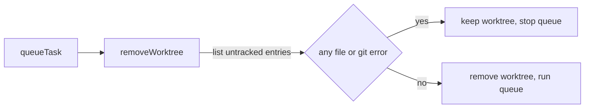

# Execution Plan - Driver keeps uncommitted entries from a worktree

> Every requirement must be traceable to a user story or acceptance criterion.

**Skill:** [plan](../../ravintio-zero/skills/ravintio-plan/SKILL.md)
**Feature:** 0000497-keep-worktree-entries
**Version:** 0.106.0
**Status:** active

## Active Skills

| Skill | Scope | Purpose |
|-------|-------|---------|
| none | plan | No capability skill applies |

## Functional Requirements Directory

Functional requirements are split into individual files, one user story per file, at `plan/current/requirements/`.

| File | Requirement |
|------|------------|
| [req-001-keep-untracked-entries.md](requirements/req-001-keep-untracked-entries.md) | The driver keeps a worktree that holds untracked backlog entries |
| [req-002-remove-clean-worktree.md](requirements/req-002-remove-clean-worktree.md) | The driver removes a clean worktree and keeps one it cannot list |
| [req-003-ship-commits-entries.md](requirements/req-003-ship-commits-entries.md) | Ship and the docs state the rule |

## Non-Functional Requirements

| ID | Category | Requirement | Target | Measurement |
|----|----------|------------|--------|-------------|
| NFR-001 | Safety | The driver never removes a worktree that holds an untracked backlog entry or that it cannot list | 0 removals in the tests for an untracked entry and a failed listing | The new test file |

## API Summary

No API changes.

## Data Model Summary

| Entity | Owner Component | Key Fields | Relationships |
|--------|----------------|------------|--------------|
| `plan/.initiative-worktrees/step-{n}` | ravintio-zero | one git worktree per step | Read by the step session and removed by the queue |

## Component Interactions

## Test impact

| Cause | Test | Unit |
|-------|------|------|
| Backlog entry id 0000498 | none found | U3 |
| New test file | `test-0000164-req-008-no-process-substitution-loops.sh` | U1 |
| Reference file edit | none found | U3 |
| Skill-text budget (ship `SKILL.md`) | none found | U3 |
| Scheduler fixture edit | every suite that sources `helpers/scheduler-fixture.sh`, such as `test-0000493-req-001-003-handoff.sh` | U1 |
| Fixture-pinned line | none found | U3 |

## Branch-point reads

| File | Commit read | Unit |
|------|-------------|------|
| `src/ravintio-zero/scripts/initiative-run.mjs` | e1d507e0 | U2 |
| `src/ravintio-zero/skills/ravintio-ship/SKILL.md` | e1d507e0 | U3 |
| `src/ravintio-zero/standards/roadmap-standards.md` | e1d507e0 | U3 |
| `src/ravintio-zero/tests/helpers/scheduler-fixture.sh` | e1d507e0 | U1 |
| `docs/decisions-index.md` | e1d507e0 | U3 |
| `docs/adr/0325-driver-keeps-worktrees-with-untracked-entries.md` | new | U3 |
| `src/ravintio-zero/tests/test-0000497-req-001-002-keep-entries.sh` | new | U1 |

## Concurrency plan

| Unit | Depends on | Writes | Batch | Sequential reason | Shared resources |
|------|-----------|--------|-------|-------------------|------------------|
| U1 | none | `src/ravintio-zero/tests/test-0000497-req-001-002-keep-entries.sh`, `src/ravintio-zero/tests/helpers/scheduler-fixture.sh` | 1 | Tests first: the tests fail before U2 starts | none |
| U2 | U1 | `src/ravintio-zero/scripts/initiative-run.mjs` | 2 | none | none |
| U3 | U1 | `src/ravintio-zero/skills/ravintio-ship/SKILL.md`, `src/ravintio-zero/standards/roadmap-standards.md`, `docs/adr/0325-driver-keeps-worktrees-with-untracked-entries.md`, `docs/decisions-index.md` | 2 | none | none |
| U4 | U2, U3 | `ravintio-zero/` | 3 | It copies the files that U2 and U3 write | none |

## Assumptions

| ID | Assumption | Impact if Wrong |
|----|-----------|----------------|
| A-001 | `git ls-files --others --exclude-standard` lists every untracked, non-ignored file | An entry could still be lost, and the test pins the listing |
| A-002 | The coordinator accepts a refusal in place of a move | A queue stop that the coordinator clears by committing the entry |

## Open Questions

None.
