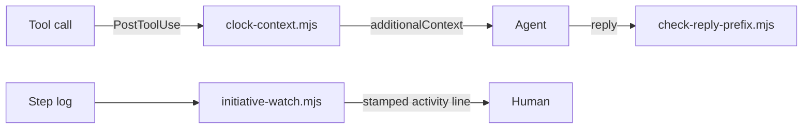

# Execution Plan - Reply times match the clock

> Every requirement traces to a user story.

**Skill:** [plan](../skills/ravintio-plan/SKILL.md)
**Feature:** 0000499-reply-times-match-clock
**Version:** 0.101.0
**Status:** active

## Active Skills

None.

## Functional Requirements Directory

| File | Requirement |
|------|------------|
| [req-001-clock-hook.md](requirements/req-001-clock-hook.md) | A PostToolUse hook returns the local time |
| [req-002-clock-rule-text.md](requirements/req-002-clock-rule-text.md) | Every timestamp comes from a fresh clock read |
| [req-003-tighter-reply-check.md](requirements/req-003-tighter-reply-check.md) | Warn on a time over 2 minutes off and on an unknown status |
| [req-004-stamped-activity-lines.md](requirements/req-004-stamped-activity-lines.md) | The watcher stamps each activity line |

## Non-Functional Requirements

| ID | Category | Requirement | Target | Measurement |
|----|----------|------------|--------|-------------|
| NFR-001 | Safety | The clock hook and the reply hook exit 0 and block nothing | exit code 0 in 100% of test cases | the hook suites |
| NFR-002 | Size | The orchestrator `SKILL.md` stays under its cap | 9,000 bytes or fewer | `test-0000391-req-008-standard-text.sh` |
| NFR-003 | Cost | The clock hook adds one line of context | under 40 characters | the hook suite |

## API Summary

No API.

## Data Model Summary

No data store. The reply hook appends lines to `plan/.prefix-misses.log`.

## Component Interactions

## Test impact

| Cause | Test | Unit |
|-------|------|------|
| Skill-text budget | `test-0000206-req-002-step-application.sh` and `test-0000391-req-008-standard-text.sh` cap all skills at 1,720 lines. Now 1,683. | U-2 |
| Size cap | `test-0000391-req-008-standard-text.sh` caps the orchestrator at 9,000 bytes. The plan leaves it unchanged. | U-2 |
| Reference file edit | none, the change edits no skill `references/` file | U-2 |
| Frozen-line tests | `test-0000388-req-001-time-before-prefix.sh`, `test-0000468-req-001-clock-check.sh`, and `test-0000200-req-003-stop-hook-warns-and-logs.sh` pin the 5 minute margin or the hook comment | U-3 |
| Activity line tests | `test-0000240-req-002-activity-lines.sh`, `test-0000379-req-006-watcher.sh`, and `test-0000205-req-003-watch-script.sh` match activity lines | U-4 |
| Hook list tests | `test-0000390-req-005-setup-wires-the-hook.sh`, `test-0000200-req-004-setup-wires-the-stop-hook.sh`, and `test-0000245-req-001-hook-enforcement-reference.sh` read the hook list | U-1 |
| Backlog entry id 0000500 | none found | U-2 |
| New test file | repo-wide style tests, such as `test-0000164-req-008` | U-1 to U-4 |
| Non-suite file | none, the change adds only `test-*.sh` suites | U-1 |
| Fixture-pinned line | none found in `ravintio-zero/tests/fixtures/` | U-2 |

## Branch-point reads

| File | Commit read | Unit |
|------|-------------|------|
| src/ravintio-zero/hooks/enforcement/clock-context.mjs | new | U-1 |
| src/ravintio-zero/setup.sh | 79e47ef9 | U-1 |
| src/ravintio-zero/setup.ps1 | c952df2c | U-1 |
| src/ravintio-zero/pack-facts.json | c952df2c | U-1 |
| src/ravintio-zero/scripts/install-lifecycle.mjs | c952df2c | U-1 |
| src/ravintio-zero/standards/roadmap-standards.md | 140887d0 | U-2 |
| src/ravintio-zero/skills/ravintio-initiative/SKILL.md | 5287d516 | U-2 |
| src/ravintio-zero/pipeline-reference.md | 140887d0 | U-2 |
| src/ravintio-zero/hooks/enforcement/check-reply-prefix.mjs | 140887d0 | U-3 |
| src/ravintio-zero/scripts/initiative-watch.mjs | 86bed28b | U-4 |
| src/ravintio-zero/standards/hook-enforcement.md | ae9dfaee | U-5 |
| docs/architecture-overview.md | 140887d0 | U-5 |
| docs/decisions-index.md | 140887d0 | U-5 |
| docs/adr/0319-clock-from-a-post-tool-use-hook.md | new | U-5 |

## Concurrency plan

U-1 is the clock hook and setup. U-2 is the rule text. U-3 is the reply check. U-4 is the watcher stamp. U-5 is the living docs.

| Unit | Depends on | Writes | Batch | Sequential reason | Shared resources |
|------|-----------|--------|-------|-------------------|------------------|
| U-1 | none | src/ravintio-zero/hooks/enforcement/clock-context.mjs, src/ravintio-zero/setup.sh, src/ravintio-zero/setup.ps1, src/ravintio-zero/pack-facts.json, src/ravintio-zero/scripts/install-lifecycle.mjs, src/ravintio-zero/tests/test-0000499-req-001-clock-hook.sh | 1 | none | none |
| U-2 | none | src/ravintio-zero/standards/roadmap-standards.md, src/ravintio-zero/skills/ravintio-initiative/SKILL.md, src/ravintio-zero/pipeline-reference.md, src/ravintio-zero/tests/test-0000499-req-002-clock-rule-text.sh | 1 | none | none |
| U-3 | none | src/ravintio-zero/hooks/enforcement/check-reply-prefix.mjs, src/ravintio-zero/tests/test-0000499-req-003-tighter-reply-check.sh | 1 | none | none |
| U-4 | none | src/ravintio-zero/scripts/initiative-watch.mjs, src/ravintio-zero/tests/test-0000499-req-004-stamped-activity-lines.sh | 1 | none | none |
| U-5 | U-1, U-2, U-3, U-4 | docs/, plan/changelog/, src/ravintio-zero/standards/hook-enforcement.md, src/ravintio-zero/project-operations.md | 2 | depends on the final behaviour | none |

## Assumptions

| ID | Assumption | Impact if Wrong |
|----|-----------|----------------|
| A-001 | Claude Code passes `additionalContext` from a `PostToolUse` hook to the model. | The hook adds nothing. The rule text still applies. |

## Open Questions

None.
