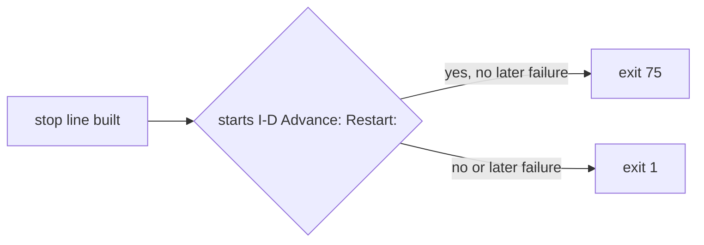

# Execution Plan - Planned restart exits with its own code

> Every requirement must be traceable to a user story or acceptance criterion.

**Skill:** [plan](../../ravintio-zero/skills/ravintio-plan/SKILL.md)
**Feature:** 0000503-planned-restart-exit-code
**Version:** 0.108.0
**Status:** active

## Active Skills

| Skill | Scope | Purpose |
|-------|-------|---------|
| none | plan | No capability skill applies |

## Functional Requirements Directory

Functional requirements are split into individual files, one user story per file, at `plan/current/requirements/`.

| File | Requirement |
|------|------------|
| [req-001-exit-75-on-restart.md](requirements/req-001-exit-75-on-restart.md) | The driver exits 75 after a `Restart:` line |
| [req-002-exit-1-on-failure.md](requirements/req-002-exit-1-on-failure.md) | A real failure keeps exit 1 |
| [req-003-docs-state-the-code.md](requirements/req-003-docs-state-the-code.md) | The docs and an ADR state exit 75 |

## Non-Functional Requirements

| ID | Category | Requirement | Target | Measurement |
|----|----------|------------|--------|-------------|
| NFR-001 | Safety | A failure never exits 75 | 0 failures with exit 75 in the tests | The new test file |

## API Summary

No API changes. The driver exit code gains the value 75.

## Data Model Summary

| Entity | Owner Component | Key Fields | Relationships |
|--------|----------------|------------|--------------|
| Driver exit code | ravintio-zero | 0, 1, or 75 | Read by the host and the initiative skill |

## Component Interactions

## Test impact

| Cause | Test | Unit |
|-------|------|------|
| Restart line now exits 75 | `test-0000250-req-002-driver-restart-stop.sh` | U1 |
| Restart: Setup: line now exits 75 | `test-0000313-req-001-driver-setup-stop.sh` | U1 |
| Restart line now exits 75 | `test-0000448-req-002-driver-runs-setup-command.sh` | U1 |
| Restart line now exits 75 | `test-0000493-req-001-003-handoff.sh` | U1 |
| Skill text and tree match | `test-0000493-req-004-handoff-text.sh` | U3 |
| Backlog entry id 0000504 | `test-0000399-req-002-add-step.sh` | U3 |

## Branch-point reads

| File | Commit read | Unit |
|------|-------------|------|
| `src/ravintio-zero/scripts/initiative-run.mjs` | 32b8e8ff | U2 |
| `src/ravintio-zero/standards/roadmap-standards.md` | 32b8e8ff | U3 |
| `src/ravintio-zero/skills/ravintio-initiative/SKILL.md` | 32b8e8ff | U3 |
| `docs/decisions-index.md` | 32b8e8ff | U3 |
| `docs/adr/0327-planned-restart-exits-75.md` | new | U3 |
| `src/ravintio-zero/tests/test-0000503-req-001-003-restart-exit.sh` | new | U1 |

## Concurrency plan

| Unit | Depends on | Writes | Batch | Sequential reason | Shared resources |
|------|-----------|--------|-------|-------------------|------------------|
| U1 | none | `src/ravintio-zero/tests/test-0000503-req-001-003-restart-exit.sh`, the four fixtures named in Test impact | 1 | Tests first: the tests fail before U2 starts | none |
| U2 | U1 | `src/ravintio-zero/scripts/initiative-run.mjs` | 2 | none | none |
| U3 | U1 | `src/ravintio-zero/standards/roadmap-standards.md`, `src/ravintio-zero/skills/ravintio-initiative/SKILL.md`, `docs/adr/0327-planned-restart-exits-75.md`, `docs/decisions-index.md` | 2 | none | none |
| U4 | U2, U3 | `ravintio-zero/` | 3 | It copies the files that U2 and U3 write | none |

## Assumptions

| ID | Assumption | Impact if Wrong |
|----|-----------|----------------|
| A-001 | Code 75 means no other driver exit today | The coordinator reads a second cause as a restart |
| A-002 | A restart hit with a later failure reads as a failure | The coordinator reads the stop line either way |

## Open Questions

None.
