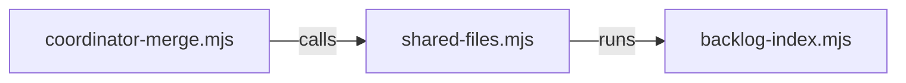

# Execution Plan - Coordinator branches regenerate shared files

> Every requirement traces to a user story or acceptance criterion.

**Skill:** [plan](../../ravintio-zero/skills/ravintio-plan/SKILL.md)
**Feature:** 0000505-coordinator-branch-regenerate
**Version:** 0.96.0
**Status:** active

## Active Skills

| Skill | Scope | Purpose |
|-------|-------|---------|
| ravintio-implement | plan | TDD loop for REQ-001 |

## Functional Requirements Directory

| File | Requirement |
|------|------------|
| [req-001-coordinator-merge.md](requirements/req-001-coordinator-merge.md) | A command merges the base into a coordinator branch and regenerates shared files |

## Non-Functional Requirements

| ID | Category | Requirement | Target | Measurement |
|----|----------|------------|--------|-------------|
| NFR-001 | Security | Git calls take argument arrays and file text is data | 0 shell-interpolated calls | Code review at P3 |

## API Summary

None. The feature has no API.

## Data Model Summary

None. The feature changes no stored data.

## Component Interactions

## Test impact

| Cause | Test | Unit |
|-------|------|------|
| Backlog entry id 0000506 | none found | U-1 |
| New test file | repo-wide style tests such as `test-0000164-req-008` | U-1 |
| Edit to `roadmap-standards.md` | none found | U-2 |

## Branch-point reads

| File | Commit read | Unit |
|------|-------------|------|
| src/ravintio-zero/scripts/shared-files.mjs | 7a307729 | U-1 |
| src/ravintio-zero/scripts/coordinator-merge.mjs | new | U-1 |
| src/ravintio-zero/tests/test-0000505-req-001-coordinator-merge.sh | new | U-1 |
| src/ravintio-zero/standards/roadmap-standards.md | 7a307729 | U-2 |

## Concurrency plan

| Unit | Depends on | Writes | Batch | Sequential reason | Shared resources |
|------|-----------|--------|-------|-------------------|------------------|
| U-1 | none | src/ravintio-zero/scripts/coordinator-merge.mjs, src/ravintio-zero/tests/test-0000505-req-001-coordinator-merge.sh | 1 | Too small to split. One script with its test. | none |
| U-2 | none | src/ravintio-zero/standards/roadmap-standards.md, docs/architecture-overview.md, docs/decisions-index.md | 1 | none | none |
| U-3 | U-1, U-2 | ravintio-zero/ (sync-installed refresh) | 2 | Copies the source to the installed copy after both units | none |

## Assumptions

| ID | Assumption | Impact if Wrong |
|----|-----------|----------------|
| A-001 | `shared-files.mjs` exports cover the resolve and regenerate steps | The command needs new helpers |

## Open Questions

None.
