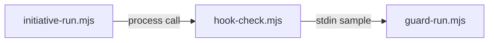

# Execution Plan - Check every hook after setup

> Every requirement must be traceable to a user story or acceptance criterion.

**Skill:** [plan](../skills/ravintio-plan/SKILL.md)
**Feature:** 0000507-hook-check-after-setup
**Version:** 0.110.0
**Status:** draft

## Active Skills

None.

## Functional Requirements Directory

Functional requirements are split into individual files, one user story per file, at `plan/current/requirements/`.

Each file follows the naming convention `req-{NNN}-{kebab-slug}.md` and the [Requirement Template](../templates/requirement.template.md).

| File | Requirement |
|------|------------|
| [req-001-run-every-hook.md](requirements/req-001-run-every-hook.md) | Run each hook with `CLAUDE_PROJECT_DIR` and a fixed sample |
| [req-002-judge-each-result.md](requirements/req-002-judge-each-result.md) | Exit 0 and exit 2 pass, anything else fails |
| [req-003-driver-runs-check.md](requirements/req-003-driver-runs-check.md) | The driver runs the check after setup and stops on a failure |

## Non-Functional Requirements

| ID | Category | Requirement | Target | Measurement |
|----|----------|------------|--------|-------------|
| NFR-001 | Performance | The check finishes quickly on the installed hook set | Under 30 seconds for 15 hooks | Test with a timer |
| NFR-002 | Security | The check runs only commands in `.claude/settings.json` | 0 other commands run | Test with a stub settings file |

## API Summary

None. The feature builds no API.

## Data Model Summary

None. The feature stores no data.

## Component Interactions

## Test impact

| Cause | Test | Unit |
|-------|------|------|
| Backlog entry id 0000508 | none found | U-1 |
| New test file | test-0000164-req-008-no-process-substitution-loops.sh | U-1 |
| Non-suite file | none found | U-1 |
| Fixture-pinned line | none found | U-2 |

## Branch-point reads

| File | Commit read | Unit |
|------|-------------|------|
| src/ravintio-zero/scripts/hook-check.mjs | new | U-1 |
| src/ravintio-zero/tests/test-0000507-req-001-hook-check.sh | new | U-1 |
| src/ravintio-zero/scripts/initiative-run.mjs | f39459b7 | U-2 |
| src/ravintio-zero/tests/test-0000507-req-003-driver-hook-check.sh | new | U-2 |
| src/ravintio-zero/component.yml | f39459b7 | U-3 |
| src/ravintio-zero/docs/hook-check.md | new | U-3 |

## Concurrency plan

| Unit | Depends on | Writes | Batch | Sequential reason | Shared resources |
|------|-----------|--------|-------|-------------------|------------------|
| U-1 | none | src/ravintio-zero/scripts/hook-check.mjs, src/ravintio-zero/tests/test-0000507-req-001-hook-check.sh | 1 | Alone in its batch because U-2 calls the script | none |
| U-2 | U-1 | src/ravintio-zero/scripts/initiative-run.mjs, src/ravintio-zero/tests/test-0000507-req-003-driver-hook-check.sh | 2 | Needs the script from U-1 | none |
| U-3 | U-2 | src/ravintio-zero/component.yml, src/ravintio-zero/docs/hook-check.md, docs/ | 3 | Documents what U-1 and U-2 built | none |

## Assumptions

| ID | Assumption | Impact if Wrong |
|----|-----------|----------------|
| A-001 | Every hook command accepts JSON on stdin | The check reports a false failure for that hook |
| A-002 | The driver can find `hook-check.mjs` in the root after setup | The driver stops with a missing-script error |

## Open Questions

None.
