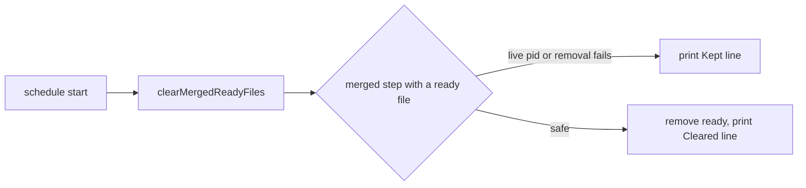

# Execution Plan - Driver clears ready files of merged steps

> Every requirement must be traceable to a user story or acceptance criterion.

**Skill:** [plan](../../ravintio-zero/skills/ravintio-plan/SKILL.md)
**Feature:** 0000509-clear-merged-ready-files
**Version:** 0.110.0
**Status:** active

## Active Skills

| Skill | Scope | Purpose |
|-------|-------|---------|
| none | plan | No capability skill applies |

## Functional Requirements Directory

Functional requirements are split into individual files, one user story per file, at `plan/current/requirements/`.

| File | Requirement |
|------|------------|
| [req-001-clear-merged-ready-files.md](requirements/req-001-clear-merged-ready-files.md) | The driver removes the ready file of each merged step at start |
| [req-002-keep-file-when-unsafe.md](requirements/req-002-keep-file-when-unsafe.md) | The driver keeps the file when a session runs or the removal fails |
| [req-003-docs-state-the-clearing.md](requirements/req-003-docs-state-the-clearing.md) | The driver header, the standards, and an ADR state the clearing |

## Non-Functional Requirements

| ID | Category | Requirement | Target | Measurement |
|----|----------|------------|--------|-------------|
| NFR-001 | Safety | The pass never removes a file of an unmerged step, a file under a live session, or a file through a symlink | 0 removals in the tests for each case | The new test file |

## API Summary

No API changes.

## Data Model Summary

| Entity | Owner Component | Key Fields | Relationships |
|--------|----------------|------------|--------------|
| `plan/.initiative-control/step-{n}/ready` | ravintio-zero | one PR number per step | Written by the step session and removed by the driver |

## Component Interactions

## Test impact

| Cause | Test | Unit |
|-------|------|------|
| Backlog entry id 0000510 | none found | U3 |
| New test file | `test-0000164-req-008-no-process-substitution-loops.sh` | U1 |
| Reference file edit | none found | U3 |
| Skill-text budget | none found | U3 |
| Fixture-pinned line | none found | U3 |

## Branch-point reads

| File | Commit read | Unit |
|------|-------------|------|
| `src/ravintio-zero/scripts/initiative-run.mjs` | b9e8e826 | U2 |
| `src/ravintio-zero/standards/roadmap-standards.md` | f39459b7 | U3 |
| `docs/decisions-index.md` | b9e8e826 | U3 |
| `docs/adr/0340-driver-clears-merged-ready-files.md` | new | U3 |
| `src/ravintio-zero/tests/test-0000509-req-001-003-clear-ready.sh` | new | U1 |

## Concurrency plan

| Unit | Depends on | Writes | Batch | Sequential reason | Shared resources |
|------|-----------|--------|-------|-------------------|------------------|
| U1 | none | `src/ravintio-zero/tests/test-0000509-req-001-003-clear-ready.sh` | 1 | Tests first: the tests fail before U2 starts | none |
| U2 | U1 | `src/ravintio-zero/scripts/initiative-run.mjs` | 2 | none | none |
| U3 | U1 | `src/ravintio-zero/standards/roadmap-standards.md`, `docs/adr/0340-driver-clears-merged-ready-files.md`, `docs/decisions-index.md` | 2 | none | none |
| U4 | U2, U3 | `ravintio-zero/` | 3 | It copies the files that U2 and U3 write | none |

## Assumptions

| ID | Assumption | Impact if Wrong |
|----|-----------|----------------|
| A-001 | A merged step needs no `ready` file | A new driver reads the PR from the step branch |
| A-002 | `runningPid()` and `alive()` report a live session | The pass keeps a file that could go, and the `Kept:` line says why |

## Open Questions

None.
